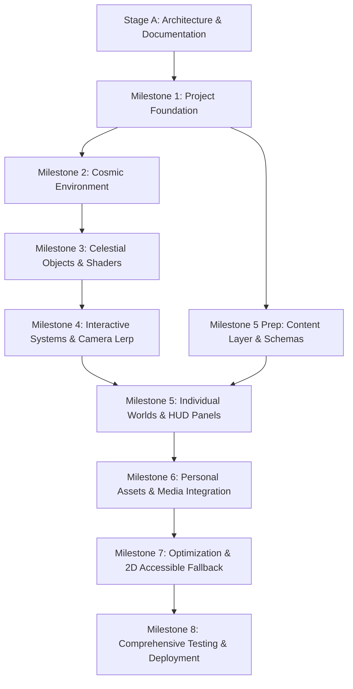

# IMPLEMENTATION.md — Complete Engineering Roadmap & Execution Plan

> **PROJECT**: Cosmic Portfolio — Rudra Tiwari  
> **STATUS**: STAGE A (Architecture & Documentation) Active  
> **WORKFLOW**: Documentation First → Architecture Approval → Phased Implementation → Verification → Deployment

---

## 🧭 Roadmap Overview & Dependency Graph

---

## 📋 Phase Breakdown & Milestones

### STAGE A — Architecture & Documentation (Current Phase)
* **Goal**: Establish the entire theoretical, architectural, design, and testing foundation before writing application code.
* **Deliverables**: All required documents in `docs/`, `README.md`, `GEMINI.md`, `IMPLEMENTATION.md`, `.claude/skills/cosmic-portfolio/SKILL.md`.
* **Exit Gate**: Verification checklist complete; explicit approval from Rudra Tiwari to proceed to Stage B.

---

### STAGE B — Implementation Milestones

---

### Milestone 1 — Project Foundation (COMPLETED ✅)
* **Goal**: Initialize the modern frontend workspace with standard development tooling, routing, styling, state store, and testing harness.
* **Dependencies**: Stage A approval.
* **Status**: **Completed & Verified**
* **Verification Summary**:
  * Dependencies installed cleanly (React 19, Three.js, R3F v9, Drei v10, Tailwind CSS v3, Zustand v5, Lucide).
  * Build verified: `npm run build` completed in 8.29s with minified bundle output.
  * TypeScript verification: `npm run typecheck` passed with 0 errors.
  * Unit tests verified: `npm run test` (Vitest) passed 2 test suites and 7 tests.
  * All 4 reference design views mapped and implemented.
  * Initial git repository committed with clean working tree.

---

### Milestone 2 — Cosmic Environment
* **Goal**: Render the high-performance deep-space cosmic environment in WebGL.
* **Dependencies**: Milestone 1.
* **Tasks**:
  1. Build `CanvasContainer` with R3F Canvas configured with ACESFilmicToneMapping, perspective camera, and clamped DPR.
  2. Implement `Starfield` component using GPU instancing (`THREE.InstancedMesh` or Point buffer) rendering 4,000+ stars with realistic stellar magnitudes and slight color temperature variations.
  3. Build procedural/textured `Nebula` skybox with subtle rotational drift and depth layers.
  4. Construct `Surya` (Central Sun) with core geometry, custom emissive corona shader, pulsing glow effect, and central `PointLight`.
  5. Construct stylized orbital rings (`OrbitalPath` components) using line loops with subtle dashed/emissive transparency.
  6. Implement the initial camera rig with responsive perspective FOV calculation.
* **File Ownership**:
  * `src/components/3d/CanvasContainer.tsx`
  * `src/components/3d/environment/Starfield.tsx`
  * `src/components/3d/environment/Nebula.tsx`
  * `src/components/3d/environment/Lighting.tsx`
  * `src/components/3d/celestial/Surya.tsx`
  * `src/components/3d/celestial/OrbitalPath.tsx`
  * `src/components/3d/shaders/SunCoronaShader.ts`
* **Acceptance Criteria**:
  * Fluid 60 FPS deep-space background with glowing central Sun and concentric orbital guides.
  * Zero memory leaks during canvas resize.
* **Verification**: Visual inspection and Chrome DevTools frame rate audit.

---

### Milestone 3 — Celestial Objects & Shaders
* **Goal**: Build and place all nine Vedic celestial representations along their designated orbits with unique astronomical visual identities.
* **Dependencies**: Milestone 2.
* **Tasks**:
  1. Implement reusable `CelestialSphere` component handling LOD, rotation, and material parameters.
  2. Implement **Chandra** (Moon/Earth analog): Cratered lunar surface texture, subtle cool blue atmospheric fringe.
  3. Implement **Mangal** (Mars analog): Rust-red iron oxide texture, faint dusty atmosphere.
  4. Implement **Budh** (Mercury analog): Gray cratered texture, rapid axial rotation, close orbit.
  5. Implement **Guru** (Jupiter analog): Massive scale, detailed gas bands, Great Red Spot storm vortex shader.
  6. Implement **Shukra** (Venus analog): Golden-yellow dense atmosphere with shimmering refractive cloud shader.
  7. Implement **Shani** (Saturn analog): Banded sphere plus multi-ring buffer geometry with alpha transparency and shadow mapping.
  8. Implement **Rahu** (Shadow Singularity): Non-physical celestial anomaly rendered as a dark gravitational lensing node with swirling purple-blue accretion disk.
  9. Implement **Ketu** (Cometary Nebula): Ethereal particle plume / cometary tail shader trailing through space in teal and emerald tones.
* **File Ownership**:
  * `src/components/3d/celestial/CelestialSphere.tsx`
  * `src/components/3d/celestial/Chandra.tsx`, `Mangal.tsx`, `Budh.tsx`, `Guru.tsx`, `Shukra.tsx`, `Shani.tsx`
  * `src/components/3d/celestial/RahuAnomaly.tsx`, `KetuComet.tsx`
  * `src/components/3d/celestial/SaturnRings.tsx`
  * `src/components/3d/shaders/AtmosphereShader.ts`, `AccretionShader.ts`, `CometTailShader.ts`
* **Acceptance Criteria**:
  * All 9 celestial entities are rendered distinctly at calculated orbital distances.
  * Rahu and Ketu appear as distinctive, artistic cosmic phenomena rather than generic spheres.
* **Verification**: Visual verification of each world from multiple camera angles.

---

### Milestone 4 — Interactive Systems & Camera Choreography
* **Goal**: Implement intuitive, responsive 3D interaction: raycasting, hover cues, smooth camera travel, and orbit controls.
* **Dependencies**: Milestone 3.
* **Tasks**:
  1. Implement camera state controller using spherical lerp/slerp interpolation for cinematic travel between the solar overview and planetary orbits.
  2. Integrate `OrbitControls` with damping, pan restrictions, and zoom bounds (clamped to prevent clipping through planets or Sun).
  3. Implement pointer raycasting with hover hit-boxes optimized for touch screens and desktop mouse navigation.
  4. Build 3D contextual hover badges (displaying Sanskrit name, English title, and dimensional theme).
  5. Connect selection events to `useUniverseStore`: updating `activeWorld`, pausing or slowing background orbital rotation during inspection.
  6. Implement keyboard navigation (`ArrowLeft`/`ArrowRight` to cycle planets, `Enter` to focus, `Escape` to return).
* **File Ownership**:
  * `src/components/3d/camera/CameraController.tsx`
  * `src/components/3d/interaction/RaycastHandler.tsx`
  * `src/components/3d/interaction/HoverBadge.tsx`
  * `src/hooks/useCameraNavigation.ts`
  * `src/hooks/useKeyboardShortcuts.ts`
* **Acceptance Criteria**:
  * Clicking any celestial body smoothly accelerates and decelerates the camera into close orbit.
  * "Return to Universe" restores the default solar system overview.
  * Full keyboard accessibility for world selection.
* **Verification**: Playwright automated camera transition tests and manual touch/mouse tests.

---

### Milestone 5 — Individual Planetary Worlds & HUD Panels
* **Goal**: Build rich, responsive, glassmorphic information panels and populate them with Rudra Tiwari's authentic personal and technical data.
* **Dependencies**: Milestone 4, Milestone 5 Prep.
* **Tasks**:
  1. Build glassmorphic HUD overlay system with sliding drawers and modal panels.
  2. Populate **Surya** drawer: Bio, philosophy, professional summary, downloadable resume link, and contact form.
  3. Populate **Chandra** drawer: Personal interests, college life at ABES, cricket tournament triumph, life memories.
  4. Populate **Mangal** drawer: Deep project breakdowns (Natural Language to SQL, Food Delivery System, AI applications) with architecture diagrams, challenges, and GitHub links.
  5. Populate **Budh** drawer: Technical skills tree (Java, Spring Boot, React, AWS, Python), DSA accomplishments (600+ LeetCode, 1200+ total solved).
  6. Populate **Guru** drawer: Education (B.Tech CSE, ABES EC, 8.02 CGPA), Oracle Certifications (Agentic AI, GenAI Professional).
  7. Populate **Shukra** drawer: UI/UX experiments, creative designs, and frontend architecture philosophies.
  8. Populate **Shani** drawer: Professional engineering timeline (~10 months experience, enterprise authentication, microservice dashboards, lessons learned).
  9. Populate **Rahu** drawer: AI & Generative AI frontiers (RAG architectures, agentic workflows, LLM orchestration).
  10. Populate **Ketu** drawer: Space of reflection, lessons from failure, ethics in engineering, and personal principles.
* **File Ownership**:
  * `src/components/ui/HUD.tsx`
  * `src/components/ui/PlanetDrawer.tsx`
  * `src/components/ui/tabs/` (ProjectCard, SkillBadge, TimelineView, ContactModal)
  * `src/data/` (all content files)
* **Acceptance Criteria**:
  * Every celestial body opens a dedicated, beautifully styled panel displaying authentic, accurate details.
  * Zero fabricated company names, dates, or metrics.
* **Verification**: Data validation test ensuring all required content fields are present and non-empty.

---

### Milestone 6 — Personal Assets & Media Integration
* **Goal**: Integrate authentic user photographs, project screenshots, and credential badges with strict privacy, compression, and responsive loading.
* **Dependencies**: Milestone 5.
* **Tasks**:
  1. Create asset directories and placeholder images according to `docs/design/ASSET_MAPPING.md`.
  2. Implement responsive image loaders with skeleton placeholders and blur-up transitions.
  3. Map photographs to their designated worlds (Surya -> Profile, Chandra -> Memories/Cricket, Mangal -> Project Screenshots, Guru -> Certifications).
  4. Ensure all images are stripped of sensitive EXIF metadata and compressed into modern WebP format.
  5. Verify no AI-generated fake portrait photos are included.
* **File Ownership**:
  * `assets/user-photos/`
  * `src/components/ui/common/OptimizedImage.tsx`
  * `docs/design/ASSET_MAPPING.md`
* **Acceptance Criteria**:
  * Clean, crisp image rendering across all display densities.
  * No broken image links; graceful placeholder fallbacks when user photos are pending upload.
* **Verification**: Automated image asset existence and aspect ratio validation.

---

### Milestone 7 — Optimization & 2D Accessible Fallback
* **Goal**: Achieve optimal WebGL performance (60 FPS), fast load times, and provide a full-featured 2D accessible alternative.
* **Dependencies**: Milestone 6.
* **Tasks**:
  1. Optimize Three.js draw calls, share geometries and materials where applicable, and implement distance-based LOD.
  2. Clamp canvas DPR to `Math.min(window.devicePixelRatio, 2)` to eliminate mobile thermal throttling.
  3. Implement code-splitting using `React.lazy` and `Suspense` for 3D heavy bundles and individual planet drawers.
  4. Build the **2D Fallback Portfolio**: A complete, highly accessible, elegant single-page portfolio layout for devices without WebGL or users who prefer a traditional interface.
  5. Respect `prefers-reduced-motion` media queries by automatically suggesting or defaulting to the 2D view or simplified transitions.
  6. Audit Lighthouse scores (Target: Performance > 85, Accessibility > 95, Best Practices > 95, SEO > 95).
* **File Ownership**:
  * `src/components/fallback/AccessiblePortfolioView.tsx`
  * `src/components/3d/ErrorBoundary3D.tsx`
  * `src/utils/performance.ts`
* **Acceptance Criteria**:
  * Tested 60 FPS on desktop and 30-60 FPS on mid-range mobile.
  * 2D Fallback view completely accessible via keyboard and screen readers.
* **Verification**: Lighthouse audit and WebGL disabling simulation test.

---

### Milestone 8 — Comprehensive Testing, Domain Configuration & Deployment
* **Goal**: Execute complete test suite, configure production DNS and SSL on custom `.me` domain, and deploy to Vercel.
* **Dependencies**: Milestone 7.
* **Tasks**:
  1. Execute complete test suite: Vitest unit tests, component tests, and Playwright end-to-end tests.
  2. Verify all 9 planet selection flows, drawer openings, contact submission, and fallback toggle.
  3. Configure GitHub Actions CI/CD pipeline (`.github/workflows/deploy.yml`) for automated linting, testing, and Vercel edge deployment.
  4. Configure DNS records for the custom `.me` domain (Apex `A` record, `CNAME www`).
  5. Verify HTTPS, HSTS, and Content Security Policy headers.
  6. Perform live production smoke test on desktop and mobile browsers.
* **File Ownership**:
  * `.github/workflows/ci.yml`, `.github/workflows/deploy.yml`
  * `vercel.json`
  * `tests/e2e/portfolio.spec.ts`
* **Acceptance Criteria**:
  * Clean build, passing tests, and zero console errors in production deployment.
  * Production domain resolving cleanly with SSL.
* **Verification**: Live URL inspection and SSL certificate validation.

---

## 🔒 Acceptance & Quality Checklist

| Checkpoint | Requirement | Status |
| :--- | :--- | :--- |
| **Stage A Completion** | All architecture, design, requirements, and test docs created with deep, meaningful content | In Progress |
| **No Fabrication** | All personal metrics, education, and skills correspond strictly to Rudra Tiwari's verified data | Enforced |
| **WebGL Performance** | Clamped DPR, low draw calls, 60 FPS desktop, zero memory leaks on unmount | Designed |
| **Accessibility** | Complete 2D non-WebGL fallback, keyboard navigable, ARIA labels, reduced-motion support | Designed |
| **Design Consistency** | Nine celestial worlds each have distinct colors, shaders, and thematic information architecture | Designed |
| **Zero Console Errors** | Clean React 19 rendering, strict TypeScript with zero `any` leaks | Enforced |
