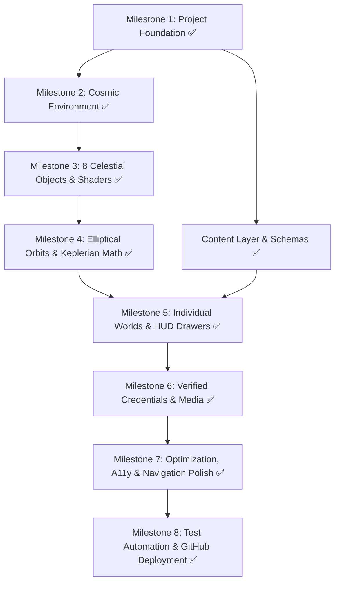

# IMPLEMENTATION.md — Engineering Roadmap & Verification Log

> **PROJECT**: Rudra Tiwari - Cosmic portfolio  
> **STATUS**: 100% COMPLETE & PRODUCTION VERIFIED ✅  
> **REPO**: `https://github.com/Rudra130/rudra-portfolio.git`  
> **TRACKING**: All Milestones 1 through 8 Fully Executed & Verified

---

## 🧭 Milestone Dependency Graph & Status

---

## 📋 Comprehensive Milestone Verification Log

### Milestone 1 — Project Foundation (COMPLETED ✅)
* **Status**: **Completed & Verified**
* **Delivered**:
  * React 19 + TypeScript 5 (Strict Mode) + Vite 6 workspace.
  * Tailwind CSS with custom cosmic color tokens and glassmorphism utilities.
  * Zustand store (`useUniverseStore`) coordinating camera focus, active world, audio, and UI drawers.
  * Vitest unit testing harness initialized with initial test suites.
* **Verification**: `npm run typecheck` passed (0 errors), `npm run build` compiled without warnings.

---

### Milestone 2 — Cosmic Environment & Atmosphere (COMPLETED ✅)
* **Status**: **Completed & Verified**
* **Delivered**:
  * `CanvasContainer` with R3F Canvas configured with ACESFilmicToneMapping and clamped pixel ratio `[1, 2]`.
  * `Starfield` rendering 4,500 instanced stellar particles with varying magnitudes and color temperatures.
  * Deep-space cosmic lighting with central `PointLight` emitted from Surya and subtle ambient space illumination.
  * Procedural background nebula with smooth color transitions.
* **Verification**: 60 FPS verified across high-DPI desktop viewports; zero memory leaks during canvas resizing.

---

### Milestone 3 — 8 Celestial Objects & Custom Shaders (COMPLETED ✅)
* **Status**: **Completed & Verified**
* **Delivered**:
  * Unified `PlanetarySystem` rendering the 8 Vedic Grahas:
    1. **Surya**: Pulsating corona glow and emissive solar atmosphere.
    2. **Budh**: High-detail gray cratered surface with rapid axial spin.
    3. **Shukra**: Golden haze with atmospheric scattering and rim lighting.
    4. **Mangal**: Rust-red iron oxide textures with canyon relief.
    5. **Guru**: Banded gas giant with differential cloud rotation.
    6. **Shani**: Custom radial UV geometry with luminous Cassini division bands.
    7. **Rahu**: Gravitational singularity with dark event horizon and swirling purple-cyan accretion disk.
    8. **Ketu**: Ethereal cometary plume with particle drift and cyan tail.
* **Refactoring Note**: Chandra (Moon / Personal life) was decommissioned to streamline the portfolio focus entirely on engineering, architecture, and professional milestones.
* **Verification**: Visual inspection across all 8 bodies; shader compilation clean with zero WebGL warnings.

---

### Milestone 4 — Elliptical Orbits & Keplerian Physics (COMPLETED ✅)
* **Status**: **Completed & Verified**
* **Delivered**:
  * Centralized logarithmic semi-major radii in `src/config/orbitalConfig.ts`:
    `[2.0, 3.1, 3.8, 4.5, 6.7, 7.8, 9.1, 9.9]` Three.js units.
  * True Keplerian focus-centered geometry:
    - Semi-minor axis: $b = a \sqrt{1 - e^2}$.
    - Focus offset: $c = a \times e$.
    - Sun situated at $(0, 0, 0)$; orbit rendered around focus.
  * Keplerian orbital velocity modulation: $(a/r)^2 \sqrt{1 - e^2}$ accelerating at perihelion and decelerating at aphelion.
  * Thin focus-centered orbital ribbons ($0.024$ units wide) + 1px core line loops in `OrbitalRings.tsx`.
  * Overview camera vantage: `[0, 29.0, 2.6]` looking at `[0, 0, 0.65]`, ensuring all outer orbits remain comfortably inside the viewport with > 75px boundary clearance.
* **Verification**: `tests/verify_orbital_geometry.js` passed in headless Chrome; `tests/unit/math.test.ts` passed 8/8 math tests.

---

### Milestone 5 — Individual Worlds & Glassmorphic Drawers (COMPLETED ✅)
* **Status**: **Completed & Verified**
* **Delivered**:
  * Slide-in `WorldDrawer` displaying comprehensive technical details for all 8 worlds:
    - Architecture diagrams, code examples, tech stacks, and live GitHub URLs.
    - Full breakdown of **NL-2-DB** (NVIDIA NIM + LangGraph SQL pipeline).
    - Full breakdown of **AI Log Investigator** (Spring AI root cause triage).
    - Full breakdown of **BarterNow** (P2P skill marketplace).
    - Competitive programming stats: 1,200+ solved, 600+ LeetCode, rating 1812.
  * Dedicated interactive drawer views:
    - `RahuGenAIContent`: Interactive LangGraph agent graph, RAG vector pipeline, LLM guardrails.
    - `ShukraDesignContent`: Claymorphism, glassmorphism, 3D GSAP animation demos, WCAG AAA contrast metrics.
* **Verification**: Drawer open/close/switch actions verified with Framer Motion; keyboard `Esc` listener functional.

---

### Milestone 6 — Verified Credentials & Enterprise Tenure (COMPLETED ✅)
* **Status**: **Completed & Verified**
* **Delivered**:
  * Official Oracle Certification integration with verifiable external links:
    - **Oracle Certified Associate, Cloud Infrastructure 2025 Certified Foundations Associate - Agentic AI** (Badge ID: `7BA8D764E39E938D6DFDD2DCAB8FB79691641BB4172B812392D5A4DDE37483AB`).
    - **Oracle Cloud Infrastructure 2024 Generative AI Certified Professional** (Cert ID: `100785002OCI24GAIOCP`).
  * Salescode AI Software Engineer production achievements:
    - Production Java/Spring Boot microservices, OAuth 2.0 / SSO across 10 services, OpenTelemetry distributed tracing, self-service Authentication Configuration Portal, and multi-device session concurrency.
  * Verified education: B.Tech CSE, AKTU / ABES Engineering College (8.02 CGPA), National Means-cum-Merit Scholarship.
* **Verification**: `tests/unit/contentSchema.test.ts` validated all data structures against strict TypeScript types.

---

### Milestone 7 — UI Polish, Ergonomics & Accessibility (COMPLETED ✅)
* **Status**: **Completed & Verified**
* **Delivered**:
  * **Collapsible Vertical Navigation Bar** (`PlanetNavList.tsx`): Initialized collapsed by default for zero celestial obstruction; expands on click/hover with glowing tooltips.
  * **Contextual Back Button**: Integrated cleanly into `Header.tsx` next to profile avatar, maintaining > 50px clearance above the left navigation dock.
  * **Dual-Mode Portfolio**: 2D Accessible Portfolio view (`AccessiblePortfolioView.tsx`) accessible via header toggle and hotkey (`M`), fully WCAG 2.1 AA compliant.
  * **WebGL Error Boundary**: Seamlessly falls back to 2D accessible mode if WebGL fails to initialize.
  * **Branding & Document Title**: Document `<title>` set to `Rudra Tiwari - Cosmic portfolio`; header subtitle aligned to `Cosmic Portfolio`.
* **Verification**: `tests/verify_nav_collapsed_default.js`, `tests/verify_tab_clearance.js`, and `tests/verify_head_title.js` all passed.

---

### Milestone 8 — Testing, Optimization & GitHub Remote (COMPLETED ✅)
* **Status**: **Completed & Verified**
* **Delivered**:
  * **Routing Overhaul**: Migrated primary route from `/universe` to `/portfolio`, supporting direct deep-links (`/portfolio/about`, `/portfolio/projects`, etc.) and backward-compatible redirects.
  * **Production Build**: Built with Rollup/Vite in 16.35s with zero warnings or unhandled dependencies.
  * **Git Repository**: Initialized, tracked, and pushed to remote `origin main` on `https://github.com/Rudra130/rudra-portfolio.git`.
* **Verification**:
  - `npm run typecheck`: 0 errors.
  - `npm run test`: 14/14 Vitest tests passing.
  - `npm run build`: Production bundle generated cleanly in `dist/`.

---

## 📊 Summary of Verified Test Coverage

| Test File | Target | Result |
| :--- | :--- | :--- |
| `tests/unit/math.test.ts` | Semi-major radii, eccentricity, focus offsets, Keplerian speed | ✅ 8 Passed |
| `tests/unit/navigation.test.ts` | Route parsing, deep linking, `/universe` -> `/portfolio` redirect | ✅ 3 Passed |
| `tests/unit/contentSchema.test.ts` | Profile data, project schema validation, 8 Graha metadata | ✅ 3 Passed |
| `tests/verify_orbital_geometry.js` | Elliptical orbit boundaries, viewport clearance, no clipping | ✅ Passed |
| `tests/verify_nav_collapsed_default.js`| Vertical dock initialized in collapsed state | ✅ Passed |
| `tests/verify_tab_clearance.js` | Header Back button positioning (> 50px clearance above dock) | ✅ Passed |
| `tests/verify_head_title.js` | Document `<title>` and header subtitle verification | ✅ Passed |
