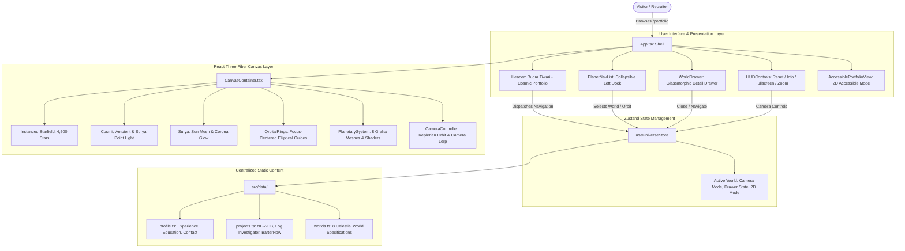

# Rudra Tiwari - Cosmic portfolio

> *"Every celestial body represents a different dimension of my life. Together, they tell my story."*

[](https://www.typescriptlang.org/)
[](https://react.dev/)
[](https://threejs.org/)
[](https://vitejs.dev/)
[](https://tailwindcss.com/)
[](https://vitest.dev/)
[]()

---

## 🌌 Product Introduction & Vision

**Rudra Tiwari - Cosmic portfolio** is an interactive, astronomical-grade 3D web experience designed to showcase the identity, engineering accomplishments, and philosophical journey of **Rudra Tiwari**. 

Unlike conventional developer portfolios that rely on standard scrolling grids or superficial 3D gimmicks, this application conceptualizes the developer's career and engineering philosophy as an autonomous celestial universe inspired by the **Grahas (celestial entities) of Vedic cosmology**:

1. **Surya (Core Identity & Bio)** — The Central Sun: Core values, engineering philosophy, professional summary, resume gateway, and direct contact (`rudra.tiwari.4141@gmail.com`).
2. **Budh (Technical Skills & DSA)** — The Swift Planet: Core CS fundamentals, languages (Java, Python, TypeScript, SQL), distributed systems (Spring Boot, Kafka), and competitive programming mastery (**1,200+ problems solved**, **600+ LeetCode**, **Rating: 1812**).
3. **Shukra (UI/UX & Design Systems)** — Golden Haze: Visual engineering, Claymorphism, glassmorphism, 3D GSAP animations, accessibility compliance, and analytics dashboards.
4. **Mangal (Projects & Architecture)** — The World of Action: Production-grade architectures including **NL-2-DB** (NVIDIA NIM & LangGraph multi-agent SQL pipeline), **AI Log Investigator** (Spring AI root cause triage), **BarterNow** (P2P skill exchange), and high-concurrency microservices.
5. **Guru (Education & Certifications)** — Knowledge & Wisdom: Academic foundation (**B.Tech CSE, AKTU / ABES Engineering College, 8.02 CGPA**), National Means-cum-Merit Scholarship, and industry certifications including **Oracle Certified Associate Cloud Infrastructure 2025 Agentic AI** and **Oracle 2024 Generative AI Certified Professional**.
6. **Shani (Work Experience)** — The Timeline of Karma: Production engineering tenure as **Software Engineer at Salescode AI** (OAuth 2.0 / SSO across 10 microservices, OpenTelemetry distributed tracing, self-service Authentication Configuration Portal, multi-device session security).
7. **Rahu (Generative AI & Autonomous Agents)** — Frontier of Innovation: Shadow Singularity with gravitational accretion disc representing LangGraph state machines, advanced RAG pipelines, vector embeddings, and LLM guardrails.
8. **Ketu (Philosophy & Space of Reflection)** — Cometary Nebula: Resilience through technical challenges, lifelong learning, engineering discipline, and principles beyond code.

---

## 🚀 Key Architectural Features

* **Logarithmically Compressed Elliptical Orbits**:
  - Implements visually balanced semi-major axes: `[2.0, 3.1, 3.8, 4.5, 6.7, 7.8, 9.1, 9.9] Three.js units`.
  - True Keplerian focus-centered geometry ($b = a\sqrt{1-e^2}$, focus offset $c = a \times e$) with the Sun situated at $(0, 0, 0)$.
  - Real-time Keplerian orbital speed updates: planets accelerate at perihelion and decelerate at aphelion.
* **Photorealistic Saturn (Shani) Ring System**:
  - Custom radial UV mapping geometry with authentic Cassini division, high-reflectance B-ring, semi-translucent A-ring, and luminous warm glow.
* **Ergonomic Contextual Navigation**:
  - Collapsible vertical navigation dock on the left, initialized collapsed by default for zero celestial obstruction, expandable on demand with tooltips.
  - Contextual **"Back to Overview"** button integrated into the top header row with zero component collision.
* **Comprehensive Deep-Linking Routing**:
  - Primary route: `/portfolio` (with automatic backward-compatibility redirects from `/universe`).
  - Dedicated deep links: `/portfolio/about`, `/portfolio/skills`, `/portfolio/design`, `/portfolio/projects`, `/portfolio/education`, `/portfolio/experience`, `/portfolio/ai`, `/portfolio/reflection`.
* **Dual-Mode 3D & 2D Accessible Portfolio**:
  - Full-featured 3D WebGL space explorer with OrbitControls and cinematic camera lerp transitions.
  - Dedicated 2D accessible fallback view for low-power hardware, screen readers, and `prefers-reduced-motion` settings.
  - Automatic WebGL error boundary preventing crashes on unsupported devices.
* **Zero Fabrication Guarantee**:
  - Purely accurate representation of Rudra's academic metrics, verified credentials, and software engineering tenure at Salescode AI.

---

## 🛠 Technology Stack

### Frontend & 3D Engineering
* **Core Framework**: [React 19](https://react.dev/) with [TypeScript 5](https://www.typescriptlang.org/) (Strict Mode).
* **Build Tool**: [Vite 6](https://vitejs.dev/) with fast HMR and Rollup tree-shaking.
* **3D Rendering**: [Three.js r174](https://threejs.org/) via [@react-three/fiber](https://docs.pmnd.rs/react-three-fiber) & [@react-three/drei](https://github.com/pmndrs/drei).
* **State Management**: [Zustand 5](https://github.com/pmndrs/zustand) for decoupled, high-performance UI and 3D camera state.
* **Styling**: [Tailwind CSS 3.4](https://tailwindcss.com/) with custom cosmic design tokens and glassmorphism.
* **Motion & Animation**: [Framer Motion](https://www.framer.com/motion/) for responsive drawers and HUD overlays.
* **Icons**: [Lucide React](https://lucide.dev/).
* **Testing**: [Vitest](https://vitest.dev/) and [Puppeteer](https://pptr.dev/) for headless browser and visual verification.

---

## 📐 Architecture Overview



---

## 📂 Project Structure

```text
personal-portfolio/
├── index.html                           # Document entry point (<title>Rudra Tiwari - Cosmic portfolio</title>)
├── package.json                         # Dependencies, scripts, and build metadata
├── tsconfig.json                        # Strict TypeScript compiler options
├── vite.config.ts                       # Vite build configuration
├── tailwind.config.js                   # Cosmic design tokens & glassmorphism theme
├── README.md                            # Comprehensive product & architecture documentation
├── IMPLEMENTATION.md                    # Engineering milestones & verification record
├── GEMINI.md                            # Persistent guidelines & architectural boundaries
├── docs/                                # Technical documentation suite
│   ├── architecture/
│   │   ├── SYSTEM_ARCHITECTURE.md       # High-level architecture & data flow
│   │   ├── 3D_UNIVERSE_ARCHITECTURE.md  # Orbital math, Three.js shaders, and geometry
│   │   ├── FRONTEND_ARCHITECTURE.md     # React 19, component tree, and hooks
│   │   ├── CONTENT_ARCHITECTURE.md      # Data schemas, profile facts, and projects
│   │   ├── ANIMATION_ARCHITECTURE.md    # Keplerian speed formulas & camera lerp
│   │   ├── INTERACTION_ARCHITECTURE.md  # Keyboard shortcuts, hover, and selection
│   │   ├── SECURITY_AND_PERFORMANCE.md  # GPU budgets, frame clamping, and security
│   │   └── DEPLOYMENT_ARCHITECTURE.md   # Build pipeline, edge deployment, and headers
│   ├── design/
│   │   ├── CELESTIAL_DESIGN_GUIDE.md    # Visual identity for all 8 Graha worlds
│   │   ├── DESIGN_SYSTEM.md             # Color tokens, typography, and spacing
│   │   ├── USER_EXPERIENCE.md           # User journeys, accessibility, and navigation
│   │   └── ASSET_MAPPING.md             # Textures, photographs, and media manifests
│   ├── requirements/
│   │   ├── PRODUCT_REQUIREMENTS.md      # PRD, user stories, and acceptance criteria
│   │   ├── FUNCTIONAL_REQUIREMENTS.md   # Functional specs matrix
│   │   └── NON_FUNCTIONAL_REQUIREMENTS.md # Performance, a11y, and browser targets
│   ├── decisions/
│   │   └── ARCHITECTURE_DECISIONS.md    # ADR log (ADR-001 through ADR-012)
│   └── testing/
│       └── TEST_STRATEGY.md             # Test plans, Vitest units, and Puppeteer checks
├── tests/                               # Test suites and headless verification scripts
│   ├── unit/                            # Vitest unit tests (navigation, math, schemas)
│   ├── verify_orbital_geometry.js       # Puppeteer elliptical orbit verification
│   ├── verify_nav_collapsed_default.js  # Navigation dock collapsed state test
│   ├── verify_tab_clearance.js          # Back button header clearance verification
│   └── verify_head_title.js             # Document and header title test
└── src/                                 # Source code
    ├── components/
    │   ├── 3d/
    │   │   ├── CanvasContainer.tsx      # R3F Canvas setup with tone mapping & DPR clamping
    │   │   ├── camera/
    │   │   │   └── CameraController.tsx # Slerp/lerp camera rig & OrbitControls
    │   │   ├── celestial/
    │   │   │   ├── Surya.tsx            # Central Sun with procedural corona glow
    │   │   │   ├── PlanetarySystem.tsx  # 8 Graha meshes, Saturn radial rings, Keplerian loop
    │   │   │   └── OrbitalRings.tsx     # Focus-centered elliptical ribbon guides
    │   │   └── environment/
    │   │       ├── Lighting.tsx         # Sun point light & space ambient illumination
    │   │       └── Starfield.tsx        # 4,500 instanced particle stars
    │   ├── fallback/
    │   │   └── AccessiblePortfolioView.tsx # 2D accessible view for screen readers & low GPU
    │   └── ui/
    │       ├── Header.tsx               # Top navigation bar & contextual Back button
    │       ├── HUDControls.tsx          # Right floating control pill (Zoom, Reset, Info)
    │       ├── LandingHero.tsx          # Hero introduction with cinematic entrance CTA
    │       ├── PlanetNavList.tsx        # Collapsible left navigation dock with tooltips
    │       ├── WorldDrawer.tsx          # Slide-in glassmorphic detail drawer
    │       ├── drawer-content/          # Dedicated rich content views (Rahu, Shukra)
    │       └── icons/BrandIcons.tsx     # Custom SVG icons
    ├── config/
    │   └── orbitalConfig.ts             # Centralized elliptical orbital parameters
    ├── data/
    │   ├── profile.ts                   # Rudra Tiwari's verified biography & experience
    │   ├── projects.ts                  # Production projects (NL-2-DB, Log Investigator, etc.)
    │   └── worlds.ts                    # 8 Grahas metadata, analogies, and styling
    ├── hooks/
    │   └── useKeyboardNavigation.ts     # Keyboard shortcuts (Esc, 1-8, Space, M)
    ├── store/
    │   └── useUniverseStore.ts          # Central Zustand state store
    ├── types/
    │   ├── celestial.ts                 # Orbital and Three.js TypeScript interfaces
    │   └── content.ts                   # Content schemas and profile types
    └── utils/
        ├── math.ts                      # Elliptical geometry and Keplerian speed functions
        └── navigation.ts                # Deep linking URL synchronization utilities
```

---

## 💻 Installation & Development

### Prerequisites
* **Node.js**: v20.x or higher (LTS recommended)
* **Package Manager**: `npm` (v10+)
* **Browser**: Chrome, Edge, Safari, or Firefox with WebGL 2.0 support

### Setup Steps
```bash
# 1. Clone repository
git clone https://github.com/Rudra130/rudra-portfolio.git
cd rudra-portfolio

# 2. Install dependencies
npm install

# 3. Start local development server
npm run dev

# 4. Run TypeScript typecheck
npm run typecheck

# 5. Run unit test suite
npm run test

# 6. Build production bundle
npm run build

# 7. Preview production build
npm run preview
```

---

## 🧪 Testing & Verification

The project enforces automated test coverage and headless browser validation:

* **Unit Tests (Vitest)**:
  - `tests/unit/math.test.ts`: Validates elliptical coordinates, focus offsets ($c = a \times e$), semi-minor axes ($b = a \sqrt{1-e^2}$), and Keplerian velocity multipliers.
  - `tests/unit/navigation.test.ts`: Tests route resolution, deep linking, and backward-compatible redirect handlers.
  - `tests/unit/contentSchema.test.ts`: Ensures all profile and project data adhere strictly to TypeScript interfaces with zero missing fields.
* **Headless Chrome E2E Verification (Puppeteer)**:
  - `tests/verify_orbital_geometry.js`: Validates all 8 orbits render inside viewport without clipping.
  - `tests/verify_nav_collapsed_default.js`: Asserts left navigation dock is collapsed on boot.
  - `tests/verify_tab_clearance.js`: Validates > 50px clearance between header Back button and navigation dock.
  - `tests/verify_head_title.js`: Validates `<title>Rudra Tiwari - Cosmic portfolio</title>` and header branding.

---

## 🗺️ Implementation Status (Completed ✅)

- [x] **Milestone 1 — Foundation**: React 19, TypeScript strict mode, Tailwind CSS, Vite 6, Zustand 5, Vitest.
- [x] **Milestone 2 — Cosmic Environment**: Deep-space starfield (4,500 particles), procedural nebula, Surya core, and tone-mapped lighting.
- [x] **Milestone 3 — Celestial Shaders & Systems**: 8 Graha meshes, photorealistic Cassini Saturn rings with radial UVs, Rahu accretion disc, Ketu cometary plume.
- [x] **Milestone 4 — Elliptical Keplerian Orbits**: Centralized orbital parameters `[2.0, 3.1, 3.8, 4.5, 6.7, 7.8, 9.1, 9.9]`, focus-centered geometry, velocity modulation.
- [x] **Milestone 5 — Information Architecture & Drawers**: Slide-in glassmorphic drawers with full project breakdowns, verified LeetCode rating (1812), and Salescode AI work history.
- [x] **Milestone 6 — Verified Certifications**: Official Oracle Cloud Infrastructure 2024 Generative AI & 2025 Agentic AI badges with verification links.
- [x] **Milestone 7 — UI Polish & Accessibility**: Header-integrated Back button, default collapsed vertical dock, 2D accessible fallback view, and keyboard navigation.
- [x] **Milestone 8 — Production Deployment**: Headless browser verification, clean production build, and remote repository sync on `main`.

---

## 📜 License

Created and maintained by **Rudra Tiwari**. All rights reserved. Built with passion for astronomy, systems architecture, and modern web engineering.
