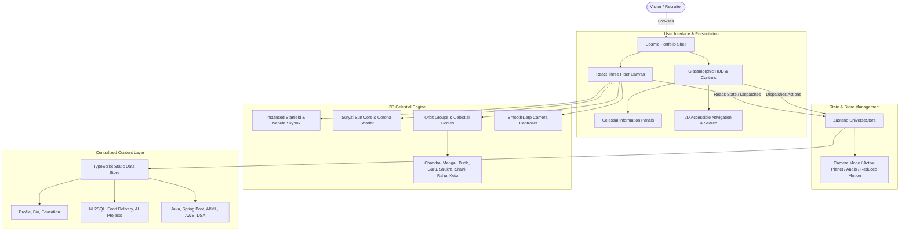

# Cosmic Portfolio — Rudra Tiwari: Personal 3D Universe

> *"Every celestial body represents a different dimension of my life. Together, they tell my story."*

---

## 🌌 Product Introduction & Vision

**Cosmic Portfolio** is an interactive, astronomical-grade 3D web experience designed to showcase the identity, engineering accomplishments, and philosophical journey of **Rudra Tiwari**. 

Unlike conventional developer portfolios that rely on standard scrolling layouts or superficial three-dimensional widgets, this application conceptualizes the developer's career and personal journey as an autonomous celestial universe inspired by the **nine Grahas (celestial entities) of Vedic cosmology**:

1. **Surya (The Core Identity)** — Central Sun: Biography, core values, career direction, resume, and contact gateway.
2. **Chandra (The Inner Universe)** — Personal life, interests, inspirations, college memories, cricket championship, and life reflections.
3. **Mangal (The World of Action)** — Software engineering projects, technical demonstrations, architecture breakdowns, and GitHub repositories.
4. **Budh (The Intelligence Network)** — Core computer science foundations, system design, data structures & algorithms (1,200+ problems solved, 600+ LeetCode), and technical communication.
5. **Guru (Knowledge & Wisdom)** — Academic foundation (B.Tech CSE, ABES Engineering College, 8.02 CGPA), Oracle Certifications (Generative AI & Agentic AI), research, and lifelong learning.
6. **Shukra (Creativity & Aesthetics)** — Visual experimentation, UI/UX design systems, creative coding, and frontend craft.
7. **Shani (The Timeline of Karma)** — Professional work experience (10 months in production software engineering), enterprise auth, workflows, engineering discipline, and key milestones.
8. **Rahu (The Frontier of Innovation)** — A mysterious celestial singularity / accretion disc representing Generative AI, autonomous AI agents, Retrieval-Augmented Generation (RAG), and vector databases.
9. **Ketu (The Space of Reflection)** — An ethereal cometary nebula representing personal philosophy, resilience through setbacks, and life values beyond professional achievements.

The core objective is to strike a synthesis between **visual wonder** and **engineering rigor**:
* **The Universe attracts attention** through realistic astronomical shaders, lighting, and smooth celestial camera choreography.
* **The Story creates curiosity** through culturally rooted symbolism and genuine personal reflection.
* **The Engineering earns credibility** through clean code, deep architectural documentation, verified technical demonstrations, and zero fabrication.

---

## 🚀 Key Features

* **Cinematic Entry Sequence**: Atmospheric dark scene transitioning into an expansive starfield, volumetric nebula, and glowing distant Sun, culminating in an "Enter Universe" flight transition.
* **Interactive 3D Solar System**: Smooth OrbitControls, camera pan/zoom/rotate, dynamic lighting, customizable orbital speeds, and stylized orbits designed specifically for portfolio navigation ergonomics.
* **Celestial Object Deep-Dives**: Smooth slerp/lerp camera transitions that fly visitors directly to any selected celestial body, accompanied by glassmorphic HUD telemetry.
* **Modular Information Architecture**: Tailored slide-in HUD drawers displaying rich text, project architecture breakdowns, interactive previews, verifiable GitHub links, and credential verification.
* **Dual-Paradigm Navigation**:
  * **3D Space Explorer**: Full WebGL camera navigation with contextual raycasted labels.
  * **2D Accessible Interface**: Accessible drawer and quick-switcher supporting screen readers, keyboard navigation (`Tab`, `Arrows`, `Esc`, `Space`), and `prefers-reduced-motion`.
* **Zero Fabrication Guarantee**: Purely accurate representation of Rudra's academic metrics, certifications, and technical projects.

---

## 🛠 Technology Stack

### Frontend Architecture
* **Core Framework**: [React 19](https://react.dev/) with [TypeScript 5](https://www.typescriptlang.org/) (Strict Mode).
* **Build Tool**: [Vite](https://vitejs.dev/) for high-speed HMR, tree-shaking, and optimized bundling.
* **3D Rendering**: [Three.js](https://threejs.org/) via [@react-three/fiber](https://docs.pmnd.rs/react-three-fiber) and [@react-three/drei](https://github.com/pmndrs/drei).
* **State Management**: [Zustand](https://github.com/pmndrs/zustand) for decoupled, performant camera, navigation, and audio state.
* **Styling**: [Tailwind CSS v3/v4](https://tailwindcss.com/) with custom cosmic design tokens and glassmorphism utilities.
* **Motion & Transitions**: [Framer Motion](https://www.framer.com/motion/) for fluid HTML/UI overlays and entry animations.
* **Icons**: [Lucide React](https://lucide.dev/).

### Hosting & Edge Infrastructure
* **Hosting**: [Vercel](https://vercel.com/) (Edge Global CDN) for the static React SPA; custom `.me` apex domain with automatic SSL/TLS.
* **Architecture Model**: 100% Pure Client-Side Single-Page Application (Zero Backend). All content, project specifications, and credentials are statically pre-compiled in TypeScript.

---

## 📐 Architecture Overview



---

## 📂 Project Structure

```text
personal-portfolio/
├── README.md                           # Main product overview, setup, and guide
├── IMPLEMENTATION.md                   # 8-milestone implementation plan and tracking
├── GEMINI.md                           # Persistent engineering instructions and rules
├── docs/                               # Comprehensive architecture documentation
│   ├── architecture/
│   │   ├── SYSTEM_ARCHITECTURE.md      # System topology, boundaries, and data flow
│   │   ├── FRONTEND_ARCHITECTURE.md    # React, R3F, Zustand, and component layout
│   │   ├── 3D_UNIVERSE_ARCHITECTURE.md  # Shaders, orbital math, lighting, and textures
│   │   ├── INTERACTION_ARCHITECTURE.md # State machine, camera lerp, hover, and controls
│   │   ├── CONTENT_ARCHITECTURE.md     # Data schemas, profile facts, and content pipeline
│   │   ├── DEPLOYMENT_ARCHITECTURE.md  # CI/CD, Vercel, domain, DNS, and rollback
│   │   └── SECURITY_AND_PERFORMANCE.md # WebGL budget, bundle splitting, CSP, and privacy
│   ├── design/
│   │   ├── DESIGN_SYSTEM.md            # Palettes, typography, glassmorphism, and tokens
│   │   ├── USER_EXPERIENCE.md          # End-to-end visitor journey and UX flows
│   │   ├── CELESTIAL_DESIGN_GUIDE.md   # Detailed specification for all 9 Grahas
│   │   └── ASSET_MAPPING.md            # Photographs, 3D textures, and specs manifest
│   ├── requirements/
│   │   ├── PRODUCT_REQUIREMENTS.md     # Vision, personas, user stories, and scope
│   │   ├── FUNCTIONAL_REQUIREMENTS.md  # Prioritized functional requirements matrix
│   │   └── NON_FUNCTIONAL_REQUIREMENTS.md # Performance, accessibility, and compatibility
│   ├── decisions/
│   │   └── ARCHITECTURE_DECISIONS.md   # ADR log (ADR-001 through ADR-008)
│   └── testing/
│       └── TEST_STRATEGY.md            # Unit, R3F, a11y, and Playwright E2E strategy
├── .claude/
│   └── skills/
│       └── cosmic-portfolio/
│           └── SKILL.md                # Agent skill specification
├── assets/                             # Raw and optimized project assets
│   ├── user-photos/                    # Real user photos (profile, college, cricket)
│   ├── planets/                        # 3D planet models / glTF if required
│   ├── textures/                       # Surface maps, normal maps, specular maps
│   ├── backgrounds/                    # Nebula cubemaps and star textures
│   └── icons/                          # SVG icons and celestial insignias
└── src/                                # Frontend source code (Created in Milestone 1)
```

---

## 💻 Installation & Development

### Prerequisites
* **Node.js**: v20.x or higher (LTS recommended)
* **Package Manager**: `npm` (v10+) or `pnpm`
* **Hardware**: Dedicated GPU or modern integrated graphics supporting WebGL 2.0

### Setup Steps
```bash
# Clone repository
git clone https://github.com/rudra-tiwari/cosmic-portfolio.git
cd cosmic-portfolio

# Install dependencies (once initialized)
npm install

# Start local development server
npm run dev

# Run tests
npm run test

# Build production bundle
npm run build

# Preview production build locally
npm run preview
```

---

## ⚙️ Environment Variables

Create a `.env` file in the project root:

```env
# Application Metadata
VITE_APP_TITLE="Rudra Tiwari — Cosmic Portfolio"
VITE_APP_URL="https://rudratiwari.me"

# Contact Form / Notification (Optional Phase 1 serverless / EmailJS / Resend)
VITE_CONTACT_SERVICE_ID=""
VITE_CONTACT_TEMPLATE_ID=""
VITE_CONTACT_PUBLIC_KEY=""

# Feature Flags
VITE_ENABLE_AUDIO="false"
VITE_DEBUG_ORBITS="false"
VITE_FORCE_FALLBACK="false"
```

---

## 🧪 Testing Strategy

* **Unit Testing**: [Vitest](https://vitest.dev/) for mathematical functions (Keplerian orbits, camera lerp interpolation) and state transitions.
* **Component Testing**: [React Testing Library](https://testing-library.com/docs/react-testing-library/intro/) for UI panels, accessibility tags, and modal traps.
* **3D Testing**: Headless WebGL context validation and mock R3F canvas execution.
* **E2E Testing**: [Playwright](https://playwright.dev/) for critical user journeys (landing page -> universe -> planet inspection -> drawer opening -> return).
* **Accessibility**: `axe-core` automated scans ensuring WCAG 2.1 AA compliance.

---

## 🌐 Deployment & Custom Domain

* **Hosting Target**: [Vercel](https://vercel.com/) with Global Edge Network.
* **Custom Domain**: Custom `.me` domain configured with Apex A records and `www` CNAME records.
* **SSL/TLS**: Fully managed zero-configuration SSL certificates through Vercel Edge.
* **CI/CD Pipeline**: Automated GitHub Actions workflow running linting, TypeScript verification, unit tests, and production build checks on every pull request.

---

## 🗺️ Implementation Roadmap

* [x] **Stage A**: Complete Repository Architecture & Documentation Package
* [ ] **Milestone 1**: Project Foundation (Vite, React 19, TypeScript, Tailwind, Zustand)
* [ ] **Milestone 2**: Cosmic Environment (Starfield, Volumetric Nebula, Surya Glow, Camera Rig)
* [ ] **Milestone 3**: Celestial Objects (All 9 Vedic celestial bodies, textures, rings, and Rahu/Ketu shaders)
* [ ] **Milestone 4**: Interactive Systems (Hover detection, raycasting, camera slerp transitions, orbit controls)
* [ ] **Milestone 5**: Individual Planetary Worlds (Dynamic information drawers, project breakdowns, skills network)
* [ ] **Milestone 6**: Personal Assets & Content Polish (Real user photos, project screenshots, verifiable credentials)
* [ ] **Milestone 7**: Optimization & Fallbacks (Draw call batching, texture compression, non-WebGL 2D accessible mode)
* [ ] **Milestone 8**: Final Testing, Domain Configuration & Production Deployment

---

## 📜 License

Created and maintained by **Rudra Tiwari**. All rights reserved. Creative astronomical concept and personal portfolio content.
