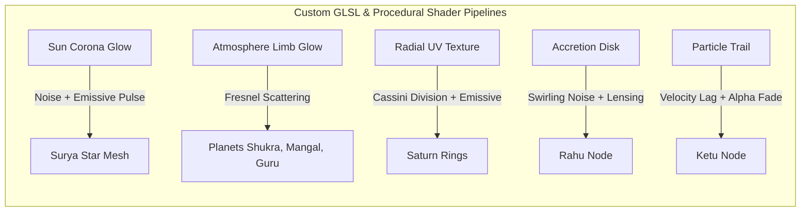

# 3D_UNIVERSE_ARCHITECTURE.md — 3D Universe Engine & Astronomical Systems

> **PROJECT**: Rudra Tiwari - Cosmic portfolio  
> **DOCUMENT**: 3D Graphics, Orbital Mechanics & Simulation Specification  
> **VERSION**: 2.0.0

---

## 1. 3D Architectural Overview

The 3D celestial engine is developed using **Three.js** and **React Three Fiber (R3F)**. The engine simulates an interactive solar system where astronomical realism meets portfolio interaction usability.

To ensure comfortable exploration, celestial distances and planetary radii are **stylized, visually compressed coordinates** based on a logarithmic transformation of planetary distances. Real solar distances (where Neptune is 30x farther than Earth and the Sun is 109x Earth's diameter) would render planets invisible specks on a web viewport. Instead, an engineered geometric distribution is applied so all 8 Grahas remain visibly identifiable, aesthetically spaced, and accessible without boundary clipping.

---

## 2. Astronomical Entities & Physical Parameters

The system models the **8 Vedic Grahas** using visually compressed logarithmic orbital distances to ensure all celestial bodies remain distinct, clearly spaced, and fully visible on standard display viewports without edge clipping:

| Graha (Entity) | Celestial Type | Base Radius | Semi-Major Axis ($a$) | Semi-Minor Axis ($b$) | Eccentricity ($e$) | Surface / Shader Details |
| :--- | :--- | :--- | :--- | :--- | :--- | :--- |
| **Surya** | Yellow Dwarf Star | 0.85 units | 0.0 (Focus) | 0.0 | 0.000 | Emissive pulsating corona, multi-octave noise, solar flares, central `PointLight` |
| **Budh** | Terrestrial Planet | 0.16 units | 2.0 units | 1.996 units | 0.060 | Mercury analog: heavily cratered gray basalt surface, high specular sharpness |
| **Shukra** | Cloud Planet | 0.24 units | 3.1 units | 3.097 units | 0.040 | Venus analog: dense swirling golden atmosphere, iridescent Fresnel rim glow |
| **Mangal** | Terrestrial Planet | 0.20 units | 3.8 units | 3.791 units | 0.070 | Mars analog: iron oxide rust red, canyon normal maps, faint dust storms |
| **Guru** | Gas Giant | 0.52 units | 4.5 units | 4.494 units | 0.050 | Jupiter analog: banded turbulent atmospheric bands, rotating Great Red Spot |
| **Shani** | Ringed Gas Giant | 0.44 units | 6.7 units | 6.691 units | 0.050 | Saturn analog: golden banding, custom radial UV Cassini rings with warm emissive glow |
| **Rahu** | Celestial Singularity | 0.32 units | 7.8 units | 7.780 units | 0.070 | Shadow anomaly: dark event horizon sphere, gravitational lensing, purple accretion disk |
| **Ketu** | Cometary Anomaly | 0.26 units | 9.1 units | 9.071 units | 0.080 | Ethereal comet: glowing nucleus with lagging emerald/cyan particle tail shader |

*Note: Chandra (Moon / Personal Life) was decommissioned to streamline the portfolio focus entirely on engineering excellence, technical architecture, and verified career milestones.*

---

## 3. Orbital Mechanics & Focus-Centered Keplerian Geometry

Orbital geometry adheres to strict astronomical principles adapted for visual clarity:

1. **Elliptical Orbit Geometry**:
   * For every orbit with semi-major axis $a$ and eccentricity $e$:
     $$b = a \cdot \sqrt{1 - e^2}$$
   * The linear focus offset is:
     $$c = a \cdot e$$
   * The **Sun is placed at one focus** $(0, 0, 0)$.
   * The orbit is rendered around that focus by shifting the ellipse geometry by $-c$ along its major axis ($x$-axis), rather than around its geometric center.

2. **Keplerian Orbital Motion**:
   * In compliance with Kepler's Second Law (equal areas swept in equal time), planets move faster near perihelion (closest to Sun) and slower near aphelion (farthest from Sun):
     $$\frac{d\theta}{dt} = \omega_0 \cdot \left(\frac{a}{r(\theta)}\right)^2 \cdot \sqrt{1 - e^2}$$
     where current radial distance from the focus is:
     $$r(\theta) = \frac{a \cdot (1 - e^2)}{1 + e \cdot \cos(\theta)}$$
   * Planetary positions at true anomaly $\theta$ are computed directly relative to the Sun focus:
     $$x(t) = a \cdot (\cos(E) - e)$$
     $$z(t) = b \cdot \sin(E)$$
   * Independent axial spin is maintained across all bodies using delta-time based updates.

3. **Orbital Rings**:
   * Thin, subtle, anti-aliased focus-centered elliptical ribbons ($0.024$ units wide) and 1px core lines in `OrbitalRings.tsx`.
   * Color-coded to match each world's celestial theme (`#06b6d4`, `#f59e0b`, `#ef4444`, `#eab308`, `#f97316`, `#a855f7`, `#14b8a6`).
   * Scene vantage: Overview camera positioned at `[0, 29.0, 2.6]` looking at `[0, 0, 0.65]`, ensuring all outer orbits (including Ketu at $9.1$) remain comfortably inside the viewport with > 75px boundary clearance.

---

## 4. Shaders & Visual Effects



### 1. Surya Corona & Emissive Shader
* **Core & Glow**: High-intensity emissive mesh blended with pulsating radial glow and corona noise.
* Uses warm gold (`#f59e0b`), amber (`#d97706`), and incandescent white highlights with additive blending.

### 2. Atmospheric Fresnel Scattering
* Applied to Shukra (Venus), Mangal (Mars), and Guru (Jupiter).
* Computes dot product between normal vector $\vec{N}$ and camera view direction $\vec{V}$:
  $$\text{Fresnel} = \text{clamp}(1.0 - \vec{N} \cdot \vec{V}, 0.0, 1.0)^p$$
* Renders a soft glowing limb/edge that highlights the spherical planetary boundary without needing geometry duplication.

### 3. Saturn Ring System Geometry (Shani)
* **Custom Radial UV Geometry**: Generates a ring buffer where $u \in [0, 1]$ directly represents radial distance from inner radius ($r_{\text{in}} = 0.65$) to outer radius ($r_{\text{out}} = 1.35$), and $v \in [0, 1]$ represents azimuthal angle.
* **Cassini Division & High-Reflectance Banding**:
  - Inner C Ring: Semi-transparent hazy inner boundary.
  - Broad B Ring ($u \in [0.22, 0.58]$): Dense, high-albedo golden bands.
  - Cassini Division ($u \in [0.58, 0.65]$): Crisp dark gap with zero opacity.
  - Outer A Ring ($u \in [0.65, 0.92]$): Medium density with Encke gap modulation.
* **Lighting & Luminous Warmth**: Configured with `emissive="#e5ce98"` and intensity $0.45$ to $0.75$, rendering rings clearly visible against deep-space void.

### 4. Rahu Gravitational Lensing & Accretion Disk
* **Core**: Pure pitch-black event horizon sphere absorbing all light.
* **Accretion Disk**: Double-sided flat ring geometry running dynamic UV rotation, violet-indigo hues (`#6366f1` / `#4f46e5`), and an opacity falloff simulating relativistic matter accretion.

### 5. Ketu Cometary Nebula & Trail
* Emits a trail of billboarded particle sprites trailing opposite to the vector of motion.
* Particle lifetimes decay with alpha fade, shifting from bright mystic teal (`#14b8a6`) to deep smoky cyan (`#042f2e`).

---

## 5. Lighting Architecture

The cosmic scene uses an astronomical, physically plausible lighting setup:

1. **Primary Central Source (`PointLight`)**:
   * Positioned at the center of Surya $(0, 0, 0)$.
   * Intensity: $800$ lumens, decay rate $2.0$.
   * Projects realistic shadows on the dark sides of all orbiting planets.
2. **Deep Space Ambient Fill (`AmbientLight`)**:
   * Very low intensity ($0.08$) with a subtle navy-indigo color (`#0a0f1d`).
   * Ensures that the dark sides of planets do not turn completely black, allowing surface textures and normal relief to remain discernible to visitors.
3. **Cosmic Directional Rim Light (`DirectionalLight`)**:
   * Positioned distantly to simulate illumination from the galactic core.
   * Subtle intensity ($0.15$), highlighting ring structures and planetary silhouettes.

---

## 6. Starfield Construction

* **Starfield Engine**:
  * Generated with `THREE.InstancedMesh` or point buffer geometry containing 4,500 particles distributed randomly on a spherical shell of radius $600$ units.
  * Star magnitudes: Assigned pseudo-random diameters ($0.5$ to $2.5$ px).
  * Color temperature: Sampled from astronomical spectral classes: O/B (cool blue-white), A/F (pure white), G (warm yellow), M (subtle reddish-amber).

---

## 7. Camera Choreography & Interpolation

The camera is managed by an autonomous `CameraController` responding to state changes in `useUniverseStore`:

```typescript
// Camera interpolation logic inside R3F useFrame
useFrame((state) => {
  const { activeWorldId, cameraMode } = useUniverseStore.getState();

  if (cameraMode === 'APPROACHING' && activeWorldId) {
    const targetWorldPos = getWorldPosition(activeWorldId);
    const targetCamPos = targetWorldPos.clone().add(getWorldCameraOffset(activeWorldId));
    
    // Smooth spherical interpolation (lerp)
    state.camera.position.lerp(targetCamPos, 0.05);
    controlsRef.current.target.lerp(targetWorldPos, 0.05);
    controlsRef.current.update();

    if (state.camera.position.distanceTo(targetCamPos) < 0.2) {
      useUniverseStore.getState().setCameraMode('INSPECTING');
    }
  } else if (cameraMode === 'RETURNING') {
    const defaultOverviewPos = new THREE.Vector3(0, 29.0, 2.6);
    const sunFocus = new THREE.Vector3(0, 0, 0.65);

    state.camera.position.lerp(defaultOverviewPos, 0.05);
    controlsRef.current.target.lerp(sunFocus, 0.05);
    controlsRef.current.update();

    if (state.camera.position.distanceTo(defaultOverviewPos) < 0.2) {
      useUniverseStore.getState().setCameraMode('OVERVIEW');
    }
  }
});
```

---

## 8. Performance & WebGL Optimization Strategy

1. **Draw Call Budgeting**: Target < 45 draw calls for the complete solar system view.
2. **Device Pixel Ratio Clamping**: Always clamp DPR: `gl={{ powerPreference: 'high-performance', antialias: true }}` with `dpr={[1, Math.min(window.devicePixelRatio, 2)]}`.
3. **Geometry Sharing**: All spherical planets share common `SphereGeometry` primitives with varying scale matrices.
4. **Frustum Culling**: Enabled on all celestial meshes and ring objects.
5. **Zero Allocation in `useFrame`**: Reusable vectors (`THREE.Vector3`, `THREE.Quaternion`) are allocated in module scope, preventing garbage collection pauses during orbital animation.
