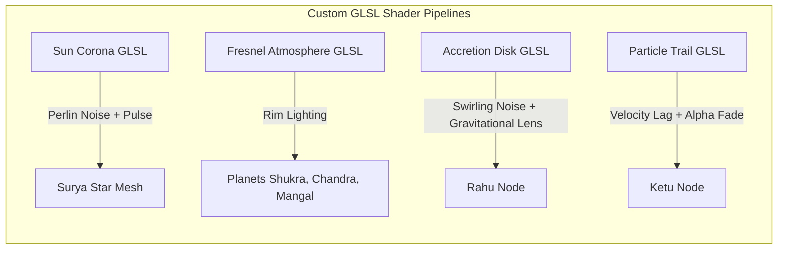

# 3D_UNIVERSE_ARCHITECTURE.md — 3D Universe Engine & Astronomical Systems

> **PROJECT**: Cosmic Portfolio — Rudra Tiwari  
> **DOCUMENT**: 3D Graphics & Simulation Specification  
> **VERSION**: 1.0.0

---

## 1. 3D Architectural Overview

The 3D celestial engine is developed using **Three.js** and **React Three Fiber (R3F)**. The engine simulates a stylized solar system where astronomical realism meets portfolio interaction usability.

To ensure comfortable exploration, celestial distances and planetary radii are **stylized non-astronomical coordinates**. Real solar distances (where Neptune is 30x farther than Earth and the Sun is 109x Earth's diameter) would render planets invisible specks on a web viewport. Instead, an engineered geometric distribution is applied so all bodies remain visibly identifiable and accessible.

---

## 2. Astronomical Entities & Physical Parameters

| Graha (Entity) | Celestial Type | Base Radius | Semi-Major Axis ($R$) | Orbital Period ($T$) | Surface / Shader Details |
| :--- | :--- | :--- | :--- | :--- | :--- |
| **Surya** | Yellow Dwarf Star | 10.0 units | 0.0 (Center) | Stationary | Emissive pulsating corona, multi-octave Perlin noise, solar flare particles |
| **Budh** | Terrestrial Planet | 1.8 units | 22.0 units | 18s | Mercury analog: heavily cratered gray basalt surface, high specular sharpness |
| **Shukra** | Cloud Planet | 2.6 units | 34.0 units | 28s | Venus analog: dense swirling golden atmosphere, iridescent Fresnel rim glow |
| **Chandra** | Rocky Terrestrial | 2.8 units | 48.0 units | 38s | Moon/Earth analog: cratered silver-slate maria, subtle atmospheric haze |
| **Mangal** | Terrestrial Planet | 2.2 units | 62.0 units | 48s | Mars analog: iron oxide rust red, canyon normal maps, faint dust storms |
| **Guru** | Gas Giant | 6.5 units | 82.0 units | 68s | Jupiter analog: banded turbulent atmospheric shader, rotating Great Red Spot |
| **Shani** | Ringed Gas Giant | 5.2 units | 104.0 units | 92s | Saturn analog: golden banding, concentric ring buffer geometry with transparency |
| **Rahu** | Celestial Singularity | 3.5 units | 126.0 units | 115s | Shadow anomaly: dark event horizon sphere, gravitational lensing, purple accretion disk |
| **Ketu** | Cometary Anomaly | 2.5 units | 148.0 units | 140s | Ethereal comet: glowing nucleus with lagging emerald/cyan particle tail shader |

---

## 3. Orbital Mechanics & Mathematical Calculations

Planetary coordinates at any given timestamp $t$ are calculated along stylized elliptical orbits using parametric orbital equations:

$$\theta(t) = \theta_0 + \frac{2\pi \cdot t}{T}$$

$$x(t) = R \cdot \cos(\theta(t))$$

$$z(t) = R \cdot (1 - e^2)^{1/2} \cdot \sin(\theta(t))$$

$$y(t) = R \cdot \sin(i) \cdot \sin(\theta(t))$$

Where:
* $R$: Semi-major axis radius.
* $T$: Orbital period (seconds for a complete revolution).
* $e$: Stylized orbital eccentricity ($0.02 \le e \le 0.08$, providing subtle realistic ellipticity).
* $i$: Orbital inclination ($1.5^\circ \le i \le 5.0^\circ$, avoiding planar visual overlap).
* $\theta_0$: Initial phase offset (radians) separating planets so they do not start clustered in a line.

```typescript
// Conceptual orbital calculation utility in src/utils/math.ts
export function calculateOrbitalPosition(
  semiMajorAxis: number,
  eccentricity: number,
  inclinationDeg: number,
  periodSeconds: number,
  phaseOffset: number,
  elapsedTime: number
): [number, number, number] {
  const inclinationRad = (inclinationDeg * Math.PI) / 180;
  const theta = phaseOffset + (2 * Math.PI * elapsedTime) / periodSeconds;
  
  const x = semiMajorAxis * Math.cos(theta);
  const z = semiMajorAxis * Math.sqrt(1 - eccentricity * eccentricity) * Math.sin(theta);
  const y = semiMajorAxis * Math.sin(inclinationRad) * Math.sin(theta);
  
  return [x, y, z];
}
```

---

## 4. Shaders & Visual Effects



### 1. Surya Corona & Emissive Shader
* **Vertex Shader**: Computes vertex displacement based on low-frequency simplex noise to simulate solar flares.
* **Fragment Shader**: Blends two layers of animated Perlin noise across gold (`#f59e0b`), fiery orange (`#ea580c`), and incandescent white (`#fef08a`). Uses additive blending for a rich volumetric glow.

### 2. Atmospheric Fresnel Scattering
* Applied to Shukra (Venus), Chandra, and Mangal.
* Computes dot product between normal vector $\vec{N}$ and camera view direction $\vec{V}$:
  $$\text{Fresnel} = \text{clamp}(1.0 - \vec{N} \cdot \vec{V}, 0.0, 1.0)^p$$
* Renders a soft glowing limb/edge that highlights the spherical planetary boundary without needing geometry duplication.

### 3. Rahu Gravitational Lensing & Accretion Disk
* **Core**: Pure pitch-black sphere (`#020205`) absorbing all light.
* **Accretion Disk**: Double-sided flat ring geometry running a fragment shader with dynamic UV rotation, violet-indigo hues (`#6366f1` / `#4f46e5`), and an opacity falloff simulating relativistic matter accretion.

### 4. Ketu Cometary Nebula & Trail
* Emits a trail of billboarded particle sprites trailing opposite to the vector of motion.
* Particle lifetimes decay with alpha fade, shifting from bright mystic teal (`#14b8a6`) to deep smoky cyan (`#042f2e`).

---

## 5. Lighting Architecture

The cosmic scene uses an astronomical, physically plausible lighting setup:

1. **Primary Central Source (`PointLight`)**:
   * Positioned at the center of Surya $(0, 0, 0)$.
   * Intensity: $800$ lumens, decay rate $2.0$.
   * Projects realistic shadows on the dark sides of all orbiting planets.
2. **Deep Space Ambient Fill (`AmbientLight`)**:
   * Very low intensity ($0.08$) with a subtle navy-indigo color (`#0a0f1d`).
   * Ensures that the dark sides of planets do not turn completely black, allowing surface textures and normal relief to remain discernible to visitors.
3. **Cosmic Directional Rim Light (`DirectionalLight`)**:
   * Positioned distantly to simulate illumination from the galactic core.
   * Subtle intensity ($0.15$), highlighting ring structures and planetary silhouettes.

---

## 6. Starfield & Nebula Construction

* **Starfield Engine**:
  * Generated with `THREE.InstancedMesh` or point buffer geometry containing 4,500 particles distributed randomly on a spherical shell of radius $600$ units.
  * Star magnitudes: Assigned pseudo-random diameters ($0.5$ to $2.5$ px).
  * Color temperature: Sampled from astronomical spectral classes: O/B (cool blue-white), A/F (pure white), G (warm yellow), M (subtle reddish-amber).
* **Nebula Skybox**:
  * Inverted sphere of radius $700$ units.
  * Custom shader blending multi-frequency noise textures with dark cosmic violet, midnight cyan, and star-dust densities.

---

## 7. Saturn Ring System Geometry (Shani)

* **Ring Geometry**: `THREE.RingGeometry(innerRadius = 7.0, outerRadius = 14.5, thetaSegments = 128)`.
* **UV Mapping**: Radial mapping where the horizontal texture coordinate corresponds to distance from inner radius to outer radius.
* **Texture**: Alpha-transparent PNG containing the Cassini Division, Encke Gap, and high-density particle banding.
* **Lighting**: Two-sided shadow receiving material reacting accurately to Surya's point light.

---

## 8. Camera Choreography & Interpolation

The camera is managed by an autonomous `CameraController` responding to state changes in `useUniverseStore`:

```typescript
// Conceptual camera interpolation logic inside R3F useFrame
useFrame((state, delta) => {
  const { activeWorldId, cameraMode } = useUniverseStore.getState();

  if (cameraMode === 'APPROACHING' && activeWorldId) {
    const targetWorldPos = getWorldPosition(activeWorldId);
    const targetCamPos = targetWorldPos.clone().add(getWorldCameraOffset(activeWorldId));
    
    // Smooth spherical interpolation (lerp)
    state.camera.position.lerp(targetCamPos, 0.05);
    controlsRef.current.target.lerp(targetWorldPos, 0.05);
    controlsRef.current.update();

    if (state.camera.position.distanceTo(targetCamPos) < 0.2) {
      useUniverseStore.getState().setCameraMode('INSPECTING');
    }
  } else if (cameraMode === 'RETURNING') {
    const defaultOverviewPos = new THREE.Vector3(0, 75, 160);
    const sunCenter = new THREE.Vector3(0, 0, 0);

    state.camera.position.lerp(defaultOverviewPos, 0.05);
    controlsRef.current.target.lerp(sunCenter, 0.05);
    controlsRef.current.update();

    if (state.camera.position.distanceTo(defaultOverviewPos) < 0.5) {
      useUniverseStore.getState().setCameraMode('OVERVIEW');
    }
  }
});
```

---

## 9. Performance & WebGL Optimization Strategy

1. **Draw Call Budgeting**: Target < 45 draw calls for the complete solar system view.
2. **Device Pixel Ratio Clamping**: Always clamp DPR: `gl={{ powerPreference: 'high-performance', antialias: true }}` with `dpr={[1, Math.min(window.devicePixelRatio, 2)]}`.
3. **Geometry Sharing**: All spherical planets share common `SphereGeometry` primitives with varying scale matrices.
4. **Frustum Culling**: Enabled on all celestial meshes and ring objects.
5. **No Allocation in `useFrame`**: Reusable vectors (`THREE.Vector3`, `THREE.Quaternion`) are allocated in module scope, preventing garbage collection pauses during orbital animation.
