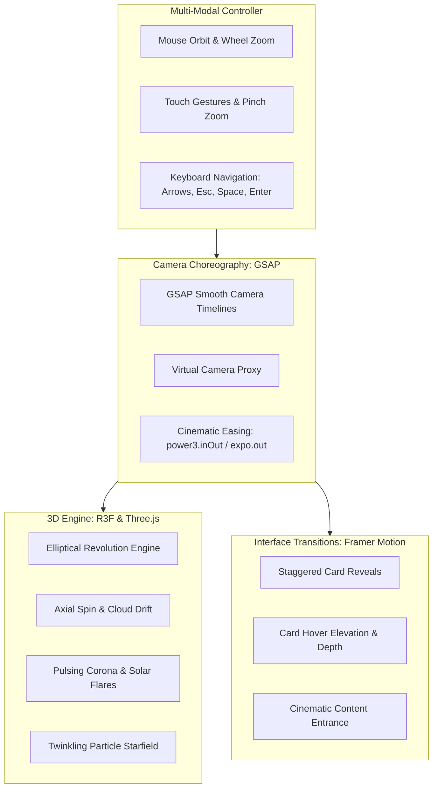
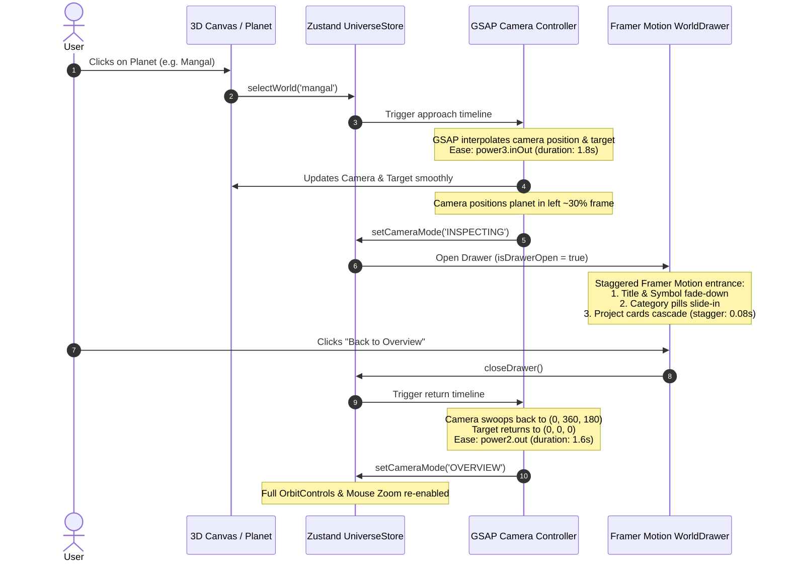

# ANIMATION_ARCHITECTURE.md — Cosmic Portfolio Animation Specification & Engine Architecture

> **PROJECT**: Cosmic Portfolio — Rudra Tiwari  
> **DOCUMENT**: Animation System & Interaction Choreography Architecture  
> **VERSION**: 1.0.0  
> **AUTHOR**: Principal Software Architect, Senior 3D/Graphics Engineer  
> **COMPLIANCE**: GEMINI.md Persistent Guidelines & Stage A Protocol  

---

## 1. Executive Summary & Design Philosophy

The **Cosmic Portfolio Animation System** elevates Rudra Tiwari's portfolio from a static 3D scene into a living, breathing celestial cosmos. Every motion is physically inspired, mathematically rigorous, and purposeful:

* **Astronomic Serenity**: Celestial revolution and axial rotation reflect peaceful, vast cosmic timescales rather than frantic mechanical spinning.
* **Cinematic Camera Choreography**: Camera movements between the overview vantage point and planetary focus positions are choreographed using **GSAP** for smooth, organic acceleration and deceleration curves.
* **Refined Interface Dynamics**: User interface elements emerge gracefully using **Framer Motion** staggered cascades, matching the arrival of the 3D camera.
* **Zero Disruption to Existing Structure**: Preserves 100% of the current visual identity, navigation routes, verified profile data, and layout established in the reference design.
* **Accessibility by Default**: Fully honors `prefers-reduced-motion` and provides complete keyboard, touch, and 2D fallback access.

---

## 2. Animation Engine Tech Stack



| Technology | Responsibility | Rationale |
| :--- | :--- | :--- |
| **Three.js & R3F** | 3D rendering, mesh transformations, custom shaders | Hardware-accelerated WebGL scene graph with React component lifecycle. |
| **GSAP (GreenSock)** | Camera movement & look-at choreography | Best-in-class multi-property interpolation, custom easing, and interruptible timelines without frame drops. |
| **Framer Motion** | HTML UI transitions, drawers, cards & hover depth | Native physics-based spring animations, layout transitions, and clean React 19 compatibility. |
| **Custom Hooks** | Input bindings, keyboard shortcuts, motion preferences | Separation of interaction logic from presentation components. |

---

## 3. Core 3D Celestial Animation Systems

### 3.1. Continuous Elliptical Planetary Revolution
Planetary orbits are governed by Keplerian parametric equations supporting eccentricity ($e$) and orbital inclination ($i$):

$$\theta(t) = \theta_0 + \omega \cdot t$$

$$x(t) = R \cdot \cos(\theta(t))$$

$$z(t) = R \cdot \sqrt{1 - e^2} \cdot \sin(\theta(t))$$

$$y(t) = R \cdot \sin(i) \cdot \sin(\theta(t))$$

Where:
* $R$: Semi-major axis (orbit radius).
* $e$: Orbital eccentricity ($0.04 \le e \le 0.08$ for subtle, elegant ellipticity).
* $i$: Orbital inclination ($1.5^\circ \le i \le 3.5^\circ$ for non-coplanar depth).
* $\omega$: Angular velocity derived from `world.orbitSpeed`.
* $\theta_0$: Initial phase offset in radians.

```typescript
// Optimized vector-allocation-free position calculation
export function computeEllipticalPosition(
  orbitRadius: number,
  angle: number,
  eccentricity: number,
  inclinationDeg: number,
  outVector: THREE.Vector3
): void {
  const incRad = (inclinationDeg * Math.PI) / 180;
  outVector.x = orbitRadius * Math.cos(angle);
  outVector.z = orbitRadius * Math.sqrt(1 - eccentricity * eccentricity) * Math.sin(angle);
  outVector.y = orbitRadius * Math.sin(incRad) * Math.sin(angle);
}
```

### 3.1. Keplerian Elliptical Revolution with Focus Centering
All 8 Graha worlds revolve around the Sun located at the primary focus $(0, 0, 0)$:

* **Focus-Centered Ellipse**:
  $$b = a \cdot \sqrt{1 - e^2}$$
  $$c = a \cdot e$$
* **Keplerian Orbital Velocity Modulation**:
  $$\frac{d\theta}{dt} = \omega_0 \cdot \left(\frac{a}{r(\theta)}\right)^2 \cdot \sqrt{1 - e^2}$$
  where current radial distance from the focus is:
  $$r(\theta) = \frac{a \cdot (1 - e^2)}{1 + e \cdot \cos(\theta)}$$
* **Visual Distance Specification**:
  The semi-major axes $a \in [2.0, 3.1, 3.8, 4.5, 6.7, 7.8, 9.1, 9.9]$ units are centralized in `src/config/orbitalConfig.ts`.

### 3.2. Independent Axial Rotation & Cloud Drift
* **Axial Tilt**: Each planet is mounted in an outer tilt group (`rotation.z = axialTilt`), orienting its rotational axis accurately (e.g., Mangal: 25.2°, Shani: 26.7°, Guru: 3.1°).
* **Independent Spin Speed**: Inner terrestrial bodies spin at distinct rates ($0.04 \text{ to } 0.08 \text{ rad/s}$), while Shukra (Venus) exhibits slow retrograde rotation ($-0.02 \text{ rad/s}$).
* **Differential Cloud Drift**: Planets with atmospheres (Venus/Shukra, Jupiter/Guru) feature secondary atmospheric shaders that rotate at differential speeds, generating continuous cloud drift over surface terrain.

### 3.3. Solar Dynamics: Pulsation, Corona & Flares
* **Breathing Pulsation**: The Sun's core sphere subtly expands and contracts using harmonic sine modulation:
  $$S(t) = 1.0 + 0.025 \cdot \sin(1.2 \cdot t) + 0.012 \cdot \cos(2.1 \cdot t)$$
* **Corona Shell Rotation**: Dual corona shells rotate in opposite directions ($+\omega_{c1}, -\omega_{c2}$) with additive blending (`THREE.AdditiveBlending`).
* **Solar Flare Arcs**: Animated coronal loop filaments generated via instanced curved ribbon geometry with animated alpha and UV scrolling.

### 3.4. Slowly Moving Starfield with Twinkling Particles
* **Cosmic Drift**: The starfield skybox and particle system slowly rotate on the Y and Z axes:
  $$\Delta \theta_y = \Delta t \cdot 0.0018 \text{ rad/s}$$
* **Twinkling Star Buffer Attribute**: Each star particle is assigned an individual phase offset $\phi_i$ and twinkle frequency $f_i$:
  $$\alpha_i(t) = \alpha_{\text{base}} + 0.35 \cdot \sin(f_i \cdot t + \phi_i)$$
  Creating a living, sparkling night sky without CPU overhead.

### 3.5. Subtle Planetary Atmospheric Effects
* **Atmospheric Rim Glow**: A Fresnel-approximating shell rendered with `THREE.BackSide` and custom falloff scale ($1.12 \times \text{radius}$).
* **Hover State Dynamics**: When the cursor hovers over a planet, the atmospheric glow expands smoothly ($1.12 \to 1.24$), emissive intensity increases by $+0.3$, and the hover label fades in.

---

## 4. Interaction Animations & Camera Choreography



### 4.1. GSAP Camera Proxy Architecture
Directly animating Three.js camera vectors inside React can cause jitter. We implement a **Virtual Camera Proxy** driven by GSAP:

```typescript
interface CameraProxy {
  camX: number;
  camY: number;
  camZ: number;
  targetX: number;
  targetY: number;
  targetZ: number;
}

// GSAP Transition Function
export function transitionToCelestialBody(
  currentCam: THREE.Vector3,
  currentTarget: THREE.Vector3,
  destinationCam: THREE.Vector3,
  destinationTarget: THREE.Vector3,
  onUpdate: (cam: THREE.Vector3, target: THREE.Vector3) => void,
  onComplete: () => void,
  duration: number = 1.8
): gsap.core.Tween {
  const proxy: CameraProxy = {
    camX: currentCam.x,
    camY: currentCam.y,
    camZ: currentCam.z,
    targetX: currentTarget.x,
    targetY: currentTarget.y,
    targetZ: currentTarget.z,
  };

  return gsap.to(proxy, {
    camX: destinationCam.x,
    camY: destinationCam.y,
    camZ: destinationCam.z,
    targetX: destinationTarget.x,
    targetY: destinationTarget.y,
    targetZ: destinationTarget.z,
    duration,
    ease: 'power3.inOut',
    onUpdate: () => {
      onUpdate(
        new THREE.Vector3(proxy.camX, proxy.camY, proxy.camZ),
        new THREE.Vector3(proxy.targetX, proxy.targetY, proxy.targetZ)
      );
    },
    onComplete,
  });
}
```

### 4.2. Multi-Modal Navigation Specification

| Input Device | Action | System Response |
| :--- | :--- | :--- |
| **Mouse Left Drag** | Click and drag in overview | Orbit around central Sun with inertia damping (`dampingFactor: 0.06`). |
| **Mouse Wheel** | Scroll up / down | Smooth camera zoom toward target ($15 \le \text{dist} \le 900$). |
| **Mouse Click** | Click on planet, glow, or label | Instant GSAP swoop into left-frame planetary view. |
| **Touch Single Drag** | Drag on mobile/tablet | Orbit camera around scene target. |
| **Touch Pinch** | Pinch in / out | Natural two-finger zoom. |
| **Keyboard `ArrowLeft` / `ArrowRight`** | Press left/right arrows | Cycle sequentially through all 9 Grahas with smooth camera transition. |
| **Keyboard `Escape` / `Backspace`** | Press Escape | Return to solar system overview from any planet view. |
| **Keyboard `Space`** | Press Spacebar | Toggle pause/resume on planetary revolution. |
| **Keyboard `Enter`** | Press Enter | Inspect the currently hovered planet. |

---

## 5. Internal World Animations (Framer Motion)

### 5.1. Staggered Content Orchestration
When the world drawer mounts, content cascades in using Framer Motion container variants:

```typescript
export const containerVariants = {
  hidden: { opacity: 0 },
  visible: {
    opacity: 1,
    transition: {
      staggerChildren: 0.08,
      delayChildren: 0.15,
    },
  },
};

export const itemVariants = {
  hidden: { opacity: 0, y: 18 },
  visible: {
    opacity: 1,
    y: 0,
    transition: {
      type: 'spring',
      damping: 24,
      stiffness: 260,
    },
  },
};
```

### 5.2. Project Card Depth & Elevation
Each project card in the Mangal view and portfolio drawers reacts to user hover with physical depth:

```typescript
export const cardHoverMotion = {
  initial: { y: 0, scale: 1.0 },
  whileHover: {
    y: -6,
    scale: 1.02,
    transition: { type: 'spring', stiffness: 400, damping: 25 },
  },
  whileTap: { scale: 0.98 },
};
```

---

## 6. Performance & Accessibility Guardrails

1. **Delta-Time Driven**: All frame-based updates in Three.js multiply by `delta` (`clock.getDelta()`). Motion is identical at 30fps, 60fps, 120fps, and 144Hz monitors.
2. **Zero Allocation in Loop**: Vector, matrix, and color instances are pre-allocated outside of `useFrame`.
3. **Respect `prefers-reduced-motion`**:
   ```typescript
   const prefersReducedMotion = window.matchMedia('(prefers-reduced-motion: reduce)').matches;
   // If true: duration = 0.01s (instant cut/fade), disable warp effects, pause star twinkle.
   ```
4. **Mobile Performance Tiering**:
   - Clamped DPR: `dpr={[1, Math.min(window.devicePixelRatio, 2)]}`.
   - Low-power GPU detection: Reduces particle count from 750 to 300 on devices with `navigator.hardwareConcurrency <= 4`.
5. **No Flash / No Excessive Bloom**: No jarring white flashes or disorienting camera rolls during warp transitions.

---

## 7. Files to Modify & Incremental Implementation Plan

### 7.1. File Modification Manifest

| File Path | Nature of Change | Key Additions |
| :--- | :--- | :--- |
| `src/types/celestial.ts` | Type definition updates | Add `eccentricity`, `inclination`, `axialTilt`, `cloudSpeed` to `CelestialBodyMeta`. |
| `src/data/worlds.ts` | Data model updates | Populate orbital parameters (eccentricity, tilt, inclination, rotation speeds) for all 9 Grahas. |
| `src/utils/math.ts` | Math calculations | Vector-free elliptical coordinate calculation with eccentricity and inclination. |
| `src/components/3d/camera/CameraController.tsx` | Camera engine upgrade | Integrate GSAP camera choreography with proxy timelines, smooth return, and keyboard controls. |
| `src/components/3d/celestial/PlanetarySystem.tsx` | Planetary revolution & tilt | Elliptical orbital path, axial tilt group, cloud drift layer, and hover glow tween. |
| `src/components/3d/celestial/Surya.tsx` | Solar dynamics | Breathing pulsation, counter-rotating coronas, and solar flare particles. |
| `src/components/3d/celestial/OrbitalRings.tsx` | Elliptical rings | Render matching elliptical orbits with glowing ribbon geometry. |
| `src/components/3d/environment/Starfield.tsx` | Starfield animation | Add subtle celestial drift and twinkling alpha modulation. |
| `src/components/ui/WorldDrawer.tsx` | UI animation upgrade | Wrap sections with Framer Motion staggered variants and card hover elevation. |
| `src/hooks/useKeyboardNavigation.ts` | New custom hook | Add global keyboard shortcuts (Arrows, Esc, Space, Enter) for accessibility. |

---

### 7.2. Incremental Implementation Milestones

* **Milestone 1 — Data & Mathematical Foundations**:
  * Update `CelestialBodyMeta` interface and populate realistic orbital parameters in `worlds.ts`.
  * Verify `calculateOrbitalPosition` math with unit tests.
* **Milestone 2 — Core 3D Celestial Dynamics**:
  * Implement elliptical motion and axial tilt in `PlanetarySystem.tsx`.
  * Update `OrbitalRings.tsx` to match elliptical paths.
  * Add breathing pulsation and solar flare animation in `Surya.tsx`.
  * Add starfield twinkle and drift in `Starfield.tsx`.
* **Milestone 3 — GSAP Camera Choreography & Interaction**:
  * Implement GSAP virtual camera proxy in `CameraController.tsx`.
  * Smooth cinematic transitions on world selection and return.
  * Implement `useKeyboardNavigation` hook for complete keyboard control.
* **Milestone 4 — Internal World & UI Animations**:
  * Apply Framer Motion staggered entrance animations in `WorldDrawer.tsx`.
  * Add interactive elevation and depth to project cards.
* **Milestone 5 — Performance, Accessibility & Final Verification**:
  * Add `prefers-reduced-motion` compliance.
  * Execute test suites (`typecheck`, `test`, `build`) and verify 60fps rendering in browser.

---

## 8. Verification & Test Plan

1. **Unit Testing (`vitest`)**:
   - Math tests verifying elliptical orbital calculation across all 9 planets at different timestamps.
   - Verification of content schema and orbital parameters.
2. **TypeScript Strict Typechecking**:
   - `npm run typecheck` passing with zero errors.
3. **Production Build**:
   - `npm run build` bundling successfully within budget.
4. **Interactive Verification**:
   - Verify smooth 60fps continuous orbits.
   - Verify single-click GSAP swoop to every planet.
   - Verify keyboard arrow cycling and Escape return.
   - Verify Framer Motion card animations.

---

> [!IMPORTANT]
> **Stage A Complete**: This document establishes the complete, production-grade animation architecture. In accordance with the Stage A development protocol, application code implementation will commence upon receiving your explicit approval.
