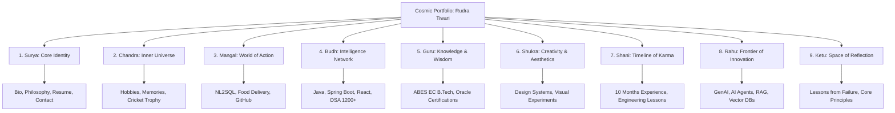

# CONTENT_ARCHITECTURE.md — Content Architecture & Data Schemas

> **PROJECT**: Cosmic Portfolio — Rudra Tiwari  
> **DOCUMENT**: Data Models & Content Pipeline Specification  
> **VERSION**: 1.0.0

---

## 1. Core Content Philosophy & Accuracy Policy

To uphold the highest engineering standards and integrity:
1. **Zero Fabrication**: All facts, education metrics, certifications, problem-solving numbers, and project technical details reflect **Rudra Tiwari's** verified records.
2. **Missing Details Handled via Explicit Placeholders**: Any project metrics or live URLs that are currently pending are designated with clear, typed placeholders (`[Pending Verification: ...]`) rather than fabricated content.
3. **Privacy First**: Sensitive personal details (private home address, phone numbers) are strictly excluded.
4. **Single Source of Truth**: All content is stored in strongly typed TypeScript files within `src/data/`. Components never contain hardcoded resume text or project descriptions.

---

## 2. Rudra Tiwari — Verified Personal & Professional Record

* **Name**: Rudra Tiwari
* **Role / Title**: Software Engineer | AI Enthusiast | Problem Solver
* **Tagline**: *"Engineer. Explorer. Creator. A journey through technology, knowledge, ambition and life."*
* **Email**: `rudra.tiwari.4141@gmail.com`
* **Professional Summary**:
  > Software Engineer specializing in Java, Spring Boot, REST APIs, and microservices, with hands-on experience building authentication, onboarding, loyalty, observability, and AI-enabled log investigation systems. Strong foundation in DSA, system design, databases, distributed systems, and Generative AI, with experience developing backend and AI solutions.
* **Education**:
  * **Degree**: Bachelor of Technology (B.Tech) in Computer Science and Engineering (CSE)
  * **University**: Dr. A.P.J. Abdul Kalam Technical University (AKTU) / ABES Engineering College, Ghaziabad, Uttar Pradesh
  * **Duration**: 2022 – 2026 (Graduating July 2026)
  * **Cumulative GPA**: 8.02 / 10.0
* **Work Experience**:
  * **Company**: **Salescode AI** (Gurugram, India)
  * **Role**: Software Engineer (Oct 2025 – Sept 2026)
  * **Core Engineering Accomplishments**:
    1. Developed production-grade Java/Spring Boot microservices and REST APIs for authentication, onboarding, password recovery, loyalty workflows, and secure service-to-service communication.
    2. Implemented SSO and OAuth 2.0 with token issuance, refresh/revocation, and session validation, establishing a reusable authentication layer adopted across 10 services.
    3. Built OpenTelemetry-based observability with structured logging and distributed tracing, and developed reusable onboarding automation for 7 clients/LOBs, reducing setup time to approximately 2 hours.
    4. Proactively built an Authentication Configuration Portal adopted by 10 LOBs, enabling self-service configuration of login/password flows, policies, and OTP providers without backend code changes; also implemented a client-specific data transformation layer for varying integration schemas.
    5. Engineered multi-device login support with concurrent session management, per-device token issuance, and device-level revocation, enabling users to maintain secure independent sessions across web, mobile, and tablet clients simultaneously.
* **Technical Skill Set**:
  * *Languages*: Java, Python, SQL, JavaScript, TypeScript.
  * *Backend & Distributed Systems*: Spring Boot, Spring AI, FastAPI, Microservices, Kafka, Node.js.
  * *AI & Generative AI*: LLMs, LangChain, LangGraph, RAG, AI Agents.
  * *Databases & Caching*: MySQL, PostgreSQL, MongoDB, Redis.
  * *Observability*: OpenTelemetry, Distributed Tracing, Structured Logging.
  * *Developer Tools*: Claude Code, Cursor, GitHub Copilot.
  * *Frontend (Cosmic Portfolio)*: React 19, TypeScript, Tailwind CSS, Vite, Three.js, React Three Fiber, Zustand, Framer Motion.
* **Certifications**:
  1. **Oracle Agentic AI Certified Foundations Associate**
  2. **Oracle Cloud Infrastructure Certified Generative AI Professional**
* **Achievements & Honors**:
  * **Competitive Programming**: 600+ problems solved on LeetCode; 1,200+ problems solved across competitive coding platforms.
  * **LeetCode Contest Rating**: **1812**.
  * **National Means-cum-Merit Scholarship**: Recipient of prestigious merit-based national scholarship awarded to high-performing students.
  * **College Cricket Tournament Winner**: Campus championship victory demonstrating leadership, tactical composure, and teamwork.
  * **Campus Leadership**: Event leadership experience in the Technovation Club.
* **Featured Projects**:
  1. **NL-2-DB: Natural Language to Database Query System**:
     * *Stack*: Python, FastAPI, NVIDIA NIM, LangChain, LangGraph, RAG, SQL.
     * LLM-powered natural-language-to-database engine translating user prompts into database-specific SQL queries without manual authoring.
     * LangGraph multi-stage orchestration (schema retrieval, SQL generation, validation, controlled execution).
     * Configurable database layer with SQL validation restricting execution to SELECT-only queries.
  2. **AI-Powered Log Investigation System (Salescode AI)**:
     * *Stack*: Java, Spring Boot, Spring AI, LangGraph, SQL.
     * AI-powered error-log investigation platform enabling engineers to analyze production errors through natural language queries, drastically reducing manual triaging.
     * Read-only log analysis workflow retrieving error logs for custom time ranges and routing to LLM via Spring AI for contextual failure analysis and root-cause summarization.
     * SQL proxy security layer restricting AI database access to SELECT-only operations.
  3. **BarterNow: AI-Powered Sponsorship Platform**:
     * *Stack*: Python, FastAPI, React, Express.js, Prisma, Razorpay.
     * Two-sided sponsorship marketplace matching brands with event organizers via an AI recommendation engine powered by audience demographics and event analytics.
     * Razorpay integration with idempotent webhook processing and real-time ROI analytics dashboards.
  4. **Food Delivery System**:
     * *Stack*: React, Spring Boot, SQL.
     * Full-stack ordering platform with authentication, multi-vendor menu management, and real-time order tracking.

---

## 3. Celestial Mapping Matrix (The 9 Worlds)



---

## 4. TypeScript Content Schemas (`src/types/content.ts`)

```typescript
// 1. Profile Schema
export interface ProfileRecord {
  name: string;
  titles: string[];
  bio: string;
  philosophy: string;
  education: EducationRecord;
  experienceMonths: number;
  contact: {
    email: string; // obfuscated/form-driven
    githubUrl: string;
    linkedinUrl: string;
    resumePdfPath: string;
  };
  metrics: {
    leetcodeSolved: number;
    totalProblemsSolved: number;
    experienceMonths: number;
    cgpa: number;
  };
}

// 2. Education Schema
export interface EducationRecord {
  degree: string;
  major: string;
  institution: string;
  graduationDate: string; // "July 2026"
  cgpa: number; // 8.02
  honors?: string[];
}

// 3. Project Schema
export interface ProjectRecord {
  id: string;
  title: string;
  tagline: string;
  category: 'AI/ML' | 'Full-Stack' | 'Cloud' | 'Microservices';
  overview: string;
  problemStatement: string;
  architectureDetails: string;
  technologies: string[];
  keyFeatures: string[];
  challengesAndLearnings: string[];
  screenshots: {
    url: string;
    caption: string;
    alt: string;
  }[];
  githubUrl?: string;
  demoUrl?: string;
  associatedWorld: 'mangal' | 'rahu';
}

// 4. Skill Schema
export interface SkillCategory {
  categoryName: string;
  description: string;
  skills: {
    name: string;
    level: 'Expert' | 'Proficient' | 'Familiar';
    category: 'language' | 'framework' | 'database' | 'cloud' | 'ai';
    iconName: string;
  }[];
}

// 5. Certification Schema
export interface CertificationRecord {
  id: string;
  name: string;
  issuingOrganization: 'Oracle' | 'Other';
  issueDate: string;
  credentialUrl?: string;
  badgeImagePath: string;
  skillsDemonstrated: string[];
}

// 6. Career Timeline Schema
export interface TimelineMilestone {
  period: string;
  role: string;
  domain: string;
  responsibilities: string[];
  technologies: string[];
  lessonsLearned: string[];
}

// 7. Celestial World Metadata Schema
export interface CelestialWorldMeta {
  id: string;
  sanskritName: string;
  englishTitle: string;
  dimensionTheme: string;
  narrativeDescription: string;
  astronomicalType: 'Star' | 'Terrestrial' | 'Gas Giant' | 'Anomaly';
  colorPalette: {
    primary: string;
    secondary: string;
    glow: string;
  };
  orbitalParameters: {
    semiMajorAxis: number;
    eccentricity: number;
    period: number;
    inclination: number;
    initialPhase: number;
  };
  tags: string[];
}
```

---

## 5. Content Editing & Extension Workflow

1. **Adding or Updating Projects**:
   * Open `src/data/projects.ts`.
   * Add a new entry conforming to `ProjectRecord`.
   * The UI dynamically renders the new project in Mangal (or Rahu) with automatic tabs, architectural tags, and modal previews.
2. **Updating Technical Metrics**:
   * Edit `src/data/skills.ts` or `src/data/profile.ts`.
   * Changes immediately propagate to the Budh HUD telemetry and 2D fallback page.
3. **Type Safety & Build Time Validation**:
   * Vitest test suites (`tests/unit/contentSchema.test.ts`) assert that all records have non-empty titles, valid URLs (or explicit placeholder notices), and proper media tags before any pull request can merge.
