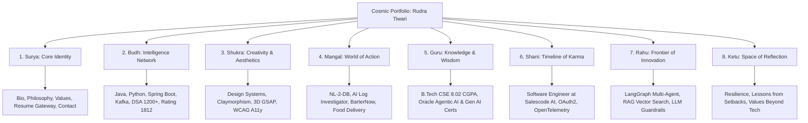

# CONTENT_ARCHITECTURE.md — Content Architecture & Data Schemas

> **PROJECT**: Rudra Tiwari - Cosmic portfolio  
> **DOCUMENT**: Data Models & Content Pipeline Specification  
> **VERSION**: 2.0.0

---

## 1. Core Content Philosophy & Accuracy Policy

To uphold the highest engineering standards and integrity:
1. **Zero Fabrication**: All facts, education metrics, certifications, problem-solving numbers, and project technical details reflect **Rudra Tiwari's** verified records.
2. **Missing Details Handled via Explicit Placeholders**: Any project metrics or live URLs that are currently pending are designated with clear, typed placeholders (`[Pending Verification: ...]`) rather than fabricated content.
3. **Privacy First**: Sensitive personal details (private home address, personal phone numbers) are strictly excluded.
4. **Single Source of Truth**: All content is stored in strongly typed TypeScript files within `src/data/`. Components never contain hardcoded resume text or project descriptions.

---

## 2. Rudra Tiwari — Verified Personal & Professional Record

* **Name**: Rudra Tiwari
* **Role / Title**: Software Engineer | AI Enthusiast | Problem Solver
* **Tagline**: *"Engineer. Explorer. Creator."*
* **Quote**: *"“A journey through technology, knowledge, ambition and life.”"*
* **Email**: `rudra.tiwari.4141@gmail.com`
* **GitHub**: `https://github.com/Rudra130`
* **LinkedIn**: `https://www.linkedin.com/in/rudratiwari1306/`
* **Professional Summary**:
  > A Computer Science Engineer passionate about building impactful software, solving complex problems, and exploring the evolving world of Artificial Intelligence. Experienced in production microservices, OAuth 2.0 authentication, distributed tracing, and LLM-powered agent workflows.
* **Education**:
  * **Degree**: Bachelor of Technology (B.Tech) in Computer Science and Engineering (CSE)
  * **University**: Dr. A.P.J. Abdul Kalam Technical University (AKTU)
  * **College**: ABES Engineering College, Ghaziabad, Uttar Pradesh
  * **Duration**: 2022 – 2026 (Graduating July 2026)
  * **Cumulative GPA**: **8.02 / 10.0**
* **Work Experience**:
  * **Company**: **Salescode AI** (Gurugram, India)
  * **Role**: Software Engineer (Oct 2025 – Sept 2026)
  * **Core Engineering Accomplishments**:
    1. Developed production-grade Java/Spring Boot microservices and REST APIs for authentication, onboarding, password recovery, loyalty workflows, and secure service-to-service communication.
    2. Implemented SSO and OAuth 2.0 with token issuance, refresh/revocation, and session validation, establishing a reusable authentication layer adopted across 10 services.
    3. Built OpenTelemetry-based observability with structured logging and distributed tracing, and developed reusable onboarding automation for 7 clients/LOBs, reducing setup time to approximately 2 hours.
    4. Proactively built an Authentication Configuration Portal adopted by 10 LOBs, enabling self-service configuration of login/password flows, policies, and OTP providers without backend code changes; also implemented a client-specific data transformation layer for varying integration schemas.
    5. Engineered multi-device login support with concurrent session management, per-device token issuance, and device-level revocation, enabling users to maintain secure independent sessions across web, mobile, and tablet clients simultaneously.
* **Technical Skill Set**:
  * *Languages*: Java, Python, SQL, JavaScript, TypeScript.
  * *Backend & Distributed Systems*: Spring Boot, Spring AI, FastAPI, Microservices, Kafka, Node.js.
  * *AI & Generative AI*: LLMs, LangChain, LangGraph, RAG, AI Agents, Vector DBs.
  * *Databases & Caching*: MySQL, PostgreSQL, MongoDB, Redis.
  * *Observability & Tools*: OpenTelemetry, Distributed Tracing, Structured Logging, Git, Docker.
  * *Frontend Architecture*: React 19, TypeScript, Tailwind CSS, Vite, Three.js, React Three Fiber, Zustand, Framer Motion.
* **Certifications**:
  1. **Oracle Certified Associate, Cloud Infrastructure 2025 Certified Foundations Associate - Agentic AI**
     * *Issuer*: Oracle
     * *Credential / Badge ID*: `7BA8D764E39E938D6DFDD2DCAB8FB79691641BB4172B812392D5A4DDE37483AB`
     * *URL*: `https://catalog-education.oracle.com/ords/certview/sharebadge?id=7BA8D764E39E938D6DFDD2DCAB8FB79691641BB4172B812392D5A4DDE37483AB`
  2. **Oracle Cloud Infrastructure 2024 Generative AI Certified Professional**
     * *Issuer*: Oracle
     * *Certificate No*: `100785002OCI24GAIOCP`
     * *Validation*: Verified Oracle University credential.
* **Achievements & Honors**:
  * **Competitive Programming**: **600+ problems solved on LeetCode**; **1,200+ problems solved** across competitive coding platforms.
  * **LeetCode Contest Rating**: **1812**.
  * **National Means-cum-Merit Scholarship**: Recipient of prestigious merit-based national scholarship awarded to high-performing students.
* **Featured Projects**:
  1. **NL-2-DB: Natural Language to Database Query System**:
     * *Stack*: Python, FastAPI, NVIDIA NIM, LangChain, LangGraph, RAG, SQL.
     * LLM-powered natural-language-to-database engine translating user prompts into database-specific SQL queries without manual authoring.
     * LangGraph multi-stage orchestration (schema retrieval, SQL generation, validation, controlled execution).
     * Configurable database layer with SQL validation restricting execution to SELECT-only queries.
  2. **AI-Powered Log Investigation System (Salescode AI)**:
     * *Stack*: Java, Spring Boot, Spring AI, LangGraph, SQL.
     * AI-powered error-log investigation platform enabling engineers to analyze production errors through natural language queries, drastically reducing manual triaging.
     * Read-only log analysis workflow retrieving error logs for custom time ranges and routing to LLM via Spring AI for contextual failure analysis and root-cause summarization.
     * SQL proxy security layer restricting AI database access to SELECT-only operations.
  3. **BarterNow: AI-Powered Sponsorship & Skill Exchange Platform**:
     * *Stack*: Python, FastAPI, React, Express.js, Prisma, Razorpay.
     * Two-sided marketplace matching brands with event organizers via an AI recommendation engine powered by audience demographics and event analytics.
     * Razorpay integration with idempotent webhook processing and real-time ROI analytics dashboards.
  4. **Food Delivery System**:
     * *Stack*: React, Spring Boot, SQL, Redis.
     * Full-stack ordering platform with authentication, multi-vendor menu management, distributed caching, and real-time order tracking.

---

## 3. Celestial Mapping Matrix (The 8 Graha Worlds)



---

## 4. TypeScript Content Schemas (`src/types/content.ts`)

```typescript
export interface EducationRecord {
  degree: string;
  major: string;
  university: string;
  college: string;
  location: string;
  duration: string;
  graduationDate: string;
  cgpa: string;
}

export interface WorkExperienceRecord {
  company: string;
  location: string;
  role: string;
  duration: string;
  highlights: string[];
}

export interface ProjectRecord {
  id: string;
  title: string;
  tagline: string;
  category: 'AI / ML' | 'Full-Stack' | 'Systems' | 'Tooling';
  technologies: string[];
  description: string;
  keyFeatures: string[];
  githubUrl?: string;
  liveUrl?: string;
  iconType: 'database' | 'cutlery' | 'brain' | 'code';
}

export interface SkillCategoryRecord {
  category: string;
  skills: string[];
}

export interface CertificationRecord {
  name: string;
  issuer: string;
  status: string;
  credentialUrl?: string;
  badgeImage?: string;
  issueDate?: string;
  validUntil?: string;
  description?: string;
  skills?: string[];
}

export interface ProfileRecord {
  name: string;
  titles: string[];
  tagline: string;
  quote: string;
  summary: string;
  email: string;
  githubUrl: string;
  linkedinUrl: string;
  resumePath: string;
  avatarPath: string;
  education: EducationRecord;
  experience: WorkExperienceRecord;
  skills: SkillCategoryRecord[];
  certifications: CertificationRecord[];
  achievements: string[];
}
```
