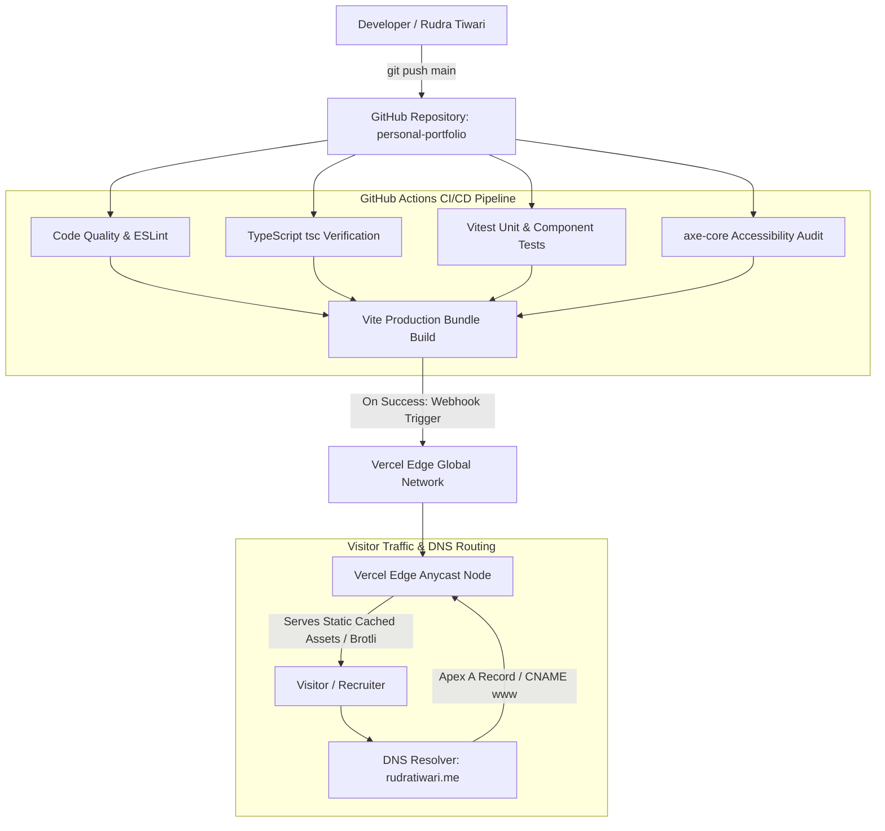

# DEPLOYMENT_ARCHITECTURE.md — Cloud Hosting, CI/CD & Production Topology

> **PROJECT**: Cosmic Portfolio — Rudra Tiwari  
> **DOCUMENT**: Production Deployment & DevOps Specification  
> **VERSION**: 1.0.0

---

## 1. Hosting Architecture & Edge Topology

The Cosmic Portfolio frontend is deployed to **Vercel's Edge Network**. The Edge platform distributes pre-rendered and static WebGL bundles across globally distributed points of presence (PoPs), ensuring high asset transfer speeds regardless of visitor location.



---

## 2. Domain & DNS Configuration

* **Target Domain**: Custom personal `.me` domain (`rudratiwari.me`).
* **Registrar / DNS Provider**: Namecheap, Cloudflare, or Porkbun.

### DNS Records Configuration Table
| Type | Host | Value / Target | TTL | Purpose |
| :--- | :--- | :--- | :--- | :--- |
| **A** | `@` (Apex) | `76.76.21.21` | Auto / 300 | Routes apex domain (`rudratiwari.me`) to Vercel Anycast IP |
| **CNAME** | `www` | `cname.vercel-dns.com.` | Auto / 300 | Routes subdomain (`www.rudratiwari.me`) to Vercel edge |
| **CAA** | `@` | `0 issue "letsencrypt.org"` | 3600 | Authorizes Let's Encrypt SSL certificate issuance |
| **TXT** | `_vercel` | `vc-domain-verify=...` | 300 | Domain ownership verification token |

### Apex Redirection
All traffic hitting `http://` or `www.rudratiwari.me` is automatically redirected to `https://rudratiwari.me` with HTTP `308 Permanent Redirect` and HTTP Strict Transport Security (HSTS).

---

## 3. HTTPS & Security Headers

Vercel provides automatic, continuous SSL/TLS certificate generation via Let's Encrypt. In addition, production responses enforce strict HTTP security headers via `vercel.json`:

```json
{
  "headers": [
    {
      "source": "/(.*)",
      "headers": [
        {
          "key": "X-Content-Type-Options",
          "value": "nosniff"
        },
        {
          "key": "X-Frame-Options",
          "value": "DENY"
        },
        {
          "key": "X-XSS-Protection",
          "value": "1; mode=block"
        },
        {
          "key": "Referrer-Policy",
          "value": "strict-origin-when-cross-origin"
        },
        {
          "key": "Permissions-Policy",
          "value": "camera=(), microphone=(), geolocation=()"
        },
        {
          "key": "Strict-Transport-Security",
          "value": "max-age=63072000; includeSubDomains; preload"
        }
      ]
    },
    {
      "source": "/assets/(.*)",
      "headers": [
        {
          "key": "Cache-Control",
          "value": "public, max-age=31536000, immutable"
        }
      ]
    }
  ]
}
```

---

## 4. Environment Variables Management

Environment variables are partitioned across development and production environments:

### Required Variables
* `VITE_APP_TITLE`: Application browser tab title.
* `VITE_APP_URL`: Canonical site URL (`https://rudratiwari.me`).
* `VITE_ENABLE_AUDIO`: Feature flag enabling ambient synthesizer audio (`true`/`false`).
* `VITE_FORCE_FALLBACK`: Debug flag to force 2D Accessible Portfolio view (`true`/`false`).

### Configuration Protocol
* **Local Development**: Stored in uncommitted `.env.local`. An identical template is documented in `.env.example`.
* **Production**: Configured directly in the Vercel Project Dashboard under *Settings > Environment Variables*.

---

## 5. Automated CI/CD Pipeline (GitHub Actions)

A GitHub Actions workflow (`.github/workflows/ci.yml`) runs on every pull request and push to the `main` branch.

```yaml
name: CI/CD Pipeline

on:
  push:
    branches: [main]
  pull_request:
    branches: [main]

jobs:
  validate:
    name: Lint, Typecheck & Test
    runs-on: ubuntu-latest
    steps:
      - name: Checkout code
        uses: actions/checkout@v4

      - name: Setup Node.js 20.x
        uses: actions/setup-node@v4
        with:
          node-version: 20
          cache: 'npm'

      - name: Install dependencies
        run: npm ci

      - name: Run ESLint
        run: npm run lint

      - name: Run TypeScript Type Check
        run: npm run typecheck

      - name: Run Vitest Unit Tests
        run: npm run test:coverage

      - name: Build Production Bundle
        run: npm run build

      - name: Verify Bundle Size Limits
        run: npx bundlesize
```

---

## 6. Monitoring, Health & Rollback Strategy

1. **Vercel Web Analytics & Speed Insights**: Real-world Core Web Vitals (LCP, FID, CLS, INP) telemetry tracked continuously across desktop and mobile visitor sessions.
2. **Client-Side Error Logging**: Integrated Sentry or lightweight client telemetry hook catching unhandled React or WebGL rendering exceptions.
3. **Instant Rollback**: If an issue emerges in production, Vercel allows one-click instantaneous atomic rollbacks to any previous successful deployment without rebuilding.
