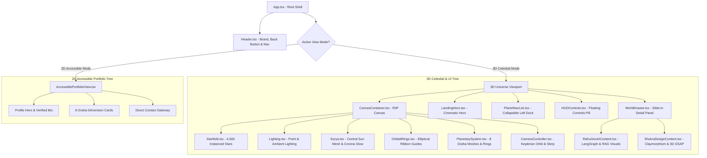

# FRONTEND_ARCHITECTURE.md — Frontend Architecture & Component Hierarchy

> **PROJECT**: Rudra Tiwari - Cosmic portfolio  
> **DOCUMENT**: Frontend Technical Specification  
> **VERSION**: 2.0.0

---

## 1. Frontend Architectural Overview

The frontend is built as a single-page application (SPA) with **React 19**, **TypeScript 5**, and **Vite 6**. It leverages **React Three Fiber (R3F)** to bridge the declarative React component lifecycle with the imperative Three.js WebGL scene graph.

### Architectural Tenets
* **Unidirectional State Flow**: User interactions mutate the central Zustand store (`useUniverseStore`), which reactively synchronizes DOM overlays, browser history, and WebGL camera controllers.
* **Component Granularity**: Components are kept focused and under 250 lines of code; UI presentation and 3D rendering are strictly separated.
* **Non-Blocking Render Loop**: Frame-rate critical loops (`useFrame`) never perform dynamic object allocations (`new THREE.Vector3()`) or trigger unnecessary React re-renders.
* **Accessibility First**: An integrated 2D Accessible Portfolio view (`AccessiblePortfolioView.tsx`) is available at any time, respecting `prefers-reduced-motion` and ensuring zero-WebGL compatibility.

---

## 2. Component Hierarchy Diagram



---

## 3. Directory Layout & Module Structure

```text
src/
├── main.tsx                         # StrictMode bootstrap & root mount
├── App.tsx                          # App shell, router dispatch & view switcher
├── index.css                        # Tailwind directives, animations & glassmorphism
│
├── components/
│   ├── 3d/                          # Three.js & React Three Fiber Scene
│   │   ├── CanvasContainer.tsx      # R3F Canvas configuration & tone mapping
│   │   ├── camera/
│   │   │   └── CameraController.tsx # Slerp camera positioning & OrbitControls
│   │   ├── celestial/
│   │   │   ├── Surya.tsx            # Sun core mesh, corona glow, and point light
│   │   │   ├── PlanetarySystem.tsx  # 8 Graha meshes, textures, Cassini Saturn rings
│   │   │   └── OrbitalRings.tsx     # Focus-centered elliptical ribbon guides
│   │   └── environment/
│   │       ├── Lighting.tsx         # Central Sun point light & space ambient illumination
│   │       └── Starfield.tsx        # 4,500 instanced particle stars
│   │
│   ├── fallback/                    # Accessible 2D Portfolio
│   │   └── AccessiblePortfolioView.tsx # Semantic HTML representation for a11y & non-WebGL
│   │
│   └── ui/                          # DOM & Glassmorphic UI Overlays
│       ├── Header.tsx               # Brand title, contextual Back button, nav links
│       ├── HUDControls.tsx          # Right floating control pill (Zoom, Reset, Info)
│       ├── LandingHero.tsx          # Cinematic opening hero with entrance CTA
│       ├── PlanetNavList.tsx        # Collapsible left navigation dock with tooltips
│       ├── WorldDrawer.tsx          # Slide-in glassmorphic detail drawer
│       ├── drawer-content/          # Rich interactive sub-components
│       │   ├── RahuGenAIContent.tsx # LangGraph multi-agent & RAG diagrams
│       │   └── ShukraDesignContent.tsx # Claymorphism & UI/UX showcase
│       └── icons/
│           └── BrandIcons.tsx       # GitHub, LinkedIn & custom SVG icons
│
├── config/
│   └── orbitalConfig.ts             # Centralized elliptical orbital parameters
│
├── data/                            # Single Source of Truth Repositories
│   ├── profile.ts                   # Rudra Tiwari's verified biography & credentials
│   ├── projects.ts                  # Production projects (NL-2-DB, Log Investigator, etc.)
│   └── worlds.ts                    # 8 Graha metadata, analogies, and design styling
│
├── hooks/
│   └── useKeyboardNavigation.ts     # Keyboard shortcuts (Esc, 1-8, Space, M)
│
├── store/
│   └── useUniverseStore.ts          # Central Zustand state store
│
├── types/
│   ├── celestial.ts                 # Orbital & Three.js TypeScript interfaces
│   └── content.ts                   # Content schemas, project types, profile records
│
└── utils/
    ├── math.ts                      # Elliptical geometry and Keplerian speed functions
    └── navigation.ts                # Deep linking URL synchronization utilities
```

---

## 4. Routing & Deep Linking Strategy

The application utilizes HTML5 History API routing through `src/utils/navigation.ts`, ensuring clean search-engine-friendly URLs and persistent shareability:

* `/portfolio`: The primary cosmic solar system overview.
* `/portfolio/about`: Focuses on **Surya** (Core Identity & Bio).
* `/portfolio/skills`: Focuses on **Budh** (Technical Skills & DSA).
* `/portfolio/design`: Focuses on **Shukra** (UI/UX & Design Systems).
* `/portfolio/projects`: Focuses on **Mangal** (Projects & Architecture).
* `/portfolio/education`: Focuses on **Guru** (Education & Certifications).
* `/portfolio/experience`: Focuses on **Shani** (Work Experience at Salescode AI).
* `/portfolio/ai`: Focuses on **Rahu** (Generative AI & Autonomous Agents).
* `/portfolio/reflection`: Focuses on **Ketu** (Philosophy & Space of Reflection).

### Backward Compatibility Redirects
Any requests to legacy routes (such as `/universe` or `/universe/:worldSlug`) are automatically intercepted and seamlessly rewritten to `/portfolio` and its corresponding world paths without causing page reloads or broken links.

---

## 5. Global State Management (`src/store/useUniverseStore.ts`)

```typescript
interface UniverseState {
  // Navigation & Selection
  activeWorldId: WorldId | null;
  selectedWorld: WorldRecord | null;
  isDrawerOpen: boolean;
  hasEntered: boolean;

  // Camera Control
  cameraMode: 'OVERVIEW' | 'APPROACHING' | 'INSPECTING' | 'RETURNING';

  // Display & Accessibility Preferences
  isFallback2D: boolean;
  prefersReducedMotion: boolean;

  // Actions
  selectWorld: (id: WorldId | null) => void;
  closeDrawer: () => void;
  openDrawer: () => void;
  enterUniverse: () => void;
  returnToLanding: () => void;
  toggleFallback2D: () => void;
  setFallback2D: (val: boolean) => void;
}
```
