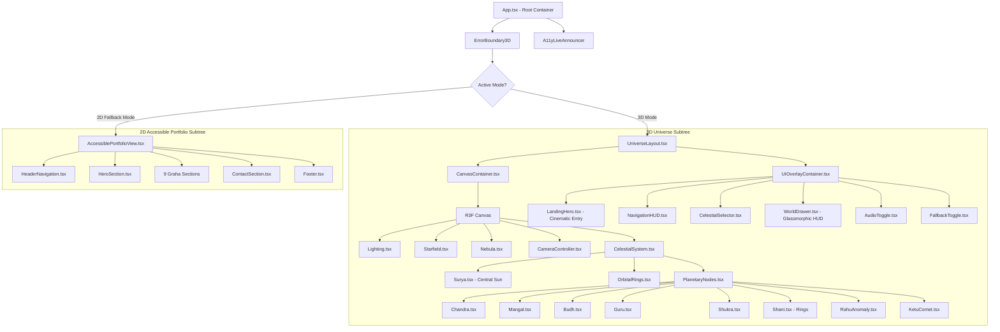
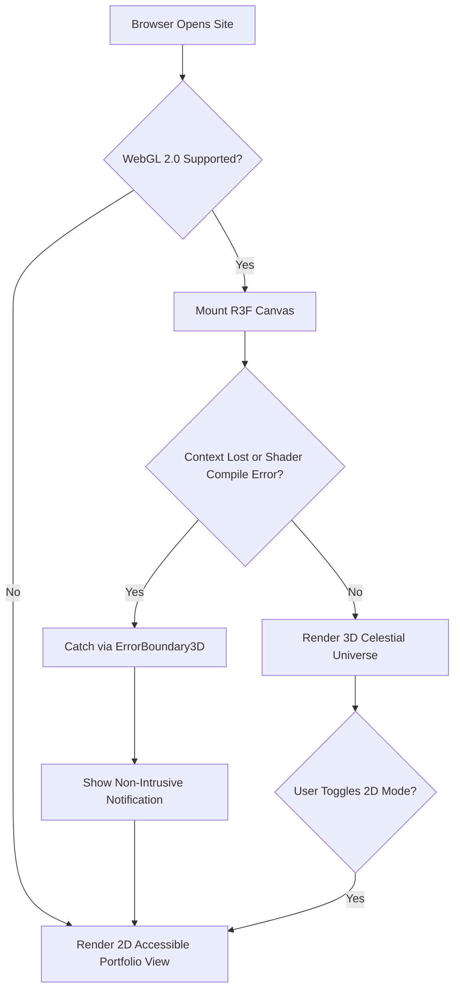

# FRONTEND_ARCHITECTURE.md — Frontend Architecture & Component Hierarchy

> **PROJECT**: Cosmic Portfolio — Rudra Tiwari  
> **DOCUMENT**: Frontend Technical Specification  
> **VERSION**: 1.0.0

---

## 1. Frontend Architectural Overview

The frontend is built as a single-page application (SPA) with **React 19**, **TypeScript 5**, and **Vite**. It leverages **React Three Fiber (R3F)** to bridge the declarative React component lifecycle with the imperative Three.js WebGL scene graph.

### Architectural Tenets
* **Unidirectional State Flow**: All user interactions mutate the global Zustand store, which notifies both DOM overlays and WebGL camera controllers.
* **Component Granularity**: Components are kept focused and under 250 lines of code; UI presentation and 3D rendering are strictly separated.
* **Non-Blocking Render Loop**: Frame-rate critical loops (`useFrame`) never perform dynamic object allocations or trigger React re-renders.

---

## 2. Component Hierarchy Diagram



---

## 3. Directory Layout & Module Structure

```text
src/
├── main.tsx                         # Application bootstrap & StrictMode mount
├── App.tsx                          # Root mode selector & global context
├── index.css                        # Tailwind directives and custom CSS variables
│
├── components/
│   ├── 3d/                          # Three.js & R3F Components
│   │   ├── CanvasContainer.tsx      # R3F Canvas configuration & tone mapping
│   │   ├── ErrorBoundary3D.tsx      # WebGL fault catcher & fallback trigger
│   │   ├── camera/
│   │   │   └── CameraController.tsx # Slerp camera positioning & OrbitControls
│   │   ├── celestial/
│   │   │   ├── Surya.tsx            # Sun mesh, point light, and corona
│   │   │   ├── CelestialSphere.tsx  # Shared planetary mesh with LOD
│   │   │   ├── Chandra.tsx          # Moon/Earth analog
│   │   │   ├── Mangal.tsx           # Mars analog
│   │   │   ├── Budh.tsx             # Mercury analog
│   │   │   ├── Guru.tsx             # Jupiter analog
│   │   │   ├── Shukra.tsx           # Venus analog
│   │   │   ├── Shani.tsx            # Saturn analog & ring geometry
│   │   │   ├── RahuAnomaly.tsx      # Black hole / accretion disc phenomenon
│   │   │   ├── KetuComet.tsx        # Ethereal cometary trail phenomenon
│   │   │   └── OrbitalRing.tsx      # Stylized orbital guide lines
│   │   ├── environment/
│   │   │   ├── Starfield.tsx        # Instanced particle starfield
│   │   │   ├── Nebula.tsx           # Procedural cosmic skybox
│   │   │   └── Lighting.tsx         # Central sun point light & ambient fills
│   │   └── shaders/
│   │       ├── SunCoronaShader.ts   # GLSL corona pulsation shader
│   │       ├── AtmosphereShader.ts  # Fresnel planetary limb glow shader
│   │       ├── AccretionShader.ts   # Rahu gravitational lens distortion
│   │       └── CometTailShader.ts   # Ketu particle drift shader
│   │
│   ├── ui/                          # DOM & Glassmorphic UI Overlays
│   │   ├── LandingHero.tsx          # Cinematic opening & "Enter Universe"
│   │   ├── NavigationHUD.tsx        # Top status bar, telemetry, and actions
│   │   ├── CelestialSelector.tsx    # Bottom carousel/dock of 9 worlds
│   │   ├── WorldDrawer.tsx          # Slide-out glassmorphic detail drawer
│   │   ├── AudioToggle.tsx          # Ambient audio mute/unmute control
│   │   ├── SearchModal.tsx          # Universal quick-search dialog
│   │   └── common/
│   │       ├── GlassCard.tsx        # Reusable glassmorphic container
│   │       ├── PillBadge.tsx        # Status & skill tags
│   │       └── OptimizedImage.tsx   # Lazy responsive WebP image with skeleton
│   │
│   └── fallback/                    # 2D Accessible Portfolio Views
│       ├── AccessiblePortfolioView.tsx # Semantic HTML non-WebGL complete page
│       ├── WorldSection.tsx         # Individual world card in 2D layout
│       └── AccessibleNav.tsx        # Jump navigation bar
│
├── data/                            # Static Content Repositories
│   ├── profile.ts                   # Bio, education, contact, achievements
│   ├── worlds.ts                    # 9 Grahas metadata, orbits, coordinates
│   ├── projects.ts                  # NL2SQL, Food Delivery, AI apps specs
│   ├── skills.ts                    # Languages, frameworks, cloud, DSA stats
│   └── timeline.ts                  # 10 months professional work history
│
├── hooks/                           # Custom React Hooks
│   ├── useUniverseNavigation.ts     # World selection and camera coordination
│   ├── useKeyboardControls.ts       # Keyboard navigation (arrows, enter, esc)
│   ├── useMediaQuery.ts             # Responsive breakpoint detector
│   └── usePrefersReducedMotion.ts   # System accessibility preference listener
│
├── store/                           # Global Zustand State
│   └── useUniverseStore.ts          # Central application state slice
│
├── types/                           # TypeScript Domain Models
│   ├── celestial.ts                 # Planet specs, orbital parameters, vectors
│   ├── content.ts                   # Project, Skill, Experience, Profile types
│   └── store.ts                     # Zustand store interface definitions
│
└── utils/                           # Helper Utilities
    ├── math.ts                      # Orbital positioning & lerp calculations
    ├── constants.ts                 # Default camera coordinates & scales
    └── a11y.ts                      # Focus management and ARIA helpers
```

---

## 4. Routing & Deep Linking Strategy

To maintain high responsiveness without full page reloads, deep linking is implemented using **URL Hash Synchronization**:

* `#/`: Cosmic solar system overview.
* `#/world/surya`: Focus on Surya (Bio, Core Identity).
* `#/world/chandra`: Focus on Chandra (Personal Life).
* `#/world/mangal`: Focus on Mangal (Projects).
* `#/world/budh`: Focus on Budh (Skills & DSA).
* `#/world/guru`: Focus on Guru (Education & Certifications).
* `#/world/shukra`: Focus on Shukra (Creativity & Aesthetics).
* `#/world/shani`: Focus on Shani (Career Timeline).
* `#/world/rahu`: Focus on Rahu (Generative AI & Agents).
* `#/world/ketu`: Focus on Ketu (Philosophy & Reflection).
* `#/view/accessible`: Forces the 2D accessible non-WebGL layout.

### Browser History Integration
When a user selects a world in 3D or clicks a link, `window.location.hash` updates. The browser back/forward buttons seamlessly trigger camera travel and drawer states without page refreshes.

---

## 5. State Management Architecture (Zustand)

```typescript
// Conceptual State Model in src/store/useUniverseStore.ts
export type CameraMode = 'OVERVIEW' | 'APPROACHING' | 'INSPECTING' | 'RETURNING';

export interface UniverseState {
  // Navigation & Celestial Focus
  activeWorldId: string | null;
  hoveredWorldId: string | null;
  cameraMode: CameraMode;
  isDrawerOpen: boolean;
  hasEnteredUniverse: boolean;
  
  // Display & Accessibility
  isFallback2D: boolean;
  prefersReducedMotion: boolean;
  isAudioMuted: boolean;
  searchQuery: string;
  isSearchOpen: boolean;

  // Actions
  enterUniverse: () => void;
  selectWorld: (id: string | null) => void;
  setHoveredWorld: (id: string | null) => void;
  setCameraMode: (mode: CameraMode) => void;
  closeDrawer: () => void;
  toggleFallback2D: () => void;
  toggleAudio: () => void;
  setSearchOpen: (open: boolean) => void;
}
```

### High-Frequency State Reading in R3F
To prevent React re-renders from throttling the 60 FPS animation loop, the `CameraController` reads state directly from the Zustand store outside React's render phase using `useUniverseStore.getState()`.

---

## 6. Asset & Resource Management

1. **Texture Preloading**: Critical low-resolution textures (Sun emissive map, celestial diffuse maps) are preloaded during the landing screen sequence.
2. **Progressive Texture Loading**: High-resolution normal and roughness maps load asynchronously when approaching a planet.
3. **Memory Lifecycle Management**: When switching between worlds or leaving WebGL mode, Three.js geometries, textures, and shader materials are systematically disposed of using `.dispose()` to eliminate VRAM memory leaks.

---

## 7. Responsive Design & Breakpoints

* **Desktop (>= 1024px)**: Full split-screen experience when a world is selected. The planet orbits in the left 40% of the screen while the glassmorphic detail drawer occupies the right 60%.
* **Tablet (768px - 1023px)**: Adaptive bottom-sheet drawer covering 70% of screen height, camera dynamically offsets upward along the Y-axis.
* **Mobile (< 768px)**: Full-screen modal drawer with a sticky top bar. WebGL canvas frame rate dynamically clamps to 30 FPS if battery saver or lower GPU capabilities are detected.

---

## 8. Error Boundaries & Fallback Mechanism


