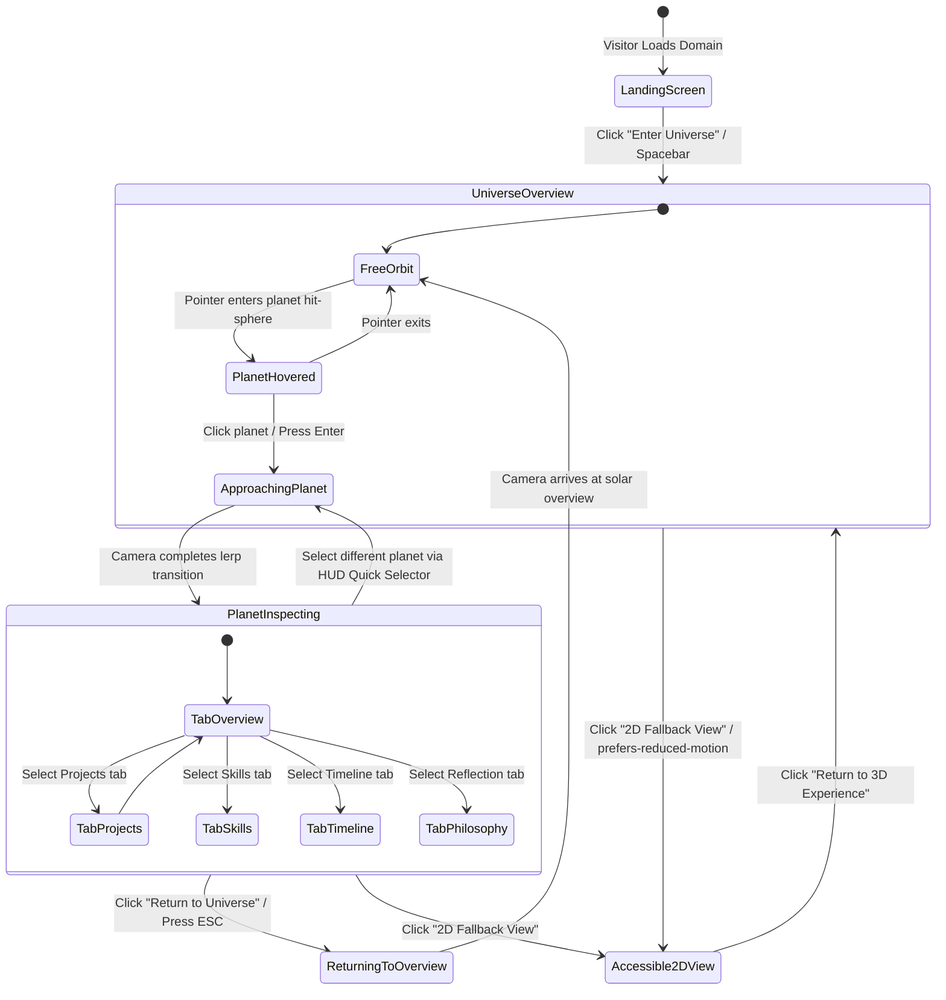

# INTERACTION_ARCHITECTURE.md — User Interaction & Navigation State Machine

> **PROJECT**: Cosmic Portfolio — Rudra Tiwari  
> **DOCUMENT**: Interaction & UX Architecture Specification  
> **VERSION**: 1.0.0

---

## 1. Interaction Paradigm & Core Principles

The user interaction design balances **exploratory cinematic immersion** with **ergonomic information retrieval**. Visitors can freely explore the universe at their own pace without feeling trapped, disoriented, or overwhelmed.

### Core Experience Axioms
1. **Never Get Lost in Space**: A persistent HUD anchor ("Return to Universe"), keyboard shortcuts (`Escape`), and an omnipresent world picker ensure immediate recovery to the global solar system view.
2. **Direct Action Feedback**: Hovering over any celestial body triggers an instant glow amplification, cursor pointer mutation, and an astronomical telemetry tag.
3. **Smooth Deceleration**: Transitions between distant space overview and close planetary inspection use smooth cubic-bezier / spherical lerp curves rather than disorienting hard cuts.
4. **Universal Accessibility**: Every interactive action available in 3D has a one-to-one keyboard shortcut and full 2D screen-reader equivalent.

---

## 2. Interaction State Machine Diagram

---

## 3. Detailed Scene Interactions

### Scene 1: Landing Experience
* **Initial State**: Viewport starts in near pitch-black void (`#030508`).
* **Timeline of Reveal (Total ~2.2 seconds)**:
  * $0.0s - 0.6s$: Distant stars fade in with randomized alpha twinkling.
  * $0.6s - 1.2s$: Deep nebula clouds slowly bloom into view.
  * $1.2s - 1.8s$: Central Sun (Surya) emerges from deep center with a soft solar flare pulse.
  * $1.8s - 2.2s$: Hero typography reveals:
    > **RUDRA TIWARI**  
    > *Engineer. Explorer. Creator.*  
    > *"A journey through technology, knowledge, ambition and life."*
* **Call to Action**: Glowing button `[ Enter Universe → ]` with pulsing border and audio chime toggle.
* **Skip Option**: Immediate click or keypress bypasses animations and opens the universe overview instantly.

### Scene 2: Solar System Overview
* **Controls**:
  * Left Click + Drag: Rotates camera around central Sun (azimuth and polar angles constrained between $15^\circ$ and $85^\circ$ to maintain optimal perspective).
  * Scroll Wheel / Pinch: Zooms camera in and out (clamped between distance $40$ and $260$ units).
  * Right Click + Drag: Gentle panning within a safe bounding box.
* **HUD Telemetry**: Displays current orbital velocity, active world count (9 Worlds), and quick-access utility buttons (Resume, GitHub, LinkedIn, Contact, 2D View).

### Scene 3: Planet Hover & Selection
* **Hover Interaction**:
  * Precision raycasting calculates distance to the closest celestial hit-box.
  * The hovered planet intensifies its rim atmosphere shader emission by $+40\%$.
  * A 3D HTML billboard badge floats slightly above the planet:
    * Primary: Planet Name (e.g., `MANGAL`)
    * Subtitle: Dimension Title (e.g., `The World of Action — Software Projects`)
    * Interaction cue: `Click to Explore [⏎]`
* **Selection Action**:
  * On click/tap, the universe state changes to `cameraMode = 'APPROACHING'`.
  * The camera smoothly glides along an arc trajectory toward a vantage point offset from the selected planet.
  * Orbital motion of the background planets smoothly decelerates to 10% speed to focus attention on the target world.

### Scene 4: Planet Inspection & Glassmorphic Drawer
* **Visual Presentation**:
  * Desktop: Planet takes prominence in the left/center viewport with gentle axial rotation. The right side slides in a sleek, frosted glass drawer (`backdrop-blur-xl bg-slate-950/80 border-l border-white/10`).
  * Mobile: Bottom-sheet drawer slides up to occupy 85% of screen height with a swipe-down dismissal handle.
* **Content Tabs**:
  * Each world features structured tabs: Overview, Architecture Breakdown, Tech Stack, Milestones, and Action Buttons.
* **Exit Controls**:
  * Prominent `[ ← Return to Universe ]` floating HUD button.
  * Keyboard `Escape` key immediately closes drawer and triggers camera return transition.
  * Direct hop: Clicking any different world in the persistent bottom selector transitions camera directly to that world.

---

## 4. Input Mapping & Controls Matrix

| Input Method | Context: Universe Overview | Context: Planet Inspection | Context: 2D Accessible Mode |
| :--- | :--- | :--- | :--- |
| **Mouse Left Drag** | Orbit rotate scene | Orbit rotate around planet | Normal page scroll |
| **Mouse Wheel** | Zoom in / Zoom out | Zoom in / Zoom out | Page scroll |
| **Mouse Hover** | Highlights planet, displays badge | Highlights interactive elements | Highlights card/button |
| **Mouse Click** | Focuses and travels to planet | Interacts with tabs/links | Interacts with links/buttons |
| **Touch 1-Finger Drag** | Rotate scene | Rotate planet view | Normal vertical swipe |
| **Touch 2-Finger Pinch**| Zoom camera in / out | Zoom planet in / out | Native browser zoom |
| **Touch Tap** | Select planet | Select item | Select item |
| **Keyboard `Tab` / `Shift+Tab`** | Cycles focus through HUD & planets | Cycles focus inside drawer | Native sequential tab flow |
| **Keyboard `Arrow Left/Right`** | Cycles through adjacent planets | Navigates tabs inside drawer | Scroll / navigate sections |
| **Keyboard `Enter` / `Space`** | Confirms selection / approaches | Activates button / link | Activates button / link |
| **Keyboard `Escape`** | Closes modals / search | Returns to universe overview | Closes modals |
| **Keyboard `/` (Slash)** | Opens quick search dialog | Opens quick search dialog | Opens quick search dialog |

---

## 5. Screen Reader & Accessibility Choreography

* **Live Region (`aria-live="polite"`)**: Whenever a celestial body is focused or selected, a hidden announcer notifies assistive tech:
  * Example: *"Navigating to Mangal, The World of Action. Showing software engineering projects."*
* **Focus Trapping**: When a world drawer opens, keyboard focus is smoothly moved into the drawer's header and trapped within the panel until dismissed.
* **Skip Link**: Top of DOM contains an accessible skip link: `"Skip 3D navigation and jump to Accessible Portfolio Content"`.
