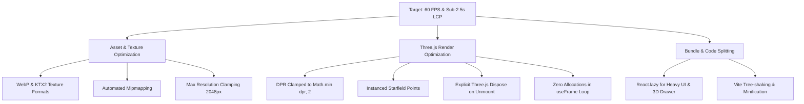

# SECURITY_AND_PERFORMANCE.md — Security Standards & WebGL Optimization Strategy

> **PROJECT**: Cosmic Portfolio — Rudra Tiwari  
> **DOCUMENT**: Security Hardening & Performance Optimization  
> **VERSION**: 1.0.0

---

## 1. Security Architecture & Threat Mitigation

Because this application serves as Rudra Tiwari's public engineering portfolio, security safeguards focus on **data privacy**, **XSS defense**, **spam mitigation**, and **resource protection**.

### Key Security Safeguards
1. **Privacy Protection & Zero Private PII**:
   * Personal telephone numbers, private residential addresses, and raw personal identifiers are strictly omitted.
   * Personal photographs are stripped of EXIF metadata (GPS coordinates, camera serial numbers, capture timestamps) before publication.
2. **Content Security Policy (CSP)**:
   * A restrictive CSP header is enforced while allowing WebGL shader compilation and Web Worker multi-threading:
   ```http
   Content-Security-Policy: default-src 'self'; script-src 'self' 'wasm-unsafe-eval'; style-src 'self' 'unsafe-inline'; img-src 'self' data: blob: https:; font-src 'self' data:; connect-src 'self'; worker-src 'self' blob:; object-src 'none'; frame-ancestors 'none';
   ```
3. **Contact Outreach via Direct Client Channels**:
   * Professional outreach is handled via client-side `mailto:` links, direct LinkedIn messaging, and GitHub links, eliminating intermediate server processing and database persistence.
4. **Zero Backend Attack Surface & Secrets Security**:
   * With 100% pure static frontend architecture, there are no database credentials, server endpoints, or backend secrets bundled into or exposed by the client.

---

## 2. Performance Engineering & WebGL Optimization

To maintain consistent 60 FPS rendering on modern laptops and 30-60 FPS on mobile devices, the graphics pipeline implements rigorous WebGL optimization techniques.



---

## 3. WebGL Budget & Execution Constraints

| Metric | Target Budget | Hard Maximum | Measurement Method |
| :--- | :--- | :--- | :--- |
| **Draw Calls (Overview)** | $\le 35$ | $50$ | `renderer.info.render.calls` |
| **Active Geometries** | $\le 20$ | $35$ | `renderer.info.memory.geometries` |
| **Active Textures** | $\le 15$ | $25$ | `renderer.info.memory.textures` |
| **Device Pixel Ratio** | $1.0 - 1.5$ | $2.0$ (Clamped) | `gl.setPixelRatio()` |
| **Frame Rate (Desktop)** | $60\text{ FPS}$ | $\ge 55\text{ FPS}$ | Chrome DevTools Performance |
| **Frame Rate (Mobile)** | $45-60\text{ FPS}$ | $\ge 30\text{ FPS}$ | Chrome Device Emulation |
| **Initial JS Bundle (Gzip)**| $\le 180\text{ KB}$ | $250\text{ KB}$ | Vite build analysis |
| **Total Assets on First Load**| $\le 3.5\text{ MB}$ | $5.0\text{ MB}$ | Network tab transfer size |

---

## 4. Texture & Asset Optimization Protocols

1. **Resolution Budget**:
   * Surya (Sun): $2048 \times 1024$ equirectangular emissive noise map.
   * Large Worlds (Guru, Shani): $2048 \times 1024$ diffuse and ring alpha PNG.
   * Medium Worlds (Mangal, Shukra): $1024 \times 512$ diffuse and normal maps.
   * Small Worlds (Budh, Rahu, Ketu): $512 \times 512$ or procedural shaders requiring zero texture downloads.
2. **Format Selection**:
   * All standard photographic and planetary surface assets are encoded as modern **WebP** images at $85\%$ quality, reducing transfer weight by $60-70\%$ compared to uncompressed JPEG/PNG.
3. **Mipmapping & Filtering**:
   * All planet textures utilize `texture.generateMipmaps = true` with `THREE.LinearMipmapLinearFilter` (trilinear filtering), eliminating high-frequency shimmering artifacts when planets orbit distantly.

---

## 5. Code Splitting & Lazy Loading

```typescript
// Lazy loading heavy components in App.tsx
import React, { Suspense, lazy } from 'react';

const UniverseCanvas = lazy(() => import('./components/3d/CanvasContainer'));
const WorldDrawer = lazy(() => import('./components/ui/WorldDrawer'));
const AccessiblePortfolioView = lazy(() => import('./components/fallback/AccessiblePortfolioView'));
```

* **Landing Screen Priority**: The landing screen renders instantly with pure HTML/CSS before the heavy WebGL engine finishes instantiating.
* **Component-Level Code Splitting**: Heavy detail drawers and project screenshot galleries are dynamically loaded only when a visitor approaches the corresponding world.

---

## 6. Accessibility (a11y) & Low-Motion Support

* **Reduced Motion Detection**:
  ```typescript
  const prefersReducedMotion = window.matchMedia('(prefers-reduced-motion: reduce)').matches;
  ```
  When active, orbital rotational velocity is paused or reduced to near zero, camera flight animations are replaced with instant gentle cross-fades, and a prominent badge offers the 2D Accessible Portfolio View.
* **Keyboard Focus Rings**: Custom Tailwind styling (`focus-visible:ring-2 focus-visible:ring-amber-400 focus-visible:outline-none`) ensures clear navigation cues for keyboard users without disrupting visual aesthetics for mouse users.

---

## 7. Cross-Browser & Device Compatibility

| Platform / Browser | Support Level | Rendering Mode | Notes |
| :--- | :--- | :--- | :--- |
| **Chrome / Edge (Desktop)** | Full (Tier 1) | 3D WebGL 2.0 (60 FPS) | Full shader support, ACES tone mapping |
| **Firefox (Desktop)** | Full (Tier 1) | 3D WebGL 2.0 (60 FPS) | Full shader support |
| **Safari (macOS)** | Full (Tier 1) | 3D WebGL 2.0 (60 FPS) | High DPI clamped to 2.0 |
| **iOS Safari (iPhone 11+)**| Full (Tier 1) | 3D WebGL 2.0 (45-60 FPS) | Touch controls, dynamic DPR |
| **Android Chrome (Modern)**| Full (Tier 1) | 3D WebGL 2.0 (30-60 FPS) | High-efficiency shader profile |
| **Legacy / No WebGL Devices**| Full (Tier 1) | 2D Semantic Portfolio | Instant automatic fallback |
