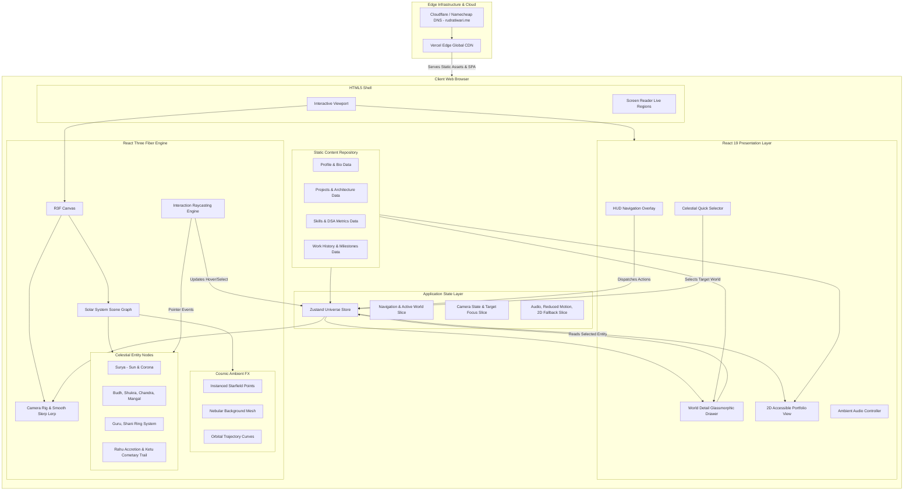
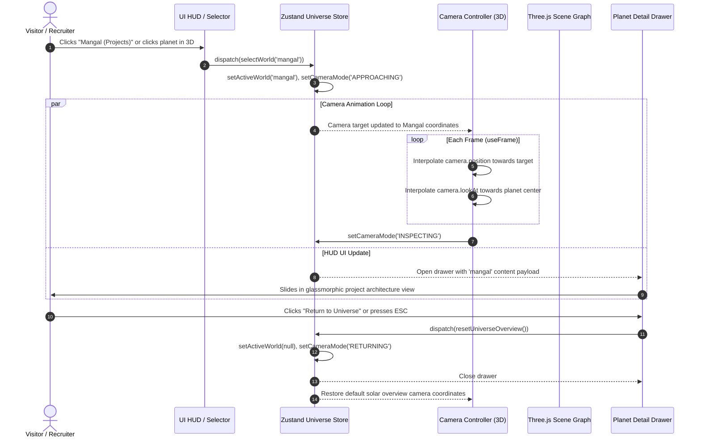

# SYSTEM_ARCHITECTURE.md — System Architecture & Component Model

> **PROJECT**: Cosmic Portfolio — Rudra Tiwari  
> **DOCUMENT**: System Architecture Specification  
> **VERSION**: 1.0.0

---

## 1. System Overview

**Cosmic Portfolio** is architected as an interactive, GPU-accelerated client-side web application built on modern web standards (WebGL 2.0, HTML5, ECMAScript 2024). The system models Rudra Tiwari's professional and personal journey as an autonomous celestial system with nine interactive worlds (inspired by the Vedic Grahas), governed by real-time orbital calculations, volumetric shaders, and a synchronized glassmorphic UI presentation layer.

The architecture prioritizes:
1. **Low Latency & High Frame Rates**: 60 FPS rendering on modern desktop and 30-60 FPS on mobile devices.
2. **Deterministic State Synchronization**: Strict decoupling between the 3D WebGL rendering tree and the 2D DOM user interface via a centralized reactive store.
3. **Graceful Degradation**: Dual-mode operational architecture featuring a full-featured 2D accessible fallback for non-WebGL devices or users requesting reduced motion.
4. **Zero-Backend Dependency for Core Experience**: Static JSON/TypeScript content bundles served from edge CDNs, eliminating runtime database latency and server maintenance overhead.

---

## 2. High-Level System Architecture Diagram

---

## 3. Component Responsibilities

| Subsystem | Primary Responsibilities | Key Technologies |
| :--- | :--- | :--- |
| **Canvas Container** | Hosts the WebGL context, handles viewport resizing, monitors frame loop (`useFrame`), configures tone mapping and shadows. | R3F (`@react-three/fiber`), Three.js |
| **Camera Controller** | Manages camera coordinate interpolation (slerp/lerp) between distant solar system overview and planetary orbital approach coordinates. | Three.js `PerspectiveCamera`, OrbitControls, custom math utilities |
| **Celestial Entities** | Renders distinct geometry, materials, and custom GLSL shaders for Sun, planets, rings, and non-physical phenomena (Rahu/Ketu). | Three.js Mesh, InstancedMesh, ShaderMaterial |
| **Raycast Handler** | Translates 2D pointer coordinates into 3D hit targets, managing hover states, cursor changes, and selection clicks. | Three.js Raycaster, R3F pointer events |
| **HUD & Navigation** | Provides persistent top-level navigation, search/filter, celestial world selector, resume download, and contact triggers. | React 19, Tailwind CSS, Lucide icons |
| **World Detail Drawer** | Displays rich content (projects, skills, career timeline, philosophy, reflections) in a glassmorphic sliding panel. | Framer Motion, Tailwind CSS, Lucide icons |
| **Universe Store** | Central reactive state authority managing active world, camera status, drawer visibility, reduced-motion preferences, and sound. | Zustand |
| **Content Repository** | Strongly typed, static single-source-of-truth holding all facts, metrics, and narratives for Rudra Tiwari. | TypeScript, Static Data |
| **2D Fallback View** | Full semantic HTML representation of the portfolio ensuring accessibility compliance and zero-WebGL compatibility. | React 19, Semantic HTML5, Tailwind CSS |

---

## 4. End-to-End Data Flow

---

## 5. Architectural Boundaries: Pure Frontend Single-Page Application (Zero Backend)

The system is strictly designed as a **100% client-side, pure frontend architecture**. No backend server, database, or API layer is implemented or required:

* **Static Edge Delivery**: The complete application bundle (HTML, JS, CSS, 3D shaders, textures, and content data) is served statically via edge CDN (Vercel).
* **Decoupled Content Data**: All facts, projects, skills, education, and milestones reside in strongly typed TypeScript static files under `src/data/`.
* **Zero Runtime Server Costs & Zero Cold Starts**: Eliminating a backend guarantees 100% uptime, zero database downtime risk, zero server maintenance overhead, and instant initial loading.
* **Direct Contact Flow**: Contact inquiries and professional outreach are handled entirely on the client through direct `mailto:` links, LinkedIn messaging, and GitHub profile connections, with zero intermediate backend hops.

---

## 6. External Services & Cloud Infrastructure

* **Vercel Edge Platform**:
  * Global CDN distribution with edge asset caching.
  * Automated branch deployments and preview links on pull requests.
  * Automatic SSL/TLS certificate renewal.
* **Domain Name System (DNS)**:
  * Apex domain (`rudratiwari.me`) mapped via `A` record (`76.76.21.21`).
  * Subdomain (`www.rudratiwari.me`) mapped via `CNAME` (`cname.vercel-dns.com`).
* **Source Control & CI/CD**:
  * GitHub repository holding all source code and documentation.
  * GitHub Actions running automated type checks, unit tests, and production build checks.

---

## 7. Key Technical Trade-Offs

| Decision Area | Option Selected | Alternative Considered | Rationale for Selection |
| :--- | :--- | :--- | :--- |
| **3D Rendering Library** | React Three Fiber (R3F) + Drei | Vanilla Three.js | Declarative component hierarchy matches React; automated lifecycle management; native Zustand integration. |
| **Scale Representation** | Stylized Accessible Orbits | True Astronomical Scale | Real astronomical distances make planets invisible dots or require unnavigable camera scales. Stylized orbits prioritize portfolio usability while retaining astronomical feel. |
| **State Management** | Zustand | Redux Toolkit / React Context | Zero boilerplate, tiny footprint (< 1KB), outside-React subscriber support for high-frequency `useFrame` reads. |
| **Content Delivery** | Static TypeScript Data Store | Headless CMS / Database API | Eliminates API cold starts, hosting costs, and network failures; enables static type-checking across all portfolio entries. |
| **Accessibility Strategy** | Dual-Mode (3D + 2D Fallback) | 3D Only / Text Alternatives | Guarantees compliance with WCAG 2.1 AA and full usability on low-power devices, screen readers, and slow connections. |
