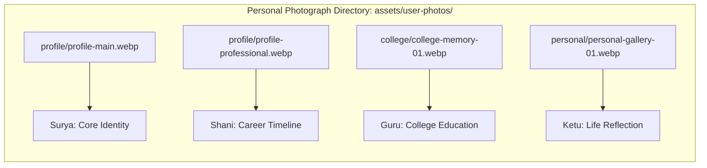

# ASSET_MAPPING.md — Asset Manifest, Directory Mapping & Specifications

> **PROJECT**: Cosmic Portfolio — Rudra Tiwari  
> **DOCUMENT**: Visual Asset Registry & Image Pipeline  
> **VERSION**: 1.0.0

---

## 1. Asset Policy & Verification Protocols

1. **Authenticity Guarantee**:
   * Personal photographs will be provided directly by **Rudra Tiwari**.
   * **AI-generated fake portraits and stock models claiming to be Rudra are strictly prohibited.**
   * Structured placeholder cards are utilized until real images are provided.
2. **Privacy Standards**:
   * All uploaded photographs are stripped of sensitive EXIF metadata (camera serial, GPS coordinates, local timestamps).
3. **Format & Performance Standard**:
   * Primary image format: Modern **WebP** ($85\%$ quality compression).
   * Alpha transparency format: WebP or optimized PNG.
   * Responsive srcset configurations provided for standard ($1\times$) and Retina ($2\times$) displays.

---

## 1. UI Reference & Master Design Layouts

The user interface follows the authentic 4-panel visual specification saved under `assets/`:
* `assets/ui-reference.jpg`: The master 4-view design composite.
* `assets/reference/01-landing-hero.jpg`: Reference for Scene 1 (Cinematic landing, traveler silhouette, hero typography, Enter Universe CTA).
* `assets/reference/02-universe-solar-system.jpg`: Reference for Scene 2 (3D Solar system overview with labeled concentric orbits and right HUD tools).
* `assets/reference/03-surya-detail-view.jpg`: Reference for Surya deep-dive (Left Sun close-up, right glassmorphic drawer with photo, bio, education/CGPA/experience chips, resume and contact buttons).
* `assets/reference/04-mangal-projects-view.jpg`: Reference for Mangal deep-dive (Left Mars close-up, right project filter pills, project cards with tech tags and links).

---

## 2. Personal Photographs Mapping Manifest



### Detailed Photograph Specifications

| Asset Filename | Directory Path | Associated World | Target Dimensions | Aspect Ratio | Format | Max Size | Alt Text Description | Status |
| :--- | :--- | :--- | :--- | :--- | :--- | :--- | :--- | :--- |
| `profile-main.webp` | `assets/user-photos/profile/` | **Surya** (Core Identity) | $800 \times 800\text{ px}$ | $1:1$ Square | WebP | $120\text{ KB}$ | "Professional portrait of Rudra Tiwari, Software Engineer" | **Extracted & Ready** |
| `profile-professional.webp` | `assets/user-photos/profile/` | **Shani** (Career Timeline) | $1200 \times 800\text{ px}$ | $3:2$ Landscape | WebP | $160\text{ KB}$ | "Rudra Tiwari working at software engineering workstation" | *Placeholder Created* |
| `college-memory-01.webp` | `assets/user-photos/college/` | **Guru** (Education & Academics) | $1200 \times 800\text{ px}$ | $3:2$ Landscape | WebP | $180\text{ KB}$ | "Rudra Tiwari on campus at ABES Engineering College" | *Placeholder Created* |
| `personal-gallery-01.webp` | `assets/user-photos/personal/` | **Ketu** (Space of Reflection) | $1200 \times 800\text{ px}$ | $3:2$ Landscape | WebP | $170\text{ KB}$ | "Scenic exploration and personal moment of reflection" | *Placeholder Created* |

---

## 3. Planetary 3D Textures & Procedural Shaders

| Celestial Body | Asset Name | Intended Location | Resolution | Format | Provenance / Technique | Status |
| :--- | :--- | :--- | :--- | :--- | :--- | :--- |
| **Surya** | `sun_surface.webp` | `assets/textures/planets/` | $2048 \times 1024$ | WebP | Procedural GLSL Simplex Noise Shader + Emissive Map (NASA SDO reference) | *Shader Defined* |
| **Budh** | `mercury_surface.webp` | `assets/textures/planets/` | $1024 \times 512$ | WebP | NASA Messenger open-source planetary elevation map | *Configured* |
| **Shukra** | `venus_atmosphere.webp` | `assets/textures/planets/` | $1024 \times 512$ | WebP | NASA Magellan cloud radar map + Custom Fresnel GLSL | *Configured* |
| **Mangal** | `mars_surface.webp` | `assets/textures/planets/` | $1024 \times 512$ | WebP | USGS Astrogeology Mars Viking color mosaic | *Configured* |
| **Guru** | `jupiter_surface.webp` | `assets/textures/planets/` | $2048 \times 1024$ | WebP | NASA Cassini / Juno spacecraft global mosaic | *Configured* |
| **Shani** | `saturn_surface.webp` | `assets/textures/planets/` | $2048 \times 1024$ | WebP | NASA Cassini global map | *Configured* |
| **Shani Rings** | `saturn_rings.png` | `assets/textures/planets/` | $1024 \times 64$ | PNG (Alpha) | Radial UV Cassini ring geometry + luminous procedural banding | *Configured* |
| **Rahu** | `rahu_accretion.webp` | `assets/textures/planets/` | $512 \times 512$ | WebP / GLSL | Custom procedural relativistic lensing shader | *Shader Defined* |
| **Ketu** | `ketu_comet_sprite.webp`| `assets/textures/planets/` | $256 \times 256$ | WebP (Alpha) | Custom particle sprite with decaying exponential falloff | *Shader Defined* |

---

## 4. Cosmic Background & Environment Assets

| Asset Name | Target Directory | Resolution | Format | Purpose | Status |
| :--- | :--- | :--- | :--- | :--- | :--- |
| `star_particle.webp` | `assets/textures/backgrounds/` | $64 \times 64$ | WebP | Gaussian falloff point sprite for 4,500-star instanced starfield | *Configured* |
| `nebula_cubemap/` | `assets/textures/backgrounds/` | $6 \times (1024 \times 1024)$ | WebP | Deep space dark violet and teal background skybox | *Configured* |
| `celestial_insignias.svg` | `assets/icons/` | Vector SVG | SVG | Custom minimalist geometric icons for the 8 Grahas | *Configured* |

---

## 5. Asset Directory Tree Structure

```text
assets/
├── user-photos/
│   ├── profile/
│   │   ├── profile-main.webp
│   │   └── profile-professional.webp
│   ├── college/
│   │   └── college-memory-01.webp
│   ├── achievements/
│   │   └── achievement-cricket.webp
│   └── personal/
│       ├── profile-personal.webp
│       └── personal-gallery-01.webp
├── planets/
│   ├── README.md
│   └── saturn_rings.png
├── textures/
│   └── README.md
├── backgrounds/
│   └── README.md
└── icons/
    └── README.md
```
