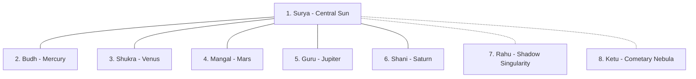

# CELESTIAL_DESIGN_GUIDE.md — Detailed Specification for the Eight Celestial Worlds

> **PROJECT**: Rudra Tiwari - Cosmic portfolio  
> **DOCUMENT**: Celestial Design Specification (8 Grahas)  
> **VERSION**: 2.0.0

---

## 1. Cosmic Conceptual Framework

The portfolio interprets the Grahas of Vedic cosmology as **creative allegorical lenses** to showcase Rudra Tiwari's life, engineering career, and technological depth. They do not present astrological predictions, but rather establish a unified, culturally rooted narrative architecture:

*Note: Chandra (Moon / Personal Life) was decommissioned to streamline the portfolio focus entirely on engineering excellence, technical architecture, and verified career milestones.*

---

## 2. World-by-World Comprehensive Specifications

---

### 1. SURYA — The Core Identity
* **Astronomical Analog**: Central Sun (G-type main-sequence star).
* **Vedic Allegory**: Atman (The Self), vital energy, source of light, core identity.
* **Portfolio Representation**: Biography, engineering identity, foundational values, ambitions, resume gateway, and direct contact (`rudra.tiwari.4141@gmail.com`).
* **Surface & Visual Appearance**:
  * Intense emissive core sphere with an animated multi-frequency procedural GLSL corona.
  * Solar flare prominences arching outward using additive particle sprites.
* **Color Palette**:
  * Core: Incandescent White (`#fef08a`)
  * Primary Corona: Solar Gold (`#f59e0b`)
  * Outer Flare: Ember Orange (`#ea580c`)
* **Lighting Role**: Central `PointLight` (800 lumens) casting physical shadows across the entire planetary system.
* **Orbital Position**: Focus of the universe `(0, 0, 0)`. Stationary with slow axial rotation.
* **Information Panel Content**:
  * Full developer biography, tagline (*"Engineer. Explorer. Creator."*), and quote.
  * Core values: Clean architecture, reliability, continuous learning.
  * Downloadable Resume button (PDF).
  * Direct contact modal and social links (GitHub, LinkedIn).

---

### 2. BUDH — The Intelligence Network
* **Astronomical Analog**: Mercury (The Swift Messenger).
* **Vedic Allegory**: Buddhi (Intellect), analytical agility, communication, computational logic.
* **Portfolio Representation**: Technical skills, programming languages, backend frameworks, data structures & algorithms (**1,200+ solved**, **600+ LeetCode**, **Rating: 1812**).
* **Surface & Visual Appearance**:
  * Gray basalt surface with high specular sharpness and impact crater normal maps.
  * Rapid axial spin and swift orbital velocity.
* **Color Palette**:
  * Surface: Cool Basalt Gray (`#94a3b8`)
  * Data Matrix Accent: Electric Cyan (`#06b6d4`)
* **Orbital Parameters**: Semi-major axis $a = 2.0$, semi-minor axis $b = 1.996$, eccentricity $e = 0.06$.
* **Information Panel Content**:
  * Core languages: Java, Python, SQL, JavaScript, TypeScript.
  * Frameworks & Systems: Spring Boot, Spring AI, FastAPI, Kafka, Microservices.
  * Competitive Programming achievements: LeetCode contest rating 1812, 1,200+ total problems solved across platforms.

---

### 3. SHUKRA — Creativity & Aesthetics
* **Astronomical Analog**: Venus (The Morning & Evening Star).
* **Vedic Allegory**: Shukra (Beauty, art, refinement, sensory grace).
* **Portfolio Representation**: Visual engineering, UI/UX design systems, Claymorphism, glassmorphism, 3D GSAP animations, WCAG AAA accessibility contrast, and BarterNow analytics dashboards.
* **Surface & Visual Appearance**:
  * Dense swirling golden atmosphere with iridescent Fresnel rim glow.
  * Differential atmosphere cloud rotation and slow retrograde spin.
* **Color Palette**:
  * Atmospheric Base: Pale Amber (`#fbbf24`)
  * Rim Glow: Iridescent Honey Gold (`#fef08a`)
* **Orbital Parameters**: Semi-major axis $a = 3.1$, semi-minor axis $b = 3.097$, eccentricity $e = 0.04$.
* **Information Panel Content**:
  * Interactive design system showcase (`ShukraDesignContent.tsx`).
  * Claymorphism & glassmorphism component breakdowns.
  * 3D GSAP animation controls and accessibility compliance metrics.

---

### 4. MANGAL — The World of Action
* **Astronomical Analog**: Mars (The Red Planet).
* **Vedic Allegory**: Mangala (Energy, courage, execution, tangible accomplishment).
* **Portfolio Representation**: Software engineering projects, technical demonstrations, system architecture breakdowns, and GitHub repositories.
* **Surface & Visual Appearance**:
  * Iron oxide rust-red terrain with canyon relief, basalt highlands, and subtle atmospheric dust haze.
* **Color Palette**:
  * Primary Surface: Rust Red (`#ef4444` / `#b91c1c`)
  * Canyon Shadow: Dark Mahogany (`#450a0a`)
* **Orbital Parameters**: Semi-major axis $a = 3.8$, semi-minor axis $b = 3.791$, eccentricity $e = 0.07$.
* **Information Panel Content**:
  * **NL-2-DB**: NVIDIA NIM + LangGraph multi-stage SQL pipeline with SELECT-only security guardrails.
  * **AI Log Investigator**: Spring AI error analysis platform triaging production exceptions with root-cause summaries.
  * **BarterNow**: AI-driven two-sided marketplace matching brands with event organizers.
  * **Food Delivery System**: Concurrency-tested ordering platform with distributed caching.

---

### 5. GURU — Knowledge & Wisdom
* **Astronomical Analog**: Jupiter (The Gas Giant).
* **Vedic Allegory**: Guru/Brihaspati (Wisdom, higher learning, scholarship, institutional mentorship).
* **Portfolio Representation**: Academic foundation (**B.Tech CSE, AKTU / ABES Engineering College, 8.02 CGPA**), National Means-cum-Merit Scholarship, and official Oracle certifications.
* **Surface & Visual Appearance**:
  * Massive scale ($0.52$ units base radius) with turbulent parallel cloud belts and rotating Great Red Spot storm vortex.
* **Color Palette**:
  * Jovian Belts: Cream Gold (`#fde047` / `#ca8a04`)
  * Storm Vortex: Ocher Amber (`#b45309`)
* **Orbital Parameters**: Semi-major axis $a = 4.5$, semi-minor axis $b = 4.494$, eccentricity $e = 0.05$.
* **Information Panel Content**:
  * Academic tenure: B.Tech CSE at ABES Engineering College (8.02 CGPA, graduated May 2026).
  * National Means-cum-Merit Scholarship.
  * Official Oracle Certifications:
    - **Oracle Certified Associate Cloud Infrastructure 2025 Agentic AI** (Badge ID: `7BA8D764E39E938D6DFDD2DCAB8FB79691641BB4172B812392D5A4DDE37483AB`).
    - **Oracle Cloud Infrastructure 2024 Generative AI Certified Professional** (Cert ID: `100785002OCI24GAIOCP`).

---

### 6. SHANI — The Timeline of Karma
* **Astronomical Analog**: Saturn (The Ringed Titan).
* **Vedic Allegory**: Shani (Discipline, persistence, time, responsibility, professional duty).
* **Portfolio Representation**: Professional software engineering work experience at **Salescode AI**, enterprise auth architectures, OpenTelemetry observability, and key career milestones.
* **Surface & Visual Appearance**:
  * Pale golden banded sphere with custom radial UV Cassini rings ($u \in [0, 1]$ from inner to outer ring) with high-reflectance B-ring, dark Cassini gap, and warm emissive glow (`#e5ce98`).
* **Color Palette**:
  * Planet Body: Warm Ochre (`#f59e0b` / `#d97706`)
  * Cassini Rings: Luminous Champagne Gold (`#e5ce98`)
* **Orbital Parameters**: Semi-major axis $a = 6.7$, semi-minor axis $b = 6.691$, eccentricity $e = 0.05$.
* **Information Panel Content**:
  * Production software engineering tenure at Salescode AI.
  * Enterprise SSO & OAuth 2.0 authentication adopted across 10 microservices.
  * OpenTelemetry distributed tracing and client onboarding automation for 7 LOBs (~2 hour setup).
  * Self-service Authentication Configuration Portal adopted across 10 business lines.
  * Multi-device login support with concurrent session management and device-level revocation.

---

### 7. RAHU — The Frontier of Innovation
* **Astronomical Analog**: Shadow Singularity / Gravitational Anomaly.
* **Vedic Allegory**: Rahu (Ambition, disruption, unconventional boundaries, the technological frontier).
* **Portfolio Representation**: Generative AI, autonomous multi-agent workflows (LangGraph), Retrieval-Augmented Generation (RAG), vector databases, and AI security guardrails.
* **Surface & Visual Appearance**:
  * Pitch-black spherical event horizon absorbing all light, surrounded by a swirling violet-cyan relativistic accretion disk.
* **Color Palette**:
  * Horizon Core: Absolute Void (`#020205`)
  * Accretion Swirl: Deep Violet (`#6366f1` / `#4f46e5`) & Neon Cyan (`#06b6d4`)
* **Orbital Parameters**: Semi-major axis $a = 7.8$, semi-minor axis $b = 7.780$, eccentricity $e = 0.07$.
* **Information Panel Content**:
  * Interactive LangGraph multi-agent orchestration architecture (`RahuGenAIContent.tsx`).
  * Vector retrieval pipelines (embeddings, hybrid search, reranking).
  * LLM guardrails and prompt safety enforcement.

---

### 8. KETU — The Space of Reflection
* **Astronomical Analog**: Cometary Nebula / Ethereal Plume.
* **Vedic Allegory**: Ketu (Liberation, introspection, inner wisdom, non-attachment, resilience).
* **Portfolio Representation**: Engineering philosophy, resilience through setbacks, root-cause learning, and personal principles beyond code.
* **Surface & Visual Appearance**:
  * Ethereal cometary nucleus trailing an expansive, translucent particle plume in mystic teal and smoky cyan.
* **Color Palette**:
  * Cometary Nucleus: Bright Mystic Teal (`#14b8a6`)
  * Trailing Plume: Deep Smoky Cyan (`#042f2e` / `#0f766e`)
* **Orbital Parameters**: Semi-major axis $a = 9.1$, semi-minor axis $b = 9.071$, eccentricity $e = 0.08$.
* **Information Panel Content**:
  * Lessons learned from production incidents, failed prototypes, and architectural refactoring.
  * Core engineering principles: Simplicity, resilience, clarity over cleverness.
  * Values beyond technology: Integrity, persistence, long-term craftsmanship.
