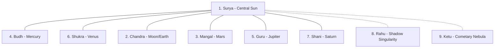

# CELESTIAL_DESIGN_GUIDE.md — Detailed Specification for the Nine Celestial Worlds

> **PROJECT**: Cosmic Portfolio — Rudra Tiwari  
> **DOCUMENT**: Celestial Design Specification (9 Grahas)  
> **VERSION**: 1.0.0

---

## 1. Cosmic Conceptual Framework

The portfolio interprets the nine Grahas of Vedic cosmology as **creative allegorical lenses** to showcase Rudra Tiwari's life and engineering career. They do not present astrological predictions, but rather establish a unified, culturally rooted narrative architecture.

---

## 2. World-by-World Comprehensive Specifications

---

### 1. SURYA — The Core Identity
* **Astronomical Analog**: Central Sun (G-type main-sequence star).
* **Vedic Allegory**: Atman (The Self), vital energy, source of light, core identity.
* **Portfolio Representation**: Biography, engineering identity, foundational values, ambitions, resume gateway, and contact.
* **Surface & Visual Appearance**:
  * Intense emissive core sphere with an animated multi-frequency procedural GLSL corona.
  * Solar flare prominences arching outward using additive particle sprites.
* **Color Palette**:
  * Core: Incandescent White (`#fef08a`)
  * Primary Corona: Solar Gold (`#f59e0b`)
  * Outer Flare: Ember Orange (`#ea580c`)
* **Lighting Role**: Central `PointLight` (800 lumens) casting physical shadows across the entire planetary system.
* **Orbital Coordinates**: Center of universe `(0, 0, 0)`. Stationary with slow axial rotation.
* **Hover Behavior**: Corona expands by 15%, flares accelerate in speed, floating HUD tag reads `SURYA — Core Identity`.
* **Selection / Travel**: Camera glides to `(0, 15, 35)`, facing the sun with a subtle bloom lens-flare shader.
* **Information Panel Content**:
  * Full developer biography and introduction.
  * Core engineering values: Clean architecture, reliability, continuous learning.
  * Downloadable Resume button (PDF).
  * Direct contact modal and social links (GitHub, LinkedIn).

---

### 2. CHANDRA — The Inner Universe
* **Astronomical Analog**: The Moon / Earth System.
* **Vedic Allegory**: Manas (The Mind), emotions, memory, inner tranquility, community.
* **Portfolio Representation**: Personal life, hobbies, college experiences, cricket championship victory, memories, and reflections.
* **Surface & Visual Appearance**:
  * Cratered silver-slate topography with high-contrast basalt maria and fine lunar dust specular highlights.
  * Faint cool-blue atmospheric fringe shader.
* **Color Palette**:
  * Surface: Silver Slate (`#cbd5e1` / `#94a3b8`)
  * Atmospheric Haze: Soft Azure (`#38bdf8`, 25% opacity)
* **Orbital Parameters**: Semi-major axis $48.0$, period $38s$, inclination $2.2^\circ$.
* **Hover Behavior**: Lunar maria emit a subtle pearlescent shimmer; HUD tag reads `CHANDRA — Inner Universe`.
* **Selection / Travel**: Camera orbits to an oblique angle capturing the illuminated crescent and soft shadow falloff.
* **Information Panel Content**:
  * College life at ABES Engineering College beyond academics.
  * Sports triumph: College Cricket Tournament Winner (teamwork, strategy, and pressure management).
  * Hobbies, reading, tech explorations, and personal inspirations.
  * Photo gallery placeholders: `assets/user-photos/college/` and `achievements/`.

---

### 3. MANGAL — The World of Action
* **Astronomical Analog**: Mars (The Red Planet).
* **Vedic Allegory**: Tejas / Shakti (Drive, energy, courage, execution, tangible action).
* **Portfolio Representation**: Production software projects, engineering accomplishments, architecture blueprints, coding demonstrations, and GitHub repositories.
* **Surface & Visual Appearance**:
  * High-relief iron oxide rust-red topography with deep rift canyons (Valles Marineris analog) and Olympus-scale volcanic plateaus.
  * Faint reddish-amber dust storm haze.
* **Color Palette**:
  * Surface: Crimson Terracotta (`#dc2626` / `#b91c1c`)
  * Shadow Valleys: Deep Burnt Ochre (`#7f1d1d`)
* **Orbital Parameters**: Semi-major axis $62.0$, period $48s$, inclination $1.8^\circ$.
* **Hover Behavior**: Canyon crevices glow with vibrant crimson data-circuit lines; HUD tag reads `MANGAL — World of Action`.
* **Selection / Travel**: Camera swoops close to the canyon rim.
* **Information Panel Content**:
  * **NL-2-DB: Natural Language to Database Query System**: Python, FastAPI, NVIDIA NIM, LangChain, LangGraph, RAG, SQL. Multi-stage query orchestration and SELECT-only security proxy.
  * **AI-Powered Log Investigation System (Salescode AI)**: Java, Spring Boot, Spring AI, LangGraph, SQL. Contextual failure analysis and root-cause summarization.
  * **BarterNow: AI-Powered Sponsorship Platform**: Python, FastAPI, React, Express.js, Prisma, Razorpay. Two-sided AI recommendation engine and real-time ROI analytics.
  * **Food Delivery System**: React, Spring Boot, SQL full-stack ordering platform with real-time tracking.

---

### 4. BUDH — The Intelligence Network
* **Astronomical Analog**: Mercury (The Swift Messenger).
* **Vedic Allegory**: Buddhi (Intellect, analytical reasoning, communication, rapid agility).
* **Portfolio Representation**: Programming languages, frameworks, system design, data structures & algorithms (~600+ LeetCode, Rating: 1812, ~1,200 total solved), and technical problem-solving.
* **Surface & Visual Appearance**:
  * Heavily cratered silvery-bronze metallic crust with high specular reflectivity.
  * Fast axial spin and rapid orbital velocity.
* **Color Palette**:
  * Surface: Quicksilver Cyan (`#06b6d4`) & Polished Graphite (`#475569`)
  * Data Pulses: Neon Teal (`#22d3ee`)
* **Orbital Parameters**: Semi-major axis $22.0$ (closest orbit), period $18s$, inclination $4.0^\circ$.
* **Hover Behavior**: Orbit trajectory pulses with neon blue data packets; HUD tag reads `BUDH — Intelligence Network`.
* **Selection / Travel**: Camera glides into close proximity, matching its swift orbital velocity.
* **Information Panel Content**:
  * Languages: Java, Python, SQL, JavaScript, TypeScript.
  * Backend & Architecture: Spring Boot, Spring AI, FastAPI, Microservices, Kafka, Node.js.
  * Observability: OpenTelemetry, Distributed Tracing, Structured Logging.
  * Databases: MySQL, PostgreSQL, MongoDB, Redis.
  * DSA Milestones: 600+ LeetCode problems solved (Rating: 1812), 1,200+ problems across competitive platforms.
  * Developer Tools: Claude Code, Cursor, GitHub Copilot.

---

### 5. GURU — Knowledge and Wisdom
* **Astronomical Analog**: Jupiter (The King of Planets).
* **Vedic Allegory**: Brihaspati (The Guru, mentor, higher wisdom, formal knowledge, expansion).
* **Portfolio Representation**: Academic foundation, university degree, Oracle certifications, national scholarship honors, and continuous learning.
* **Surface & Visual Appearance**:
  * Immense gas giant scale (largest planetary body).
  * Complex atmospheric bands swirling in opposite directions via a procedural flow shader.
  * Prominent storm vortex (Great Red Spot analog).
* **Color Palette**:
  * Atmospheric Bands: Saffron Amber (`#d97706`), Warm Gold (`#f59e0b`), Sandstone Cream (`#fde68a`)
* **Orbital Parameters**: Semi-major axis $82.0$, period $68s$, inclination $1.3^\circ$.
* **Hover Behavior**: Atmospheric bands accelerate differential rotation; HUD tag reads `GURU — Knowledge & Wisdom`.
* **Selection / Travel**: Wide-angle camera view capturing the majestic curvature of the massive gas giant.
* **Information Panel Content**:
  * **Formal Education**: B.Tech in Computer Science and Engineering from Dr. A.P.J. Abdul Kalam Technical University (AKTU) / ABES Engineering College, Ghaziabad (2022–2026, CGPA 8.02/10).
  * **National Honors**: Recipient of the **National Means-cum-Merit Scholarship** (prestigious merit-based national scholarship for academic excellence).
  * **Industry Certifications**:
    * Oracle Agentic AI Certified Foundations Associate
    * Oracle Cloud Infrastructure Certified Generative AI Professional
  * Lifelong learning philosophy, technical books, and academic milestones.

---

### 6. SHUKRA — Creativity and Aesthetics
* **Astronomical Analog**: Venus (The Morning Star).
* **Vedic Allegory**: Shukra (Beauty, refined craft, artistic vision, sensory elegance).
* **Portfolio Representation**: UI/UX design experiments, interactive frontend design systems, creative coding, and aesthetic engineering.
* **Surface & Visual Appearance**:
  * Shimmering, dense sulfuric cloud canopy with iridescent Fresnel limb scattering.
  * Soft golden-rose radiance illuminating surrounding space.
* **Color Palette**:
  * Cloud Canopy: Radiant Dawn Rose (`#ec4899`), Opalescent Peach (`#f472b6`), Sunset Champagne (`#fbcfe8`)
* **Orbital Parameters**: Semi-major axis $34.0$, period $28s$, inclination $3.4^\circ$.
* **Hover Behavior**: Cloud canopy shifts colors through a subtle chromatic dispersion shader; HUD tag reads `SHUKRA — Creativity & Aesthetics`.
* **Selection / Travel**: Camera drifts slowly alongside the shimmering cloud layer.
* **Information Panel Content**:
  * Design system philosophy (Cosmic Minimalist design tokens).
  * UI/UX experimentation, micro-animations, glassmorphism principles.
  * Creative coding demonstrations and interactive canvas components.

---

### 7. SHANI — The Timeline of Karma
* **Astronomical Analog**: Saturn (The Ringed Wonder).
* **Vedic Allegory**: Shani (Karma, discipline, time, patience, enduring effort, professional mastery).
* **Portfolio Representation**: Professional engineering experience (~10 months in production), enterprise workflows, career timeline, engineering rigor, and lessons learned.
* **Surface & Visual Appearance**:
  * Banded pale-gold gas surface surrounded by an extensive, high-resolution concentric ring system.
  * Ring system casts realistic volumetric shadows onto the planet's northern hemisphere.
* **Color Palette**:
  * Planet: Muted Bronze (`#a8a29e`), Golden Sand (`#d97706`)
  * Rings: Translucent Ice-Dust & Carbon Charcoal (`#e2e8f0` / `#475569`)
* **Orbital Parameters**: Semi-major axis $104.0$, period $92s$, inclination $2.5^\circ$.
* **Hover Behavior**: Ring particles shimmer with golden glints; HUD tag reads `SHANI — Timeline of Karma`.
* **Selection / Travel**: Cinematic oblique camera angle looking across the planar expanse of the rings.
* **Information Panel Content**:
  * **Role**: Software Engineer at **Salescode AI** (Gurugram, India, Oct 2025 – Sept 2026).
  * **Production Microservices**: Java/Spring Boot services and REST APIs for authentication, onboarding, password recovery, and loyalty workflows.
  * **SSO & OAuth 2.0**: Reusable token issuance, refresh/revocation, and session validation layer adopted across 10 services.
  * **OpenTelemetry Observability**: Structured logging, distributed tracing, and automated onboarding for 7 clients/LOBs reducing setup to ~2 hours.
  * **Authentication Configuration Portal**: Proactively engineered self-service portal adopted by 10 LOBs with zero backend code changes.
  * **Multi-Device Login & Session Security**: Concurrent session management, per-device token issuance, and device-level revocation across web, mobile, and tablet.

---

### 8. RAHU — The Frontier of Innovation
* **Astronomical Analog**: Lunar North Node (Shadow Node / Non-physical Astronomical Crossing).
* **Vedic Allegory**: Rahu (Ambition, the unconventional, technological obsession, future frontiers).
* **Portfolio Representation**: Generative AI, autonomous AI agents, Retrieval-Augmented Generation (RAG), vector databases, and bleeding-edge tech experiments.
* **Surface & Visual Appearance**:
  * **Not a physical planet**: Rendered as a mysterious cosmic singularity / gravitational lensing black hole.
  * Pure pitch-black event horizon surrounded by a rapidly rotating, ultraviolet-indigo accretion disc.
* **Color Palette**:
  * Event Horizon: Void Black (`#020205`)
  * Accretion Disc: Electric Indigo (`#6366f1`), Deep Violet (`#4f46e5`), Singularity Blue (`#38bdf8`)
* **Orbital Parameters**: Semi-major axis $126.0$, period $115s$, inclination $5.1^\circ$.
* **Hover Behavior**: Accretion disc emits relativistic light distortion rings; HUD tag reads `RAHU — Frontier of Innovation`.
* **Selection / Travel**: Camera locks into a stable orbit around the event horizon.
* **Information Panel Content**:
  * **Agentic Workflows**: LangGraph multi-stage query generation, schema validation, and controlled execution.
  * **NVIDIA NIM & LLM Integration**: Fast inference with FastAPI for natural language to database translation (NL-2-DB).
  * **Spring AI Log Investigation**: Contextual root-cause summarization and failure analysis using Spring AI with SQL proxy security.
  * **Two-Sided AI Recommendation Systems**: BarterNow AI matchmaker engine connecting brands with event organizers.

---

### 9. KETU — The Space of Reflection
* **Astronomical Analog**: Lunar South Node (Cometary / Nebular Celestial Anomaly).
* **Vedic Allegory**: Ketu (Moksha, introspection, spiritual liberation, wisdom derived from detachment and setbacks).
* **Portfolio Representation**: Personal philosophy, resilience through setbacks, ethical engineering, life principles beyond technical metrics.
* **Surface & Visual Appearance**:
  * **Not a physical planet**: Rendered as an ethereal glowing cometary nucleus trailing a long, luminous particle nebula.
  * Wisp-like smoke luminescence drifting across the starfield.
* **Color Palette**:
  * Nucleus: Mystic Emerald Teal (`#14b8a6`)
  * Cometary Plume: Ethereal Cyan (`#0d9488`), Ghostly Jade (`#042f2e`)
* **Orbital Parameters**: Semi-major axis $148.0$ (outermost orbit), period $140s$, inclination $6.2^\circ$.
* **Hover Behavior**: Nebula particles disperse and reform in gentle swirling waves; HUD tag reads `KETU — Space of Reflection`.
* **Selection / Travel**: Camera floats alongside the undulating cometary tail.
* **Information Panel Content**:
  * Personal reflections: Values that guide engineering decisions beyond mere code output.
  * Resilience: How setbacks, bugs, and failures sharpen architectural discipline.
  * Long-term perspective: Building technology that serves genuine human value.
