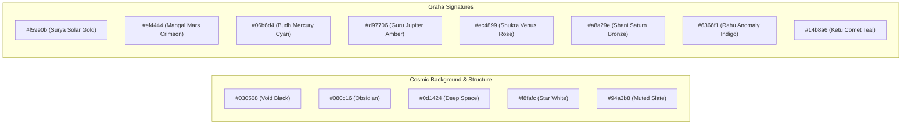

# DESIGN_SYSTEM.md — Cosmic Design System & Visual Tokens

> **PROJECT**: Cosmic Portfolio — Rudra Tiwari  
> **DOCUMENT**: Visual Language & UI Token Specification  
> **VERSION**: 1.0.0

---

## 1. Design Philosophy: Space Exploration Meets Minimalist Tech

The design system merges **deep-space astronomical realism** with a **refined, minimalist developer aesthetic**. 

### Core Aesthetic Pillars
1. **Cosmic Darkness**: The background is never flat charcoal or washed-out gray; it uses deep, rich cosmic blacks (`#030508`, `#080c16`) inspired by high-contrast telescope imagery.
2. **Atmospheric Glassmorphism**: UI panels resemble telemetry readouts on an observation deck—frosted, semi-transparent surfaces with delicate hairline borders and subtle backdrop blurs.
3. **Chromatic Symbolism**: Each celestial entity has a distinct, calibrated color signature grounded in Vedic Graha symbolism and physical astronomy.
4. **Cinematic Restraint**: Animations are purposeful and smooth. Flashy, disorienting neon flickers and gimmicky cartoon graphics are prohibited.

---

## 2. Color Palette & Cosmic Tokens



### Detailed Token Palette Table

| Token Name | Hex Code | Tailwind Token | Application |
| :--- | :--- | :--- | :--- |
| **Space Void** | `#030508` | `bg-space-void` | Deepest canvas background, primary dark backdrop |
| **Space Obsidian** | `#080c16` | `bg-space-obsidian` | Base drawer & card background (`bg-opacity-80`) |
| **Space Slate** | `#0d1424` | `bg-space-slate` | Card highlight, hovered UI states |
| **Starlight White** | `#f8fafc` | `text-slate-50` | Primary headlines, active tab labels |
| **Starlight Muted** | `#94a3b8` | `text-slate-400` | Secondary copy, body text, metadata timestamps |
| **Surya Gold** | `#f59e0b` | `accent-surya` | Primary CTAs, solar corona, bio highlights |
| **Mangal Crimson** | `#ef4444` | `accent-mangal` | Software project tags, GitHub links, action badges |
| **Budh Quicksilver**| `#06b6d4` | `accent-budh` | Technical skills, DSA milestones, system design |
| **Guru Amber** | `#d97706` | `accent-guru` | Education tags, Oracle certifications, academic honors |
| **Shukra Rose** | `#ec4899` | `accent-shukra` | UI/UX experiments, creative concepts, design highlights |
| **Shani Bronze** | `#a8a29e` | `accent-shani` | Engineering timeline, career milestones, lessons |
| **Rahu Ultraviolet**| `#6366f1` | `accent-rahu` | Generative AI, RAG pipelines, agentic workflows |
| **Ketu Mystic Teal**| `#14b8a6` | `accent-ketu` | Philosophy, setbacks, life values, resilience |

---

## 3. Typography Hierarchy

The typographic stack conveys high-tech precision paired with warm readability:

| Role | Font Family | Fallback | Tailwind Class | Characteristics |
| :--- | :--- | :--- | :--- | :--- |
| **Display / Headlines** | *Space Grotesk* | `sans-serif` | `font-display` | Geometric, astronomical, clean uppercase headings |
| **Body / Prose** | *Inter* | `system-ui, sans-serif` | `font-body` | Exceptional legibility, high x-height, neutral tone |
| **Code & Telemetry** | *JetBrains Mono* | `monospace` | `font-mono` | Fixed-width, tabular numbers, code snippets, coordinates |

### Scale & Spacing Matrix
* **Hero Title**: `text-4xl md:text-6xl font-bold tracking-tight uppercase`
* **World Heading**: `text-2xl md:text-3xl font-semibold tracking-wide`
* **Section Header**: `text-lg font-medium text-slate-200 tracking-wider uppercase`
* **Body Text**: `text-base text-slate-300 leading-relaxed`
* **Telemetry / Footnote**: `text-xs font-mono text-slate-400 uppercase tracking-widest`

---

## 4. Glassmorphism & Surface Specifications

```css
/* Custom Utility Tokens in src/index.css */
.glass-panel {
  background: rgba(8, 12, 22, 0.75);
  backdrop-filter: blur(16px);
  -webkit-backdrop-filter: blur(16px);
  border: 1px solid rgba(255, 255, 255, 0.08);
  box-shadow: 0 8px 32px 0 rgba(0, 0, 0, 0.37);
}

.glass-card {
  background: rgba(13, 20, 36, 0.6);
  backdrop-filter: blur(12px);
  border: 1px solid rgba(255, 255, 255, 0.06);
  border-radius: 0.75rem;
  transition: all 0.25s cubic-bezier(0.16, 1, 0.3, 1);
}

.glass-card:hover {
  background: rgba(18, 28, 50, 0.8);
  border-color: rgba(255, 255, 255, 0.16);
  transform: translateY(-2px);
}
```

---

## 5. UI Components & Micro-Interactions

### 1. Global Navigation Bar (Header)
* **Left Brand Identity**:
  * Golden celestial spiral/galaxy icon (`w-6 h-6 text-amber-400`).
  * Stacked typography: `Rudra Tiwari` (medium weight, crisp white, `text-sm font-semibold`) over `My Universe` (`text-xs text-slate-400`).
* **Right Actions & Social Links**:
  * Navigation items: `Universe` | `About` | `Resume ↗` (with diagonal arrow indicator).
  * Outbound social icons: GitHub (`Github`), LinkedIn (`Linkedin`), Email (`Mail`).
  * Hover states: Subtle gold/cyan illumination with underline or color transition.

### 2. Floating HUD Controls (Right Dock & Bottom Indicators)
* **Right Vertical Tool-Dock**:
  * Vertical stacked glass pill container on the right viewport edge.
  * Buttons: Information `(i)`, Fullscreen/Focus `[⛶]`, Zoom In `(+)`, Zoom Out `(-)`.
* **Bottom Action Indicator**:
  * `Click on a planet to explore` (centered telemetry instruction text in `text-xs tracking-widest text-slate-400 uppercase`).
* **Return Navigation Button**:
  * Integrated into the top header row next to the profile avatar (`Header.tsx`): `← Back to Overview` (glassmorphic pill button `px-3 sm:px-4 py-1.5 rounded-full border border-amber-500/40 bg-slate-950/90 text-amber-200 hover:text-white hover:border-amber-400 hover:bg-slate-900 shadow-[0_0_15px_rgba(245,158,11,0.35)]`), maintaining > 50px clearance above the left navigation dock.

### 3. Primary & Action Buttons
* **Landing CTA**: `Enter Universe →` (pill button `rounded-full border border-amber-500/40 bg-amber-500/10 hover:bg-amber-500/20 text-amber-200 px-6 py-2.5 transition-all`).
* **Resume CTA**: `Download Resume ↓` (solid amber gradient pill `bg-gradient-to-r from-amber-400 to-amber-500 text-slate-950 font-semibold px-5 py-2.5 rounded-full hover:shadow-[0_0_20px_rgba(245,158,11,0.5)]`).
* **Contact CTA**: `Get in Touch ✉` (glassmorphic pill `border border-white/10 bg-white/5 hover:bg-white/10 text-slate-200 px-5 py-2.5 rounded-full`).

### 4. Project & Category Filter Pills
* **Active Pill**: `bg-amber-500/20 text-amber-300 border border-amber-500/50 rounded-full px-4 py-1.5 text-xs font-medium`.
* **Inactive Pill**: `bg-white/5 text-slate-400 border border-white/5 hover:border-white/20 hover:text-slate-200 rounded-full px-4 py-1.5 text-xs font-medium transition-all`.

### 5. Detail Drawer & Cards (Surya & Mangal Archetypes)
* **Surya Archetype**:
  * Left: Sun close-up with solar flares and corona illumination.
  * Right: Header with solar disc icon, serif title `Surya`, golden subtitle `The Core Identity`, and description.
  * Tab navigation: `Overview`, `Biography`, `Resume`, `Contact`.
  * Overview Card: Displays portrait photo (`assets/user-photos/profile/profile-main.webp`, rounded-xl, 80x80px), name, subtitle, bio, and bottom stat trio:
    * 🎓 `B.Tech CSE` / `ABES Engineering College`
    * 📊 `8.02 CGPA` / `(Graduated May 2026)`
    * `</>` `1 Year` / `Software Engineering`
* **Mangal Archetype**:
  * Left: Mars terrain close-up.
  * Right: Header with red Mars glyph `♂`, serif title `Mangal`, coral subtitle `The World of Action`, category filter pills, and grid of glassmorphic project cards featuring icons, titles, summaries, tech tags, and external link triggers (`↗`).

---

## 6. Animation Principles

1. **Easing**: Standard transitions utilize Apple/Framer smooth ease-out: `cubic-bezier(0.16, 1, 0.3, 1)`.
2. **Durations**:
   * Hover effects & button clicks: $150ms - 200ms$.
   * Drawer open / close: $350ms - 400ms$.
   * Camera celestial fly-in: $1200ms - 1500ms$ with smooth deceleration.
3. **Respect for Reduced Motion**:
   * All CSS transitions check `@media (prefers-reduced-motion: reduce)`.
   * When enabled, transform translations and 3D camera travel are replaced with instant gentle crossfades.
