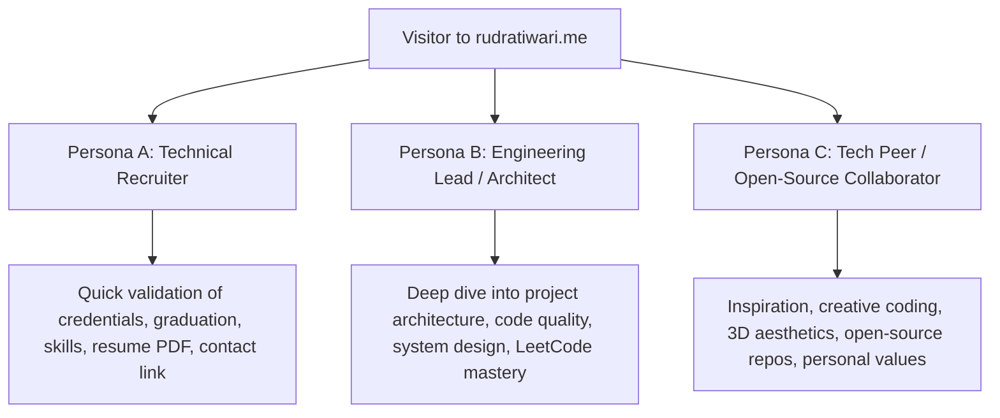
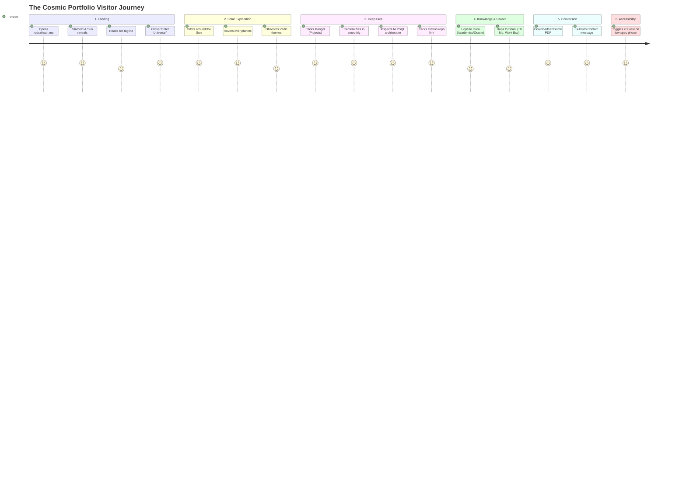

# USER_EXPERIENCE.md — End-to-End Visitor Journey & UX Flows

> **PROJECT**: Cosmic Portfolio — Rudra Tiwari  
> **DOCUMENT**: User Experience & Interaction Blueprint  
> **VERSION**: 1.0.0

---

## 1. Visitor Personas & User Goals

To ensure the portfolio addresses diverse visitor expectations effectively, the UX is engineered around three primary personas:

---

## 2. The 6-Stage Visitor Journey

---

## 3. Stage-by-Stage Experience Breakdown

### Stage 1: The Cinematic Awakening (Landing) — Reference: `assets/reference/01-landing-hero.jpg`
* **Emotional State**: Curiosity and anticipation.
* **UX Flow**:
  1. The user lands on an expansive deep space view featuring a spiral galaxy, nebula clouds, and curved Earth limb on the horizon. An explorer/backpacker sits on a rocky cliff gazing at the cosmos.
  2. Minimal top-right navigation appears: `About`, `Universe`, `Resume ↗`.
  3. Clean hero typography states:
     * `MY UNIVERSE` (small tracked caps)
     * `RUDRA TIWARI` (elegant serif headline)
     * `Engineer. Explorer. Creator.`
     * *“A journey through technology, knowledge, ambition and life.”*
  4. Call-to-action button: `Enter Universe →` (amber bordered pill button).
  5. Downward scroll chevron indicator `(↓)` at bottom center.

### Stage 2: The Macro Cosmos (Solar System Overview) — Reference: `assets/reference/02-universe-solar-system.jpg`
* **Emotional State**: Immersion, playfulness, and spatial orientation.
* **UX Flow**:
  1. The camera sweeps into an orbital perspective overlooking the Sun and the eight Grahas along concentric elliptical orbital rings.
  2. Persistent brand header appears: Golden swirl icon + `Rudra Tiwari` / `Cosmic Portfolio` (top-left); `Home`, `Portfolio`, `About`, `Resume ↗`, GitHub, LinkedIn, Email (top-right).
  3. All 8 bodies display contextual labels (`Surya (Core Identity)`, `Budh (Skills & DSA)`, `Shukra (UI/UX Design)`, `Mangal (Projects)`, `Guru (Education & Certifications)`, `Shani (Work Experience)`, `Rahu (Generative AI & Agents)`, `Ketu (Reflection)`).
  4. Collapsible vertical navigation dock on the left, initialized collapsed by default for zero celestial obstruction, expandable on demand with tooltips.
  5. Bottom center telemetry prompt: `Click on a planet to explore`.
  6. Right floating HUD tool-dock: `(i)` info, `[⛶]` fullscreen, `(+)` zoom in, `(-)` zoom out.

### Stage 3: The Approach (Planet Selection)
* **Emotional State**: Engagement and focus.
* **UX Flow**:
  1. Clicking any planet smoothly slerp-interpolates the camera toward that world.
  2. Background planets slow down, and the selected world moves to the left ~38% of the viewport.
  3. Floating button `← Back to Universe` appears at the bottom-left.

### Stage 4: World Deep-Dive — References: `assets/reference/03-surya-detail-view.jpg` & `04-mangal-projects-view.jpg`
* **Emotional State**: Analytical evaluation and technical validation.
* **UX Flow**:
  1. A glassmorphic drawer/panel slides into view on the right ~62% of the screen.
  2. **Surya View (Panel 3)**:
     * Displays Sun icon, `Surya`, golden subtitle `The Core Identity`.
     * Tabs: `Overview`, `Biography`, `Resume`, `Contact`.
     * Overview Card: Shows Rudra Tiwari's portrait photograph, title, bio summary, and education/CGPA/experience chips.
     * CTAs: `Download Resume ↓` (amber filled pill) and `Get in Touch ✉` (glassmorphic pill).
  3. **Mangal View (Panel 4)**:
     * Displays Mars glyph `♂`, `Mangal`, red subtitle `The World of Action`.
     * Filter Pills: `All`, `AI / ML`, `Full-Stack`, `Systems`, `Tooling`.
     * Project Cards: `Natural Language to SQL (NL2SQL)`, `Food Delivery System`, `AI-Powered Applications` with tech pills and external links.

### Stage 5: Smooth Egress & Celestial Hopping
* **UX Flow**:
  1. The user can click `[ ← Return to Universe ]` or press `Escape` to glide back to the global solar system.
  2. Alternatively, they can click any world in the persistent bottom dock to fly directly to another world without returning to the center first.

### Stage 6: The Universal Fallback (2D Semantic Mode)
* **Target Users**: Recruiters on low-bandwidth mobile connections, users with motion sensitivity, or screen-reader users.
* **UX Flow**:
  1. Clicking `[ 2D Fallback View ]` instantly toggles to a clean, single-page, vertically scrolling portfolio.
  2. Contains identical data: full bio, projects, skill matrices, credentials, timeline, and contact form.
  3. Supports full native browser search (`Ctrl+F`), print-to-PDF formatting, and seamless screen-reader tree parsing.
