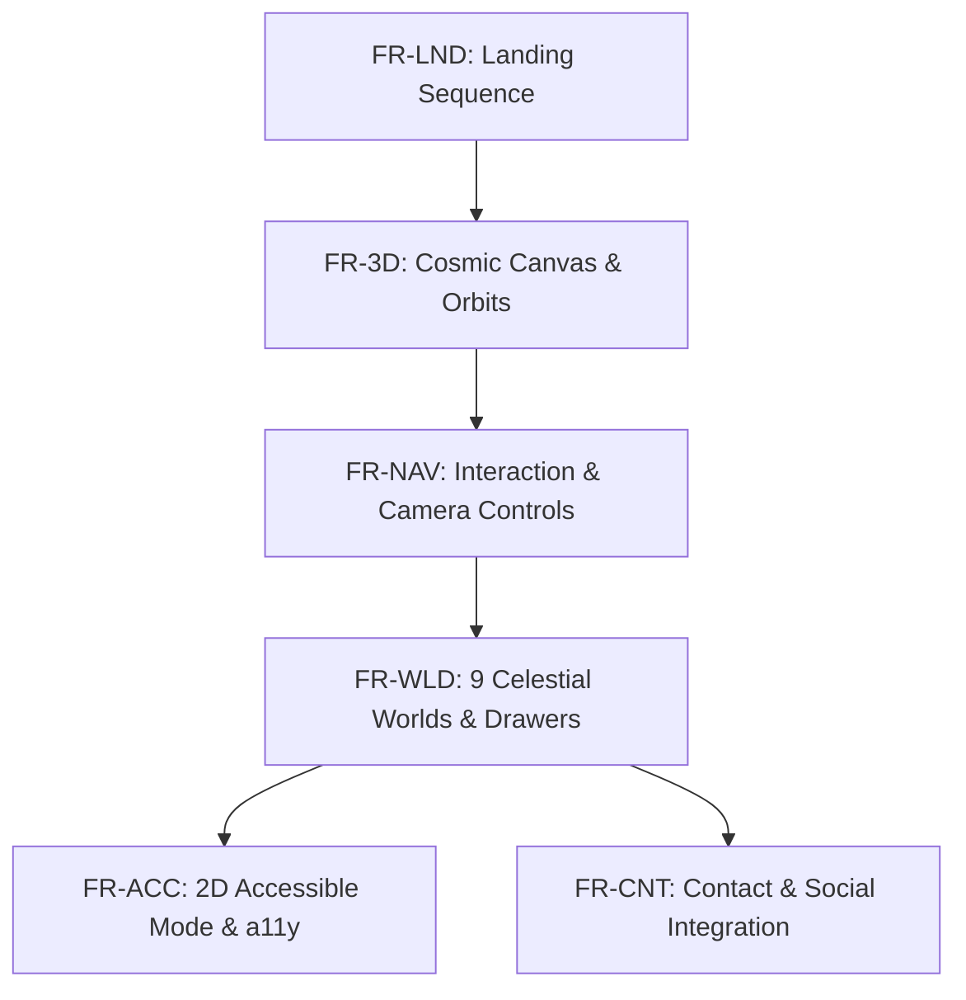

# FUNCTIONAL_REQUIREMENTS.md — Functional Requirements Specification

> **PROJECT**: Cosmic Portfolio — Rudra Tiwari  
> **DOCUMENT**: Functional Requirements Matrix  
> **VERSION**: 1.0.0

---

## 1. Requirements Priority Classification

* **P0 (Critical / Blocker)**: Must be fully implemented for Version 1.0.0 launch. Essential for core portfolio functionality, accessibility, and content integrity.
* **P1 (High Priority)**: Key differentiating features enhancing immersion, performance, and user delight.
* **P2 (Medium / Nice to Have)**: Polish and experimental features that can follow initial deployment.

---

## 2. Functional Requirements Matrix

### 1. Landing & Entry Experience (LND)

| ID | Title | Priority | Description | Acceptance Criteria |
| :--- | :--- | :--- | :--- | :--- |
| **FR-LND-001** | Cinematic Reveal | **P0** | Upon opening domain, dark scene reveals stars, nebula, Sun, and hero tagline over ~2 seconds. | Audio/visuals initialize cleanly; no flicker; respects skip triggers. |
| **FR-LND-002** | Enter Universe CTA | **P0** | Action button triggering smooth camera flight into the active solar system. | Clicking or pressing Enter triggers camera transition and mounts HUD. |
| **FR-LND-003** | Skip to Accessible | **P0** | Direct button allowing immediate jump to the 2D non-WebGL layout. | Instantly toggles `isFallback2D = true` without executing WebGL pipeline. |

---

### 2. 3D Graphics & Solar System (3D)

| ID | Title | Priority | Description | Acceptance Criteria |
| :--- | :--- | :--- | :--- | :--- |
| **FR-3D-001** | Central Sun (Surya) | **P0** | Render luminous central Sun with pulsating corona shader and central PointLight. | Visual corona pulses continuously; illuminates surrounding planets accurately. |
| **FR-3D-002** | Eight Celestial Worlds | **P0** | Render Budh, Shukra, Mangal, Guru, Shani (with Cassini rings), Rahu, and Ketu. | All 8 bodies render on distinct logarithmically spaced orbits with specified visual styling. |
| **FR-3D-003** | Logarithmic Keplerian Orbits | **P0** | Focus-centered ellipses with semi-major axes [2.0, 3.1, 3.8, 4.5, 6.7, 7.8, 9.1, 9.9] and velocity modulation. | Orbits do not collide; orbital trails render cleanly without aliasing; planets accelerate at perihelion. |
| **FR-3D-004** | Anomaly Shaders | **P1** | Rahu renders as an accretion singularity; Ketu renders as an ethereal cometary tail. | Non-physical entities appear distinctly artistic and mysterious. |
| **FR-3D-005** | Deep Space Starfield | **P1** | Render 4,000+ instanced stars with varying magnitudes and color temperatures. | GPU instanced rendering; 60 FPS maintained during camera rotations. |

---

### 3. Navigation & Interaction (NAV)

| ID | Title | Priority | Description | Acceptance Criteria |
| :--- | :--- | :--- | :--- | :--- |
| **FR-NAV-001** | Orbit Controls | **P0** | Allow mouse/touch drag rotation and wheel/pinch zoom bounded within safe clamps. | Camera cannot invert upside down or clip into the Sun. |
| **FR-NAV-002** | Planet Hover Cue | **P0** | Raycast detects pointer over celestial hit-spheres, triggering glow and floating HUD label. | Cursor changes to pointer; Sanskrit name & title display in < 50ms. |
| **FR-NAV-003** | Smooth Camera Travel | **P0** | Clicking a planet smoothly slerp-interpolates the camera into close planetary orbit. | Transition takes 1.2s-1.5s; smooth deceleration into inspecting angle. |
| **FR-NAV-004** | Return to Universe | **P0** | Persistent HUD button and `Escape` key to return camera to the global solar system. | Returns camera to overview and smoothly closes information drawers. |
| **FR-NAV-005** | Left Collapsible Navigation Dock| **P0** | Collapsible vertical dock initialized in collapsed state by default with hover tooltips. | Minimizes visual obstruction while allowing instant one-click travel to any of the 8 worlds. |
| **FR-NAV-006** | Header Back Button | **P0** | Contextual "Back to Overview" button integrated in top header row during world inspection. | Maintains > 50px clearance above left dock; returns camera to overview without UI overlap. |
| **FR-NAV-007** | Keyboard Navigation | **P1** | 1-8 keys jump to worlds; Escape returns to overview; Tab navigates interactive elements. | 100% of celestial navigation operable without a mouse. |

---

### 4. Celestial World Detail Panels (WLD)

| ID | Title | Priority | Description | Acceptance Criteria |
| :--- | :--- | :--- | :--- | :--- |
| **FR-WLD-001** | Glassmorphic Drawer | **P0** | Slide-in drawer with frosted glass styling displaying world content. | Slides in smoothly from right on desktop, bottom on mobile. |
| **FR-WLD-002** | Surya (Identity) | **P0** | Bio, personal values, resume PDF download button, contact modal. | Resume link verified; bio accurately presents Rudra Tiwari. |
| **FR-WLD-004** | Mangal (Projects) | **P0** | NL-2-DB, AI Log Investigator, and BarterNow architectures and GitHub links. | Complete architecture details and verifiable links presented. |
| **FR-WLD-005** | Budh (Skills & DSA) | **P0** | Skill badges (Java, Spring Boot, React, Kafka), 600+ LeetCode, 1,200+ solved, rating 1812. | Accurate metrics displayed with category filters. |
| **FR-WLD-006** | Guru (Academics) | **P0** | B.Tech CSE (ABES EC, July 2026, 8.02 CGPA), Oracle GenAI & Agentic AI certs. | Degree dates, institution, and certifications 100% verified. |
| **FR-WLD-007** | Shukra (Creativity) | **P1** | UI/UX design tokens, Claymorphism, 3D GSAP animations, WCAG AAA contrast. | Documents design system philosophy and aesthetic craft. |
| **FR-WLD-008** | Shani (Karma Timeline) | **P0** | Professional timeline (Salescode AI SE, OAuth2, OpenTelemetry, multi-device auth). | Accurately details software engineering responsibilities and lessons. |
| **FR-WLD-009** | Rahu (AI Frontier) | **P1** | Generative AI, LangGraph multi-agent, RAG architectures, vector DBs, guardrails. | In-depth technical breakdown of AI and LLM workflows. |
| **FR-WLD-010** | Ketu (Reflection) | **P1** | Personal philosophy, resilience, setbacks, and values beyond code. | Thoughtful personal essay on engineering values and integrity. |

---

### 5. Accessibility & 2D Fallback (ACC)

| ID | Title | Priority | Description | Acceptance Criteria |
| :--- | :--- | :--- | :--- | :--- |
| **FR-ACC-001** | 2D Semantic Mode | **P0** | Full semantic HTML page rendering all 8 worlds sequentially for non-WebGL devices. | Fully readable, scrollable, and navigable without WebGL initialization. |
| **FR-ACC-002** | Reduced-Motion Sync | **P0** | Automatically detects `prefers-reduced-motion` and pauses or simplifies 3D travel. | Eliminates rapid camera movements when reduced-motion is requested. |
| **FR-ACC-003** | Screen Reader Support | **P0** | ARIA live regions announce active planet changes and modal drawer states. | Tested with NVDA / VoiceOver; announces celestial arrivals cleanly. |

---

### 6. Contact & Conversion (CNT)

| ID | Title | Priority | Description | Acceptance Criteria |
| :--- | :--- | :--- | :--- | :--- |
| **FR-CNT-001** | Contact Direct Action | **P0** | Direct outreach modal offering verified contact pathways (direct email mailto link, LinkedIn profile, GitHub). | One-click contact initiation; verified email address with zero intermediate backend. |
| **FR-CNT-002** | Resume PDF Access | **P0** | Direct download button for Rudra Tiwari's updated curriculum vitae. | Downloads or opens PDF in new tab without 404 error. |
| **FR-CNT-003** | Social Links | **P0** | Direct outbound links to GitHub and LinkedIn profiles with secure `rel` tags. | Links open in new tab with `rel="noopener noreferrer"`. |
