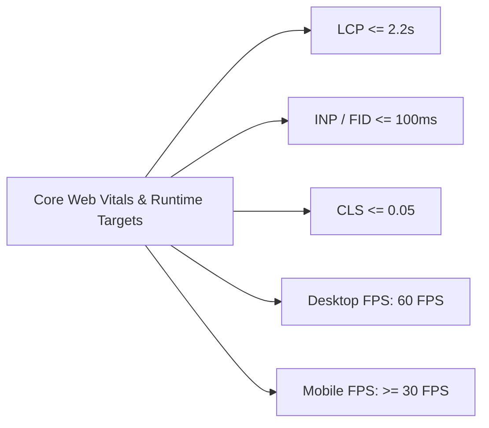

# NON_FUNCTIONAL_REQUIREMENTS.md — Quality Attributes & Technical Constraints

> **PROJECT**: Cosmic Portfolio — Rudra Tiwari  
> **DOCUMENT**: Non-Functional Requirements & Performance Standards  
> **VERSION**: 1.0.0

---

## 1. System Performance Benchmarks (NFR-PERF)

### Quantitative Performance Targets
* **NFR-PERF-001 (Frame Rate Stability)**: 
  * Desktop (GPU equivalent to GTX 1050 or M1 Mac): Maintain constant $\ge 58\text{ FPS}$ during continuous orbital camera rotations.
  * Mobile (Mid-range smartphone, e.g. Snapdragon 778G or iPhone 11): Maintain $\ge 30\text{ FPS}$ without thermal throttling over a 5-minute session.
* **NFR-PERF-002 (Core Web Vitals)**:
  * **Largest Contentful Paint (LCP)**: $\le 2.2\text{ seconds}$ on 4G network emulation.
  * **Interaction to Next Paint (INP)**: $\le 80\text{ ms}$ on user input events (clicks, tabs, keypresses).
  * **Cumulative Layout Shift (CLS)**: $\le 0.05$ across all responsive viewport resizes.
* **NFR-PERF-003 (Bundle Weight)**:
  * Initial JavaScript bundle payload: $\le 200\text{ KB}$ (Gzip compressed).
  * Initial HTML/CSS payload: $\le 30\text{ KB}$.
  * Total transferred assets on initial landing (before 3D world selection): $\le 3.5\text{ MB}$.

---

## 2. Reliability & Fault Tolerance (NFR-REL)

* **NFR-REL-001 (Graceful WebGL Recovery)**: If the browser's WebGL context is lost (`webglcontextlost` event) or GPU crash occurs, the application must automatically invoke `ErrorBoundary3D`, clean up WebGL references, and transition the user to the 2D Accessible Portfolio View without showing an unhandled React error screen.
* **NFR-REL-002 (Zero Uncaught Exceptions)**: Zero unhandled promise rejections or runtime exceptions in production builds. All asynchronous asset fetching (textures, fonts) must implement fallback error handling.
* **NFR-REL-003 (Offline Resiliency)**: Static assets and icons must cache effectively so returning visitors experience instant loading even on intermittent network connections.

---

## 3. Accessibility & Usability (NFR-A11Y)

* **NFR-A11Y-001 (WCAG 2.1 AA Compliance)**: All text elements, glassmorphic drawers, interactive buttons, and fallback views must meet or exceed WCAG 2.1 Level AA contrast standards (minimum contrast ratio of $4.5:1$ for normal text and $3.0:1$ for large text).
* **NFR-A11Y-002 (Keyboard Traversal)**: 100% of interactive capabilities must be operable via keyboard navigation alone (`Tab`, `Shift+Tab`, `Enter`, `Space`, `Arrow Keys`, `Escape`).
* **NFR-A11Y-003 (Reduced Motion)**: The application must automatically detect `@media (prefers-reduced-motion: reduce)`. When detected, camera flight animations, high-frequency orbital rotations, and pulsing flares are suppressed or substituted with subtle alpha crossfades.

---

## 4. Security & Privacy Assurance (NFR-SEC)

* **NFR-SEC-001 (Zero Fabricated Personal Information)**: Never publish fabricated employment history, fictitious project metrics, or AI-generated portraits claiming to represent Rudra Tiwari.
* **NFR-SEC-002 (PII Protection)**: Do not expose private contact information, personal home address, or telephone number.
* **NFR-SEC-003 (Content Security Policy)**: The site must enforce an explicit CSP disallowing `eval()` (except required WebAssembly modules) and restricting object embeds, iframes, and untrusted cross-origin script injections.
* **NFR-SEC-004 (Input Sanitization)**: All user input in the contact form must be sanitized and validated client-side and escaped before submission to prevent cross-site scripting (XSS) or injection attacks.

---

## 5. Maintainability & Code Quality (NFR-MAINT)

* **NFR-MAINT-001 (Strict Typing)**: TypeScript compiler configured with `"strict": true`, `"noImplicitAny": true`, and `"strictNullChecks": true`. The codebase must have zero `any` type escapes.
* **NFR-MAINT-002 (Component Modularity)**: No single component file may exceed 250 lines of code. Reusable logic must be extracted into custom hooks or utility functions.
* **NFR-MAINT-003 (Centralized Data Source)**: Content and personal information must be isolated in `src/data/` and never duplicated across component templates.

---

## 6. Responsiveness & Cross-Browser Support (NFR-COMP)

* **NFR-COMP-001 (Responsive Viewport Spectrum)**: The interface must render flawlessly across screen widths ranging from $320\text{ px}$ (compact mobile) to $3840\text{ px}$ (4K ultra-wide monitors).
* **NFR-COMP-002 (Supported Browser Engines)**:
  * Blink (Google Chrome v115+, Microsoft Edge v115+, Brave, Opera).
  * WebKit (Apple Safari v16.4+ on macOS and iOS).
  * Gecko (Mozilla Firefox v115+).
* **NFR-COMP-003 (Touch & Pointer Ergonomics)**: All interactive touch targets on mobile devices must measure at least $44 \times 44\text{ CSS pixels}$ with adequate spacing to prevent accidental mis-taps.

---

## 7. Search Engine Optimization & Social Sharing (NFR-SEO)

* **NFR-SEO-001 (Metadata & Open Graph)**: Document `<head>` must include complete Open Graph and Twitter Card metadata:
  * Title: `"Rudra Tiwari — Cosmic Portfolio | 3D Personal Universe"`
  * Description: `"Explore the personal and engineering universe of Rudra Tiwari. Featuring 3D celestial navigation, full-stack architectures, and Generative AI systems."`
  * Canonical URL: `https://rudratiwari.me`
  * Preview image: High-resolution cosmic preview banner ($1200 \times 630\text{ px}$).
* **NFR-SEO-002 (Semantic Structured Data)**: JSON-LD Schema.org `Person` markup embedded in `index.html` referencing Rudra Tiwari, software engineering qualifications, and official GitHub/LinkedIn profiles.
