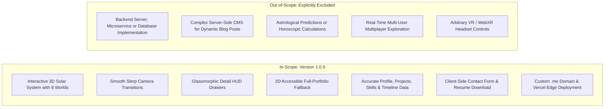

# PRODUCT_REQUIREMENTS.md — Product Vision & Strategic Scope

> **PROJECT**: Cosmic Portfolio — Rudra Tiwari  
> **DOCUMENT**: Product Requirements Document (PRD)  
> **VERSION**: 1.0.0

---

## 1. Product Vision & Mission Statement

### The Vision
To present **Rudra Tiwari's** software engineering capabilities, academic achievements, and intellectual journey through a production-grade, immersive 3D celestial universe that balances **astronomical visual elegance** with **uncompromising technical depth**.

### The Mission
* **Attract Attention**: Engage visitors through high-performance WebGL shaders, celestial orbital physics, and cinematic camera choreography.
* **Create Curiosity**: Spark meaningful exploration by interpreting the nine Vedic Grahas as allegorical portals into distinct life dimensions.
* **Earn Credibility**: Deliver verifiable proof of technical excellence through detailed project breakdowns (NL2SQL, Food Delivery System), verified credentials (Oracle GenAI / Agentic AI certifications), competitive programming rigor (~1,200 problems solved, 600+ LeetCode), and production software engineering experience (~10 months).

---

## 2. Target Audience & Stakeholders

1. **Technical Recruiters & Talent Partners**: Seeking quick verification of degree completion (B.Tech CSE, ABES EC, May 2026, 8.02 CGPA), core tech stack (Java, Spring Boot, React, AWS, GenAI), downloadable resume, and direct contact options.
2. **Engineering Managers & Principal Architects**: Evaluating system design acumen, code cleanliness, architecture depth, problem-solving mastery, and ability to handle complex 3D math and modern frontend frameworks.
3. **Open-Source Collaborators & Engineering Peers**: Exploring technical projects, GitHub repositories, creative coding aesthetics, and personal philosophies.

---

## 3. User Personas

| Attribute | Persona 1: Tech Recruiter (Rachel) | Persona 2: Engineering Manager (David) | Persona 3: Peer Developer (Alex) |
| :--- | :--- | :--- | :--- |
| **Primary Goal** | Assess candidate fit in under 90 seconds. | Evaluate architectural maturity and depth. | Explore 3D creative code and collaborate. |
| **Key Actions** | Clicks Surya for Resume, checks Budh/Guru for skills/degree. | Examines Mangal (NL2SQL architecture) and Shani (timeline). | Inspects Three.js shaders, orbital math, and GitHub. |
| **Pain Points** | Slow loading times, clunky navigation, hard-to-find contact info. | Superficial eye-candy without code substance; fabricated metrics. | Generic templates, lack of originality. |
| **Success State** | Downloads resume PDF within 2 clicks; sends interview invite. | Reviews architecture diagrams and invites candidate for technical round. | Stars GitHub repository and reaches out on LinkedIn. |

---

## 4. In-Scope vs. Out-of-Scope Features

---

## 5. Primary Use Cases

### UC-01: Cinematic Landing & Discovery
* **Actor**: Any visitor.
* **Preconditions**: Visitor opens `https://rudratiwari.me`.
* **Flow**:
  1. Dark starry canvas fades in with ambient celestial lighting and glowing Sun.
  2. Hero title introduces Rudra Tiwari.
  3. Visitor clicks "Enter Universe" (or Spacebar).
  4. Camera sweeps into orbital view of the solar system.
* **Postconditions**: Visitor is oriented in the interactive solar system.

### UC-02: Exploring Software Engineering Projects (Mangal)
* **Actor**: Engineering Manager / Recruiter.
* **Flow**:
  1. Visitor hovers over Mangal; red glow and HUD label appear.
  2. Visitor clicks Mangal.
  3. Camera glides close to the Martian terrain.
  4. Right drawer slides open showing project tabs (NL2SQL, Food Delivery System).
  5. Visitor reads architecture description, reviews tech pills, and clicks "View GitHub Repository".
* **Postconditions**: Visitor confirms candidate's engineering capability.

### UC-03: Switching to 2D Accessible Mode
* **Actor**: Screen-reader user or low-bandwidth mobile visitor.
* **Flow**:
  1. Visitor presses `[ 2D Fallback View ]` button or has `prefers-reduced-motion` enabled.
  2. 3D canvas is unmounted or paused; clean vertical semantic HTML layout renders.
  3. Visitor smoothly scrolls through all 8 worlds, reads content, and uses the contact form.
* **Postconditions**: Universal access guaranteed without graphics barriers.

---

## 6. Success Metrics & Key Performance Indicators (KPIs)

* **Load Time Performance**: First Contentful Paint (FCP) $\le 1.2s$; Largest Contentful Paint (LCP) $\le 2.2s$.
* **Rendering Smoothness**: Consistent 60 FPS on modern desktop devices; minimum 30 FPS on mobile.
* **Interaction Clarity**: Zero reported instances of visitors being unable to return to the universe overview.
* **Accessibility Score**: 100% automated score on Google Lighthouse Accessibility audit.
* **Information Integrity**: 100% verified accuracy for all degrees, certifications, and project links.
