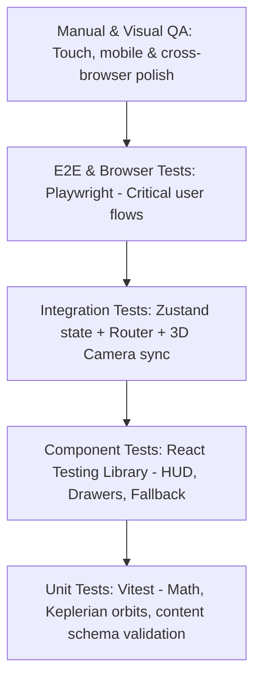

# TEST_STRATEGY.md — Comprehensive Quality Assurance & Testing Strategy

> **PROJECT**: Cosmic Portfolio — Rudra Tiwari  
> **DOCUMENT**: Quality Assurance & Verification Specification  
> **VERSION**: 1.0.0

---

## 1. Testing Philosophy & Non-Negotiable Rules

Quality engineering and genuine verification are paramount:
* ⚠️ **NO Fake Test Results**: Never claim tests or builds passed without executing them in the project workspace terminal.
* ⚠️ **Continuous Verification**: Every implementation milestone must run unit tests, type checks, and linting before being marked complete.
* ⚠️ **Zero Regressions**: Any bug encountered during development must be accompanied by a regression test.

---

## 2. The Testing Pyramid

---

## 3. Test Categories & Implementation Details

### 1. Unit Tests (Vitest)
* **Scope**: Pure logic, orbital positioning algorithms, string formatters, and data integrity.
* **Key Test Suites**:
  * `tests/unit/math.test.ts`: Verifies Keplerian orbit calculations, distance functions, and spherical interpolation bounds.
  * `tests/unit/contentSchema.test.ts`: Asserts that all data objects in `src/data/` adhere to TypeScript interfaces, have non-empty titles, valid URLs (or explicit placeholder notices), and proper media tags.
  * `tests/unit/store.test.ts`: Validates Zustand universe store transitions (`selectWorld`, `setCameraMode`, `toggleAudio`, `toggleFallback2D`).
* **Execution Command**: `npm run test:unit`

### 2. Component Tests (React Testing Library + Vitest)
* **Scope**: Individual DOM and UI overlay components in isolation.
* **Key Test Suites**:
  * `tests/components/WorldDrawer.test.tsx`: Verifies drawer rendering, tab switching, and project detail display for each of the 9 worlds.
  * `tests/components/NavigationHUD.test.tsx`: Tests HUD action clicks, search modal toggle, and resume download triggers.
  * `tests/components/AccessiblePortfolioView.test.tsx`: Confirms that all 9 worlds render semantic headings (`<h2>`, `<h3>`) and readable content in 2D mode.
* **Execution Command**: `npm run test:components`

### 3. 3D Interaction & WebGL Tests
* **Scope**: Verifying 3D canvas lifecycle, raycast handling, and camera transitions without requiring a physical GPU in CI.
* **Strategy**:
  * Mock WebGL context using `gl` or `headless-gl` during unit/component tests.
  * Verify that `CameraController` calculates correct target coordinates when a world is selected.
  * Ensure `ErrorBoundary3D` intercepts WebGL context loss cleanly and triggers fallback mode.
* **Execution Command**: `npm run test:3d`

### 4. Integration Tests
* **Scope**: Verifying that user actions in the DOM layer correctly update the 3D scene parameters and vice-versa.
* **Key Test Scenarios**:
  * Selecting a world from the bottom celestial dock -> Updates store -> Camera controller begins slerp travel -> Drawer opens with matching world metadata.
  * Closing drawer or pressing `Escape` -> Updates store -> Camera controller returns to solar overview -> Drawer unmounts.

### 5. Accessibility & a11y Tests (axe-core)
* **Scope**: WCAG 2.1 Level AA compliance verification.
* **Key Checks**:
  * Automated `axe` scanner running against both the 3D HUD overlay and the 2D Fallback View.
  * Color contrast ratios evaluated on glassmorphic backgrounds.
  * ARIA live region announcements for world changes.
  * Focus trapping inside open drawers.
* **Execution Command**: `npm run test:a11y`

### 6. Browser & End-to-End Tests (Playwright)
* **Scope**: Automated real-browser testing across Chromium, WebKit (Safari), and Firefox.
* **Key Test Scenarios (`tests/e2e/visitor-journey.spec.ts`)**:
  1. **Landing & Enter Universe Flow**: Opens homepage -> Waits for hero text -> Clicks "Enter Universe" -> Verifies HUD renders.
  2. **Planet Inspection Flow**: Clicks "Mangal" -> Verifies camera transition completes -> Asserts drawer displays NL2SQL and Food Delivery System projects -> Clicks "Return to Universe".
  3. **2D Fallback Toggle Flow**: Clicks "2D Fallback View" -> Verifies full-page vertical scroll view mounts -> Verifies all 9 world sections are readable.
  4. **Contact Modal Submission**: Opens contact form -> Enters test data -> Validates client validation and honeypot -> Submits form.
* **Execution Command**: `npm run test:e2e`

### 7. Performance & WebGL Benchmarking
* **Tools**: Google Lighthouse CI and Chrome DevTools profiling.
* **Automated Thresholds**:
  * Lighthouse Performance Score $\ge 85$
  * Lighthouse Accessibility Score $\ge 95$
  * Lighthouse Best Practices Score $\ge 95$
  * Lighthouse SEO Score $\ge 95$
* **Execution Command**: `npm run test:perf`

---

## 4. Test Execution Matrix

| Test Suite | Tool | CI Trigger | Local Command | Target Duration |
| :--- | :--- | :--- | :--- | :--- |
| **Linting & Formatting** | ESLint & Prettier | Every Commit / PR | `npm run lint` | $< 5\text{s}$ |
| **Type Checking** | TypeScript (`tsc`) | Every Commit / PR | `npm run typecheck` | $< 8\text{s}$ |
| **Unit & Schema Tests** | Vitest | Every Commit / PR | `npm run test` | $< 10\text{s}$ |
| **Component & a11y Tests** | React Testing Library + Axe | Every PR | `npm run test:ui` | $< 20\text{s}$ |
| **End-to-End (E2E)** | Playwright (Headless) | PR to `main` | `npm run test:e2e` | $< 45\text{s}$ |
| **Lighthouse CI** | LHCI | PR to `main` | `npm run test:lhci` | $< 60\text{s}$ |

---

## 5. Acceptance Criteria Sign-Off Checklist

Before any implementation milestone is certified complete:
- [ ] TypeScript compiler runs clean with zero errors (`npm run typecheck`).
- [ ] ESLint reports zero errors or warnings (`npm run lint`).
- [ ] All unit and component tests pass with 100% success (`npm run test`).
- [ ] Manual inspection verifies 60 FPS rendering and smooth camera motion.
- [ ] Mobile viewport tested for responsive layout and touch gestures.
- [ ] 2D Fallback mode verified accessible and fully styled.
- [ ] Zero fabricated information or broken links.
